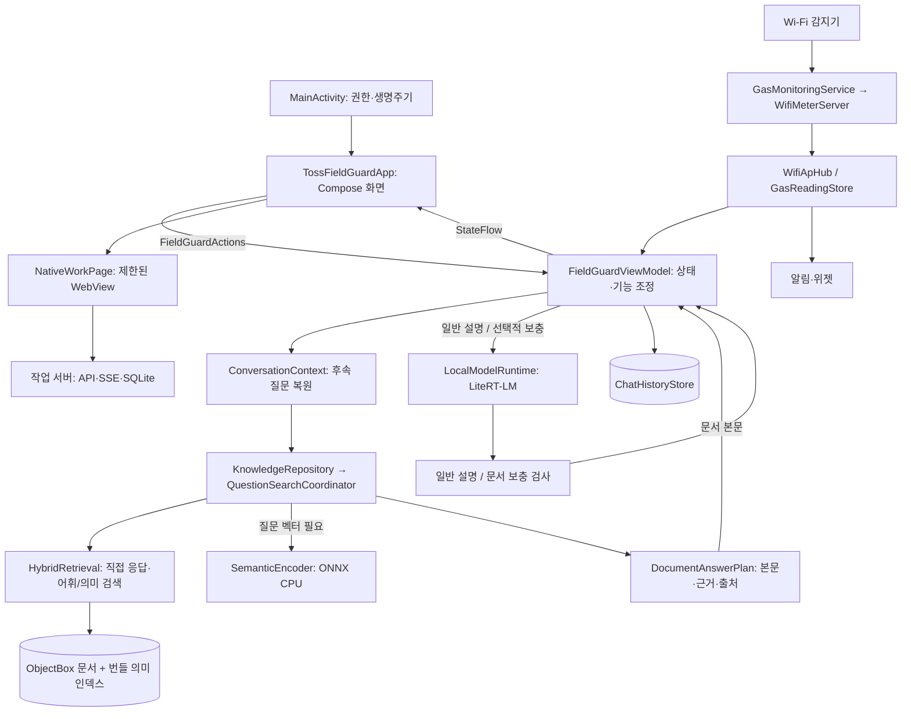

# HybridTech · O₂ Field Guard

밀폐공간 안전 문서를 기기 안에서 검색하고, 출처가 연결된 답변·원본 PDF·로컬 음성 대화·가스 측정기 수신·작업 점검을 제공하는 **Android 설치형 앱**입니다.

문서 검색과 생성은 별개의 경로입니다. 문서에 직접 근거가 있으면 선택한 원문으로 답변을 구성하고, 검색을 완료했지만 근거가 확인되지 않은 주제는 로컬 Gemma가 일반 설명을 생성합니다. 작업 요청·감독관 인증·승인은 별도 서버를 사용합니다.

**개발 기준:** Android / Kotlin / Jetpack Compose · 프로토타입 · 2026-11-10

[설치·실행](#setup) · [아키텍처](#architecture) · [기능별 구현](#features) · [데이터와 저장 위치](#data-storage) · [테스트](#tests) · [개발 문서](#developer-docs)

<a id="setup"></a>

## 설치·실행

### 개발 환경

| 항목 | 프로젝트 설정 |
| --- | --- |
| Android | minSdk 26 / compileSdk·targetSdk 37 |
| 빌드 | Gradle Wrapper 9.5.0 / Android Gradle Plugin 9.3.2 |
| Kotlin / UI | Kotlin 2.4.20 / Compose BOM 2026.09.00 / Material 3 |
| 로컬 추론 | LiteRT-LM 0.17.1 |
| 검색 / DB | ONNX Runtime Android 1.22.0 / ObjectBox 5.4.2 |
| NPU 연결 | Qualcomm QNN Runtime 2.44.0 + 칩셋별 추가 모델/라이브러리 |
| JDK | 검증 환경: Android Studio 내장 JBR 25.0.2. Java/Kotlin 바이트코드 대상은 11 |
| Node.js | 검색 자산 준비에 필요. 기존 작업 서버는 Node.js 24.15 이상 기준 |

의존성 버전은 [버전 카탈로그](gradle/libs.versions.toml), Android 설정은 [app/build.gradle](app/build.gradle)에 있습니다. Android Studio에서 저장소 루트를 열고 SDK 37과 Gradle JDK를 설정합니다. SDK 경로는 각 PC의 `local.properties`에 두며 Git에는 저장하지 않습니다.

### Android 빌드

저장소 루트에서 실행합니다. 생성 모델은 APK에 넣지 않으며 앱 설정에서 다운로드합니다. **검색용 EmbeddingGemma 자산은 APK 빌드 전에 준비**해야 합니다.

```powershell
# 최초 1회: 고정 revision의 검색 모델·토크나이저를 받아 크기/SHA-256을 검증
node tools/prepare-semantic.mjs --android-only

# JVM 검사, 앱 APK, 계측 검사 APK
.\gradlew.bat :app:testDebugUnitTest :app:assembleDebug :app:assembleDebugAndroidTest

# Android 정적 검사
.\gradlew.bat :app:lintDebug
```

`--android-only`는 웹 자산을 준비하지 않습니다. Gradle의 `verifySemanticAssets`가 검색 모델의 크기·해시와 문서 인덱스 revision/차원을 검사합니다. 이 명령은 문서 인덱스를 새로 만드는 명령이 아닙니다. 최초 의존성/자산 확보 후 캐시가 준비된 환경에서는 Gradle에 `--offline`을 추가할 수 있습니다.

| 결과물 | 저장소 루트 기준 경로 |
| --- | --- |
| 앱 APK | `app/build/outputs/apk/debug/app-debug.apk` |
| 계측 검사 APK | `app/build/outputs/apk/androidTest/debug/app-debug-androidTest.apk` |
| JVM HTML / XML 결과 | `app/build/reports/tests/testDebugUnitTest/` / `app/build/test-results/testDebugUnitTest/` |
| Lint 결과 | `app/build/reports/lint-results-debug.html` |

기기에 설치하려면 Android Studio에서 `app`을 실행하거나 `adb install -r app/build/outputs/apk/debug/app-debug.apk`를 사용합니다. 앱 설치 후 **설정 → 기기 내 Gemma**에서 모델을 선택합니다. 로컬 STT는 Android 12 이상과 기기에 설치된 한국어 인식 서비스를 요구합니다.

<a id="architecture"></a>

## 아키텍처



`MainActivity`는 화면과 Android 시스템 기능을 연결하고, `FieldGuardViewModel`은 기능을 조정합니다. 검색·생성·통신의 세부 정책은 `data/`, `model/`, `gas/`에 있습니다. UI는 `StateFlow`를 관찰하고 콜백을 돌려주는 구조이며 DI 프레임워크나 멀티 모듈 구조는 사용하지 않습니다.

### 코드 탐색 시작점

```text
app/src/main/
├── AndroidManifest.xml           # 권한·Activity·foreground service·:npu 프로세스
├── java/com/minyook/sllm2/
│   ├── SllmApplication.kt        # 기본 프로세스 DB·알림 채널 초기화
│   ├── MainActivity.kt           # UI 진입·권한·음성·생명주기 연결
│   ├── ui/                       # ViewModel·Compose 화면·음성 컨트롤러
│   ├── data/                     # 문서 저장·검색·문맥·답변 계획·출처
│   ├── model/                    # 모델 카탈로그·다운로드·추론·NPU·성능 비교
│   └── gas/                      # Local-only AP·TCP 규격·장비 상태·알림·위젯
├── assets/knowledge/              # 원문 청크·사전 계산한 의미 인덱스
├── assets/source-pdfs/            # 기본 PDF 2종
└── assets/semantic-model/          # 준비 스크립트가 생성하는 검색 모델(Git 제외)
app/src/test/                     # JVM 회귀·프로토콜 검사
app/src/androidTest/              # 실제 Android·Compose·선택 실행 모델 검사
tools/                            # 검색 자산 준비·문서 추출·평가·TCP 시험 송신기
datasets/                         # 학습/평가용 데이터. 앱 실행 모델에 자동 반영되지 않음
web/server/                       # 앱 점검 화면이 사용하는 기존 작업 API·인증·SQLite
web/src/workflow/                 # 작업 상태 전이·실시간 갱신
docs/                             # 상세 설계·평가 기준·실측 원본
```

현재 화면 진입점은 `TossFieldGuardApp`입니다. `HybridTechApp.kt`에는 공유 이벤트 계약 `FieldGuardActions`와 별도 화면 구현도 있으므로 클래스 이름만 보고 앱의 루트 화면으로 판단하지 않습니다. `web/`의 기존 웹/PWA 파일은 보존하며 신규 클라이언트 개발 대상은 Android입니다.

### 소스 주석과 전체 파일 지도

각 소스·설정 파일 첫머리의 **소스 안내**에 파일의 역할과 연결 모듈을 적었습니다. 검색·생성·음성·AP·서버 경계의 클래스/함수에는 호출자, 입력, 처리 순서, 다음 전달 대상과 종료 시 자원 정리를 설명합니다. 테스트 파일은 검사 목적·대표 사례·실행 조건을 함께 표시합니다.

[전체 코드 지도](docs/CODE_MAP.md)에서 Android 코드/리소스/테스트, 작업 서버와 보존 웹 코드, 준비·평가 도구의 모든 대상 파일과 역할을 확인할 수 있습니다. 소스 안의 이름이나 주석만으로 현재 경로를 판단하지 말고 이 README의 실제 진입점부터 호출을 따라가는 것을 권장합니다.

<a id="features"></a>

## 기능별 구현

아래 소스 링크는 저장소 루트 기준입니다. 함수/클래스 주석에는 호출자, 처리 책임, 다음 전달 대상과 주요 생명주기를 함께 설명합니다.

### 1. 문서 질문과 RAG

**진입:** 질문 전송·예시 질문·음성 인식 → `FieldGuardViewModel.submitQuestion()`

1. `ConversationContext`가 최근 완료된 턴에서 대상·초점을 복원해 사용자 원문과 검색용 질문을 분리합니다. 이전 기록의 선택 메타데이터는 읽기 호환에만 사용합니다.
2. `KnowledgeRepository.searchQuestion()`이 재사용 가능한 인덱스를 준비하고 `QuestionSearchCoordinator`에 전달합니다.
3. 단일 가스 설명·장비 목록/세부 수량·정확한 절 제목처럼 명확한 질문은 원문을 직접 선택합니다. 일반 질문은 정규화한 질의의 ONNX 벡터를 만들고 어휘 점수와 의미 순위를 결합해 재검토합니다.
4. 의미 검색은 **EmbeddingGemma 300M q4 / 768차원**입니다. 393개 문서 항목/절 벡터는 번들 JSON에 사전 계산되어 있고, 기기에서는 질문 벡터만 계산합니다. 단어 검색은 문단별 어휘·빈도/관련 조건을 사용하며 의미/어휘 순위를 결합합니다.
5. 명시적인 복합 질문은 내부에서 주제별로 검색하고 하나의 답변으로 합칩니다. 후보가 비슷해도 사용자에게 세 가지 주제 중 하나를 고르도록 하지 않습니다. 검색을 마쳤지만 직접 근거를 확정하지 못한 구체적인 질문은 원래 문장 그대로 일반 생성에 전달합니다.
6. `DocumentAnswerPlan`이 선택한 원문·필수 조건·실제 출처로 본문을 구성합니다. 일반 문서 본문을 Gemma가 매번 다시 작성하지 않으므로 직접 생성과 응답 시간이 다릅니다.

| 책임 | 구현 |
| --- | --- |
| 처리 조정 | [FieldGuardViewModel.kt](app/src/main/java/com/minyook/sllm2/ui/FieldGuardViewModel.kt) |
| 문맥·질문 정규화·초점 | [ConversationContext.kt](app/src/main/java/com/minyook/sllm2/data/ConversationContext.kt), [QuestionUnderstanding.kt](app/src/main/java/com/minyook/sllm2/data/QuestionUnderstanding.kt), [QuestionFocus.kt](app/src/main/java/com/minyook/sllm2/data/QuestionFocus.kt) |
| 저장소·검색 순서 | [KnowledgeRepository.kt](app/src/main/java/com/minyook/sllm2/data/KnowledgeRepository.kt), [QuestionSearchCoordinator.kt](app/src/main/java/com/minyook/sllm2/data/QuestionSearchCoordinator.kt) |
| 후보 순위·선택 문단 | [HybridRetrieval.kt](app/src/main/java/com/minyook/sllm2/data/HybridRetrieval.kt), [FocusedEvidence.kt](app/src/main/java/com/minyook/sllm2/data/FocusedEvidence.kt) |
| 로컬 질문 임베딩 | [SemanticEncoder.kt](app/src/main/java/com/minyook/sllm2/data/SemanticEncoder.kt), [SemanticTokenizer.kt](app/src/main/java/com/minyook/sllm2/data/SemanticTokenizer.kt) |
| 답변·출처 계획 | [DocumentAnswerPlan.kt](app/src/main/java/com/minyook/sllm2/data/DocumentAnswerPlan.kt) |

`OfflineHashEmbedding`의 384차원 필드는 문서 초기 적재/엔티티에 남아 있지만 현재 신경망 의미 검색은 위 768차원 경로를 사용합니다. `QuestionEvidencePlanner`와 `QuestionAnswerVerifier`도 실제 ViewModel의 주 검색/보충 검증기로 연결된 것과 구분해야 합니다.

### 2. 문서 기반 답변·일반 생성·문서 보충

| 경로 | 실행 조건 | 출력 계약 |
| --- | --- | --- |
| 문서 본문 | 질문에 직접 답하는 근거 선택 | 선택한 원문과 조건을 Markdown으로 구성하고 실제 PDF 쪽 연결 |
| 일반 지식 | 검색 완료 + 직접 근거 미확인 주제 | 로컬 모델 생성임을 표시. 가짜 문서 출처·미확인 안전 수치/사양·작업 허용 단정을 제한 |
| 선택적 문서 보충 | 근거가 있고 쉽게 풀어 설명해 달라는 명시적 요청 | 이미 표시한 본문을 유지하고 근거 ID·수치·조건 검사를 통과한 짧은 설명만 추가 |
| 확인/오류 | 질문 대상 자체가 없음·검색 실패 | 대상 확인 한 문장 또는 오류 상태 표시. 주제 선택 목록은 만들지 않으며 검색 오류를 문서 부재로 확정하지 않음 |

일반 생성은 [GeneralKnowledgeAnswer](app/src/main/java/com/minyook/sllm2/data/GeneralKnowledgeAnswer.kt)가 프롬프트·검증·안내·공개 가능한 문장 경계를 관리합니다. 문서 보충은 `DocumentAnswerPlan.kt`의 `AnswerSupplementVerifier`가 별도 JSON 계약으로 검사합니다. 두 검사는 제한된 규칙 검사이며 모델 지식 전체의 사실 정확성을 증명하지 않습니다.

### 3. 모델 다운로드·CPU/GPU/NPU 실행

모델 카탈로그는 [LocalModel.kt](app/src/main/java/com/minyook/sllm2/model/LocalModel.kt)에 정의합니다.

| 범용 모델 | 앱 표시 크기 | 파일 | 접근 |
| --- | --- | --- | --- |
| Gemma 4 E2B, 4비트 | 약 2.59 GB | `gemma-4-e2b-it.litertlm` | 현재 카탈로그 URL |
| Gemma 3 270M, Q8 | 약 304 MB | `gemma3-270m-it-q8.litertlm` | 모델 약관 동의 + Hugging Face 읽기 토큰 |
| Gemma 3 1B, INT4 | 약 584 MB | `gemma3-1b-it-int4.litertlm` | 모델 약관 동의 + Hugging Face 읽기 토큰 |

**다운로드:** ViewModel → `ModelDownloadScheduler` → `ModelDownloadWorker`. WorkManager의 모델/파일별 고유 작업으로 중복을 막고, HTTP Range로 `.part` 파일을 이어받습니다. 응답 길이·모델별 파일 크기를 검사한 뒤 완성 파일로 바꾸고 설치 상태를 저장합니다. 접근 토큰은 [ModelDownloadAccess.kt](app/src/main/java/com/minyook/sllm2/model/ModelDownloadAccess.kt)가 Android Keystore의 AES-GCM 키로 암호화합니다. 모델 크기 검사는 모든 가중치의 암호학적 무결성 검증과 동일하지 않습니다.

**추론:** [LocalModelRuntime.kt](app/src/main/java/com/minyook/sllm2/model/LocalModelRuntime.kt)가 Mutex로 요청을 직렬화합니다. 모델·backend·문맥이 같은 엔진을 재사용하고, E2B는 별도 생각 토큰을 비활성화합니다. 질문 의미 검색 전에는 메모리 여유에 따라 생성 엔진을 유지/정리하고, 생성 전에는 검색 인코더 세션을 해제합니다. **모델 READY는 파일 저장 상태**입니다. 전경의 유휴 채팅/음성 화면에서는 ARM64·전체 RAM 8 GiB 이상·가용 RAM 4 GiB 이상·메모리 경고 없음 조건의 E2B AUTO/GPU 엔진을 미리 적재합니다. 가짜 질문을 생성하지 않으며 조건 미달이나 CPU/NPU 선택은 실제 생성 요청에서 적재합니다. 의미 벡터가 필요할 때만 진행 중인 사전 적재의 종료를 기다리며, 제목/직접 문서 응답은 이 준비를 기다리지 않습니다.

출력 토큰/자동 길이만 저장할 때는 기존 엔진을 버리지 않습니다. 사용자가 항목 개수와 항목별 한 문장을 명시한 경우 그 번호 목록으로 바로 시작하도록 지시하며, 도입·중복 결론을 생략합니다. 완성 본문을 잘라내거나 다른 질문에 정해진 단문을 강제하는 최적화가 아닙니다. **사전 적재는 첫 요청의 준비 비용을 앞당기는 변경이며 native decode 처리량이나 전체 8~9초 완료를 보장하지 않습니다.** [지연 개선의 구현과 검증 범위](docs/ANDROID_ANSWER_LATENCY.md)를 참고하세요.

**실행 장치:** CPU는 CPU 경로, GPU는 GPU 초기화 실패 시 CPU, AUTO/NPU는 칩셋 전용 파일·런타임·문맥 조건이 맞으면 NPU를 먼저 시도합니다. NPU는 [NpuInferenceClient.kt](app/src/main/java/com/minyook/sllm2/model/NpuInferenceClient.kt) → Messenger IPC → [NpuInferenceService.kt](app/src/main/java/com/minyook/sllm2/model/NpuInferenceService.kt)의 `:npu` 별도 프로세스로 실행합니다. 실패/종료를 처리한 뒤 범용 GPU/CPU로 전환합니다. 모든 GPU 생성 오류를 CPU로 재시도한다는 계약은 아닙니다.

현재 연결한 NPU 카탈로그는 Qualcomm SM8550·SM8650·SM8750·SM8850의 Gemma 3 270M/1B이며 E2B용 휴대폰 NPU 파일은 연결하지 않았습니다. **S24의 현재 SDK/dispatch 조합은 NPU 초기화 오류가 확인되어 성공 성능 지표가 없습니다.** 파일 다운로드 가능과 NPU 실행 검증을 구분합니다.

**토큰 설정:** [InferenceSettings.kt](app/src/main/java/com/minyook/sllm2/model/InferenceSettings.kt)와 [AnswerOutputPolicy.kt](app/src/main/java/com/minyook/sllm2/model/AnswerOutputPolicy.kt)가 기기/모델별 문맥 상한, 수동 출력값, 자동 답변 예산을 적용합니다. 자동 일반 답변은 문맥의 절반·최대 8,192토큰이며 짧은 질문/문서 보충은 별도 예산을 사용합니다. 토큰은 요청의 문맥/길이 한도이며 계정 사용량이나 시간별 질문 횟수 제한이 아닙니다.

### 4. 채팅·Markdown·스크롤·대화 기록

[TossFieldGuardApp.kt](app/src/main/java/com/minyook/sllm2/ui/TossFieldGuardApp.kt)가 화면 이동과 키보드/시스템 여백을 관리하고, [WorkspaceScreens.kt](app/src/main/java/com/minyook/sllm2/ui/WorkspaceScreens.kt)의 `WorkspaceChat`이 목록과 입력을 표시합니다.

- [ChatTimeline.kt](app/src/main/java/com/minyook/sllm2/ui/ChatTimeline.kt)는 답변을 헤더·Markdown 블록·출처의 lazy 항목으로 나누고 메시지별 파싱 결과와 안정적인 키를 재사용합니다. 주제 선택 버튼은 표시하지 않습니다.
- [MarkdownBlocks.kt](app/src/main/java/com/minyook/sllm2/ui/MarkdownBlocks.kt) / [MarkdownText.kt](app/src/main/java/com/minyook/sllm2/ui/MarkdownText.kt)가 제목·강조·목록·표·코드를 렌더링합니다. 넓은 표는 가로 스크롤하고 첫 열을 고정합니다.
- [StreamingTextReveal.kt](app/src/main/java/com/minyook/sllm2/ui/StreamingTextReveal.kt)는 **검사기가 승인한 본문만** 작은 글자 묶음으로 표시합니다. 텍스트 레이아웃 갱신은 초당 약 30회로 제한하며 문서 본문·기록은 즉시 표시합니다. 표/코드 구조와 수정된 결과를 보존합니다.
- 자동 스크롤은 끝 앵커를 따라갑니다. 사용자가 위쪽으로 읽으면 멈추고, 끝 복귀·최근 답변 버튼·키보드 표시 시 최신 위치를 다시 맞춥니다.
- [ChatHistoryStore.kt](app/src/main/java/com/minyook/sllm2/data/ChatHistoryStore.kt)는 최종 본문·출처·해석된 질문·주제를 로컬에 저장하며 기존 선택 메타데이터도 읽을 수 있습니다. 새 답변에는 선택지를 만들지 않습니다. 보관 한도는 **대화 20개 / 대화당 턴 80개**이며 사용자와 답변 각각이 한 턴입니다. 모델에 전달하는 최근 문맥은 별도 예산으로 제한합니다.

답변 복사는 화면에서 보이는 일부 문단이 아닌 최종 전체 Markdown을 사용합니다. 대화 기록이 원문 지식 DB나 문서 벡터를 수정하지 않습니다.

### 5. 원문 PDF·표·문서 보관함

기본 자료는 **2022 밀폐공간 안전작업 가이드, 2026 자율점검표** 두 종입니다. 페이지 기반 원문 청크 87개와 의미 검색 항목/절 393개를 사용합니다.

`KnowledgeSeeder`가 버전별 JSON을 ObjectBox에 적재하고 보관함은 `KnowledgeRepository.documents()/chunksForDocument()`로 목록을 조회합니다. 답변 출처 ID를 누르면 ViewModel이 원본 문서/쪽을 선택하고 [SourcePdfPage.kt](app/src/main/java/com/minyook/sllm2/ui/SourcePdfPage.kt) → [SourcePdfRepository.kt](app/src/main/java/com/minyook/sllm2/data/SourcePdfRepository.kt)의 `PdfRenderer`가 해당 쪽을 렌더링합니다. [SourcePdfCatalog.kt](app/src/main/java/com/minyook/sllm2/data/SourcePdfCatalog.kt)가 문서 ID·파일·쪽 대응·판본 해시를 정의합니다.

표/도식은 [SourceTableData.kt](app/src/main/java/com/minyook/sllm2/data/SourceTableData.kt)의 검수된 다섯 구조 자료를 [SourceTables.kt](app/src/main/java/com/minyook/sllm2/data/SourceTables.kt)가 복원합니다. PDF/청크 해시가 일치하는 선택 근거에 적용하며 임의 PDF 표를 자동 이해해 복원하는 기능은 아닙니다. 단일 가스·장비 응답은 `GasDescriptionAnswer`, `EquipmentOverview`, `EquipmentDetailAnswer`가 질문 범위에 맞는 원문 절/행을 선택합니다.

### 6. 로컬 음성 대화

**흐름:** 마이크 → 음성 화면 → 기기 내 STT → 공통 문서/생성 질문 경로 → 로컬 TTS → 다음 듣기

[VoiceConversationController.kt](app/src/main/java/com/minyook/sllm2/ui/VoiceConversationController.kt)는 Android `createOnDeviceSpeechRecognizer`와 네트워크를 요구하지 않는 설치된 한국어 TTS 음성을 사용합니다. Android 13 이상 지원 서비스에서는 언어 준비 상태 조회/다운로드도 요청합니다. 언어 데이터가 없다면 준비가 필요하고 클라우드 인식으로 자동 전환하지 않습니다.

[VoiceConversationLoop.kt](app/src/main/java/com/minyook/sllm2/ui/VoiceConversationLoop.kt)는 `LISTENING → ANSWERING → SPEAKING → WAITING` 상태 전이와 시도 ID를 관리합니다. 읽는 동안 마이크를 쉬게 하는 반이중 방식이며, 정지 후 늦게 온 콜백은 무시합니다. 화면 이탈·앱 배경 전환 시 종료합니다. 선택적 호출어 ‘오투야’도 전경 음성 서비스의 인식 결과를 사용하는 방식이며 백그라운드 상시 감지 엔진은 아닙니다.

완료 본문은 `VoiceResponseFormatter`가 Markdown 기호를 읽기용으로 정리하고 OS TTS 입력 길이에 맞춰 분할합니다. STT 지연·답변 검색/생성·TTS 지연은 별도 구간입니다.

### 7. 가스 측정기 Wi-Fi AP 수신·알림·위젯

**연결:** 휴대폰 `LocalOnlyHotspot` → 감지기의 Wi-Fi STA 접속 → AP IPv4:8765의 TCP 서버

1. `MainActivity`가 OS별 Wi-Fi/로컬 네트워크 권한을 확인하고 ViewModel이 [GasMonitoringService.kt](app/src/main/java/com/minyook/sllm2/gas/GasMonitoringService.kt)를 시작합니다.
2. 서비스가 AP와 세션 연결 정보를 만들고 AP 인터페이스 주소를 확인한 뒤 [WifiMeterServer.kt](app/src/main/java/com/minyook/sllm2/gas/WifiMeterServer.kt)를 엽니다. 인터넷 테더링·모바일 데이터가 필요한 경로가 아닙니다.
3. [WifiMeterProtocol.kt](app/src/main/java/com/minyook/sllm2/gas/WifiMeterProtocol.kt)가 LF로 끝나는 UTF-8 JSON을 파싱하고 연결 코드·장비 ID·순번·단위/값 범위를 검사합니다. TCP 패킷 경계와 JSON 프레임 경계를 구분합니다.
4. `WifiMeterRegistry`가 장비별 연결·샘플 신선도·순번 누락·ping/pong RTT를 관리합니다. [WifiApHub](app/src/main/java/com/minyook/sllm2/gas/WifiApState.kt)의 StateFlow를 ViewModel이 구독합니다.
5. 선택한 장비의 스냅샷은 [GasReadingStore](app/src/main/java/com/minyook/sllm2/gas/GasReading.kt)에 저장되고 알림·[GasWidgetProvider.kt](app/src/main/java/com/minyook/sllm2/gas/GasWidgetProvider.kt)에 반영됩니다. 오래된 값·세션 종료를 현재 정상 측정으로 표시하지 않습니다. 경보는 장비가 보낸 상태를 전달하며 AI가 예측한 값이 아닙니다.

규격 v1은 **프레임 최대 8,192바이트 / 소프트웨어 동시 TCP 연결 최대 16개**입니다. 제조사 규격이나 휴대폰 AP의 무선 수용 대수를 확정한 값은 아닙니다. 운영용 장비 인증·암호화, 실제 RF/센서 지연·잠금 화면 시험은 별도 과제입니다. 현재 애플리케이션 TCP 프로토콜은 평문이며 AP 세션 공유 코드가 개별 장비 신원 인증을 대신하지 않습니다.

[tools/wifi-ap-sender.mjs](tools/wifi-ap-sender.mjs)는 명시적인 테스트 값을 보내는 PC 시험 송신기입니다. 실제 패킷·수신 시각 정의·실행 예시는 [Wi-Fi AP 규격](docs/ANDROID_WIFI_AP.md)에 있습니다. BLE 클라이언트는 현재 Android 통신 경로에 없습니다.

### 8. 작업 요청·감독관 QR 인증·승인

이 기능은 [NativeWorkPage.kt](app/src/main/java/com/minyook/sllm2/ui/NativeWorkPage.kt)의 제한된 WebView와 기존 작업 서버를 사용합니다. 홈·질문·모델·음성·센서는 네이티브입니다. [WorkServerAddress.kt](app/src/main/java/com/minyook/sllm2/ui/WorkServerAddress.kt)가 서버 origin을 검증하고 WebView는 같은 origin 탐색만 허용합니다. 실제 권한 검사는 서버가 수행합니다.

**업무 흐름:** 작업자 요청 → 감독관 점검 저장 → 명시적 승인 → 작업자 투입 확인 → 퇴장/탈출 → 감독관 종료

| 계층 | 책임과 소스 |
| --- | --- |
| 화면 | [WorkChecklist.tsx](web/src/features/WorkChecklist.tsx)의 작업자/감독관 업무 화면 |
| 도메인 | [work.ts](web/src/workflow/work.ts)의 점검 검증·역할별 상태 전이 |
| HTTP / SSE | [api.ts](web/server/api.ts)의 세션 쿠키·요청 검증·명령·변경 알림 |
| 영속성·권한 | [store.ts](web/server/store.ts)의 SQLite 트랜잭션·revision·작업 소유권·감독관 인증/만료/취소 |
| 클라이언트 갱신 | [live.ts](web/src/workflow/live.ts)의 SSE 변경 알림 후 재조회·연결 복구·5초 폴백 |
| 개발 서버 연결 | [plugin.ts](web/server/plugin.ts)가 Vite dev/preview에 같은 API를 등록 |

기본 세션은 작업자입니다. 인증된 감독관이 **5분 유효·1회 사용 QR**을 발급하고 수신자가 서버에서 교환하면 한국 시간 당일 자정까지 감독관 권한이 생깁니다. 최초 관리자는 서버 CLI의 당일 6자리 코드를 사용합니다. 작업자는 본인 요청만 조회하며 QR/코드 인증 자체가 작업 승인으로 이어지지 않습니다. 점검의 가스 수치는 수동 입력 기록이며 AP 수신값을 승인 기록에 자동 연결하지 않습니다.

작업 명령은 인증된 POST, 상대 화면 반영은 권한별 SSE 변경 알림 후 재조회입니다. 서버가 변경 번호를 1초 간격으로 확인하고 SSE 연결 실패 시 클라이언트가 5초 간격으로 확인합니다. 닫힌 앱 푸시·개인 로그인·현장별 계정 배정은 연결하지 않았습니다.

#### 작업 서버를 함께 시험할 때

Android 문서/생성/AP 개발에 이 서버를 항상 실행할 필요는 없습니다. 점검·인증을 시험할 때만 실행합니다.

```powershell
cd web
npm ci
npm run dev
```

기존 `predev`는 웹 자산도 준비할 수 있습니다. 서버 기본 포트는 개발 **5174**, 빌드 후 미리보기 **4173**이며 엄격한 포트 설정으로 임의의 다음 포트로 바뀌지 않습니다. 이 구성은 Vite 개발·미리보기 API이며 `dist`만 정적 호스팅하면 승인 API가 생기지 않습니다.

USB로 연결한 디버그 앱은 `adb reverse tcp:5174 tcp:5174` 후 **설정 → 현장 작업 서버 → `http://localhost:5174`**로 연결할 수 있습니다. 일반 주소는 HTTPS를 요구하고 loopback HTTP 예외는 디버그에만 적용합니다. APK의 WebView와 PC 브라우저는 세션 쿠키가 별도입니다.

최초 관리자 코드는 서버 PC의 `web/`에서 `npm run supervisor -- today`로 확인합니다. `rotate`는 당일 코드 교체, `revoke`는 당일 인증 사용 중지입니다. 실코드·키·세션·DB는 README나 Git에 넣지 않습니다. 세부 시나리오는 [작업 흐름 문서](web/docs/workflow.md)를 참고합니다.

### 9. 모델 비교와 성능 지표

설정에서 설치한 모델 두 개 이상을 선택해 [FieldComparisonSuite.kt](app/src/main/java/com/minyook/sllm2/model/FieldComparisonSuite.kt)의 현장 복합 12문항을 비교합니다. [ModelComparisonRunner](app/src/main/java/com/minyook/sllm2/model/ModelComparison.kt)가 공통 문맥 4,096·최대 출력 2,048토큰과 문서 근거를 사용해 순서대로 생성하고 실제 backend·준비 시간·첫 본문·전체 시간·오류·원문을 저장합니다. 보고서는 [ModelComparisonPanel.kt](app/src/main/java/com/minyook/sllm2/ui/ModelComparisonPanel.kt)에서 확인/공유합니다.

토큰 수·tokens/s는 SDK가 제공한 경우만 기록합니다. 텍스트 반환 성공, 조건/수치의 정확성, 전체 생성 속도는 별도 지표입니다. 모델 비교는 일반 문서 본문을 바로 표시하는 경로의 시간 측정이 아닙니다.

<a id="data-storage"></a>

## 데이터와 저장 위치

`noBackupFilesDir`·`filesDir`는 Android 앱 내부 디렉터리이며 PC 프로젝트 경로가 아닙니다.

| 데이터 | 위치 / 소유 코드 |
| --- | --- |
| 문서 원문·메타데이터 | 번들 `app/src/main/assets/knowledge/seed_chunks_v1.json` → [ObjectBoxStore](app/src/main/java/com/minyook/sllm2/data/ObjectBoxStore.kt)의 `confined-space-rag` 저장소 |
| 문서 의미 벡터 | `app/src/main/assets/knowledge/semantic-index-v1.json` |
| 검색 모델 원본 / 실행 사본 | `assets/semantic-model/` → `noBackupFilesDir/semantic-embeddinggemma-5090578d/` |
| 생성 모델·이어받기 파일 | `noBackupFilesDir/models/` / [ModelFiles](app/src/main/java/com/minyook/sllm2/model/ModelState.kt) |
| 추론 캐시 | `noBackupFilesDir/litert-cache/` |
| 원본 PDF / 검증한 사본 | `assets/source-pdfs/` → `noBackupFilesDir/source-pdfs/` |
| 대화·주제·출처·선택지 | SharedPreferences `local_chat_history` |
| 화면·로컬 점검·서버 주소 | SharedPreferences `field_guard_ui` |
| 모델 선택·추론 설정·설치 상태 | SharedPreferences `inference_settings`, `local_model` |
| 암호화한 다운로드 토큰 | SharedPreferences `model_download_access` + Android Keystore 키 |
| 선택 장비의 최근 수신값 | SharedPreferences `gas_reading`. AP 연결 정보는 `WifiApHub`의 세션 메모리에만 유지 |
| 모델 비교 결과 | `filesDir/model-comparison.json` |
| 작업·인증·승인 기록 | 서버 `web/.local/workflow.sqlite` 및 서버 전용 키 파일. `FIELDGUARD_WORK_DB`로 DB 위치 지정 가능 |

### 네트워크 경계

| 기능 | 최초 준비 후 실행 조건 |
| --- | --- |
| 문서 검색·원문 PDF·대화 기록 | 기기 내 실행 |
| 로컬 Gemma | 해당 모델 파일 준비 후 기기 내 추론 |
| 음성 | 기기의 로컬 한국어 STT/TTS 데이터·지원 서비스 필요 |
| 감지기 수신 | 휴대폰 AP와 감지기 로컬 TCP 연결 필요. 인터넷 불필요 |
| 작업자 요청·감독관 QR·승인 | 같은 작업 서버에 연결 필요 |

이 프로젝트는 작업허가나 안전 판정을 AI에 맡기지 않습니다. 앱의 일반 생성·문서 안내·장비 경보 전달·서버 승인 기록을 서로 다른 책임으로 취급합니다.

<a id="tests"></a>

## 테스트

### 기본 검사

JVM 검사에는 문맥 복원·질문 범위·검색/답변 정책·Markdown·표·음성 상태 머신·TCP 규격/수신기·모델 카탈로그/예산 등이 포함됩니다. 실제 Android API/화면은 `androidTest`에 분리합니다.

```powershell
.\gradlew.bat :app:testDebugUnitTest :app:assembleDebug :app:assembleDebugAndroidTest :app:lintDebug

# 연결된 시험 기기에서 채팅 화면 검사만 실행
.\gradlew.bat :app:connectedDebugAndroidTest `
  -Pandroid.testInstrumentationRunnerArguments.class=com.minyook.sllm2.ChatScreenTest
```

모델 생성 계측은 opt-in 시험이며 실제 모델 파일이 필요합니다. 예를 들어 `ReferenceAnswerStreamingTest`는 `runReferenceStream=true`를 명시해야 합니다. 일반 단위 검사 통과를 실제 모델 생성·RF·마이크 품질 검증으로 해석하지 않습니다.

### 확인한 결과와 적용 범위

| 확인 대상 | 기록된 결과 | 해석 범위 |
| --- | --- | --- |
| 기본 JVM / Lint | 187개 통과·선택 실행 10개 제외 / 오류 0개·경고 109개 | 실제 ONNX 질문 재현과 사전 적재/엔진 유지/요청 형식 회귀 포함. [현재 검사](docs/validation/android-answer-latency-20261110.json) |
| S24 채팅 UI | Compose 검사 13개 통과 | 표시 프레임·읽기 위치·끝 복귀·fixture 크기 변화·복사/출처. 모든 실제 IME/회전 시험은 아님 |
| S24 문서 응답 | 140문항, 중앙값 0.081초·95백분위 0.146초 | 준비된 평가 집합의 문서 처리 시간. 실제 디스플레이·음성 지연 제외 |
| S24 E2B 짧은 현장 생성 | 421~532자, 첫 공개 가능 본문 0.9~2.8초·전체 16.7~18.5초 | 준비 후 GPU 직접 생성·화면 녹화 포함, 질문별 1회. 내용 정확도 합격이나 8~9초 완료 달성 아님 |
| 세 모델의 긴 직접 생성 | E2B도 수치/조건 오류가 있고 270M/1B 출력 문제 확인 | 모델 크기만으로 품질/속도를 판단하지 않음. NPU 성공 지표 없음 |
| TCP 스트레스 | PC loopback에서 동시 연결·2,208건 ACK·재접속 확인 | 실제 휴대폰 AP/감지기 RF 수용량·센서 종단 지연은 미검증 |

각 지표의 기기·문항·출력량·코드 시점·원문은 아래 검증 자료에 있습니다. 고정 개발 질문 통과율은 처음 보는 모든 질문의 정확도가 아닙니다.

**실제 채팅과 생성 시험의 차이:** 위 S24 짧은 현장 생성은 모델을 미리 준비하고 GPU·문맥 4,096·출력 한도 1,024토큰을 고정한 `ReferenceAnswerStreamingTest`의 결과입니다. 실제 `WorkspaceChat` 표시 코드를 사용하지만 `FieldGuardViewModel.submitQuestion()`의 문서 검색·이전 대화·저장된 실행 설정은 거치지 않습니다. 실제 앱과 같은 속도·답변을 검증한 결과로 해석하지 않습니다. 제품 응답 시간은 보내기 시점부터 문서 검색·모델 적재·생성·본문 공개·완료를 포함해 새 대화/기존 대화와 첫 실행/반복 실행을 나누어 재측정해야 합니다. 현재 전체 답변 8~9초 목표는 미달성입니다.

<a id="developer-docs"></a>

## 개발 문서

| 주제 | 문서 / 원시 기록 |
| --- | --- |
| 코드 탐색·문서 검증 | [전체 파일 지도](docs/CODE_MAP.md), [주석 범위·링크·코드 동일성 검사](docs/validation/developer-documentation-20261110.json) |
| 앱 전체 | [Android 현행 설계서](docs/ANDROID_APP_SPEC.md) |
| 검색·답변 계획 | [현재 RAG 설계](docs/ANDROID_REVIEWED_RAG.md), [의미 검색](docs/SEMANTIC_RAG_DESIGN.md), [검색 정확도·지연](docs/ANDROID_RAG_ACCURACY_LATENCY.md) |
| 질문 직접 처리 | [주제 선택 메뉴 제거와 현재 답변 분기](docs/ANDROID_DIRECT_ANSWERS.md) |
| 대화·질문 범위 | [대화 문맥](docs/ANDROID_CONVERSATION_CONTEXT.md), [대상/초점](docs/ANDROID_DIALOGUE_FOCUS.md), [단일 가스 범위](docs/ANDROID_GAS_QUESTION_SCOPE.md) |
| 채팅·표·표시 | [채팅 구조](docs/ANDROID_CHAT_OPTIMIZATION.md), [원문 표](docs/ANDROID_SOURCE_TABLES.md), [프레임 표시·S24 계측](docs/ANDROID_SMOOTH_ANSWERS.md) |
| 추론·모델 비교 | [비교 사용법](docs/ANDROID_MODEL_COMPARISON.md), [NPU 조건](docs/ANDROID_NPU.md), [실기기 비교 보고서](docs/ANDROID_MODEL_BENCHMARK_20261110.md) |
| 답변 지연 관리 | [사전 적재·엔진 유지·요청한 항목 형식·실측 범위](docs/ANDROID_ANSWER_LATENCY.md) |
| 음성·통신·업무 | [로컬 음성](docs/ANDROID_VOICE.md), [Wi-Fi AP 규격](docs/ANDROID_WIFI_AP.md), [작업 서버 흐름](web/docs/workflow.md) |
| 현재 검사 원본 | [UI·생성 검증](docs/validation/android-smooth-answers-20261110.json), [모델 비교 원문/CSV/JSON](docs/validation/model-comparison-20261110/), [TCP 스트레스](docs/validation/android-wifi-ap-stress-20261104.md) |
| 학습 데이터 | [gemma4-fieldguard-v2](datasets/gemma4-fieldguard-v2/README.md). 데이터 작성과 학습 완료/배포 모델 교체는 별개 |

상세 문서의 날짜는 해당 검사/변경의 기준 시점입니다. 현재 구현을 파악할 때는 이 README의 흐름과 실제 호출 코드를 먼저 확인합니다.

## 남은 개발 과제

- **검색/생성 품질:** 새 표현·복합/후속 질문을 별도 평가하고 검색 누락·잘못된 근거·모델 오설명을 구분합니다. 문서 패키지의 표/조건 검수와 버전 관리도 필요합니다.
- **실기기 성능:** 장문·연속 질문·발열·중단·메모리 압박·실제 키보드/회전을 반복 측정합니다. 표시 개선과 native decode 속도 개선을 따로 검증하며, NPU는 먼저 dispatch 호환성을 해결해야 합니다.
- **측정기 연동:** 제조사와 프레임/채널/단위·검교정·재연결·인증을 확정하고 실제 AP·RF·잠금 상태·경보 전달을 검증합니다.
- **업무/운영:** 점검 UI의 네이티브 전환, 개인/현장별 권한, 닫힌 앱 알림, 서버 운영·백업·배포 서명 정책이 남아 있습니다.
