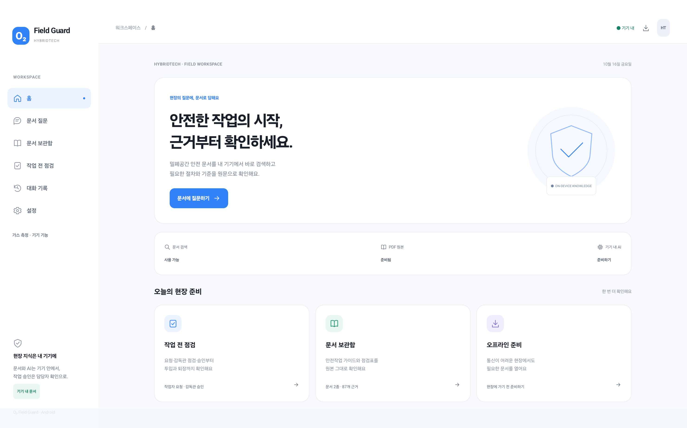
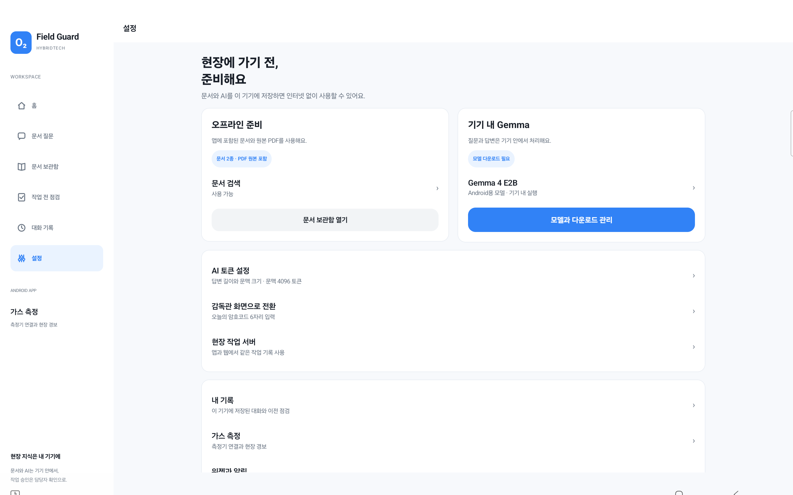

# HybridTech · O₂ Field Guard

밀폐공간 안전 문서를 근거로 질문에 답하고, 작업 요청부터 감독관 점검·승인, 현장 투입과 퇴장까지 기록하는 프로젝트입니다. **Android는 설치형 앱으로 유지하고, PC·갤럭시 탭·iPhone은 반응형 웹/PWA도 함께 사용합니다.** 질문과 문서 검색은 기기 안에서 처리하며, 작업 요청·승인만 공통 작업 서버를 사용합니다.

최종 갱신: **2026-10-21**. 이 README는 저장소 첫 화면에서 프로젝트 구조, 실행 주소, 실제 소스 경로, 감독관 코드, 테스트 방법을 확인할 수 있도록 정리한 안내입니다.

**아이폰 최신 변경:** 설정에서 Qwen3 0.6B 약 353MB를 한 번 다운로드하면 자동 준비합니다. 기존 Gemma는 아이폰에서 불러오지 않고 보존합니다. [사용 순서](#아이폰-경량-ai-사용-2026-10-20).

## 먼저 알아둘 구성

| 구성 | 구현과 역할 | 실행·진입 경로 |
|---|---|---|
| Android 설치형 앱 | Kotlin·Compose 화면, 기기 내 RAG/Gemma, 원본 PDF, 음성, BLE 측정·경보·위젯 | `app/` → Android Studio에서 실행 |
| 반응형 웹/PWA | React·TypeScript 화면, 기기 내 Gemma/Apple 경량 AI, 원문 PDF, 대화 기록, 작업 요청·점검 | `web/` → 개발 5174 / 미리보기 4173 |
| 공통 작업 서버 | 기기별 세션, 당일 6자리 감독관 코드, 요청 소유권·승인 권한 검사, 작업 기록 | `web/server/` → Vite 개발·미리보기와 함께 실행 |
| 공통 작업 화면 | 작업자 요청·감독관 점검·승인·투입·대피·종료 | `web/src/features/WorkChecklist.tsx`; 앱은 이 화면을 제한된 WebView로 사용 |

**웹 디자인을 공통 기준으로 사용합니다.** 홈·질문·답변·문서·기록·설정·원문 화면을 웹 배치와 스타일에 맞춰 전면 수정했습니다. 같은 아이콘 17개와 색상·카드 크기 기준을 웹 소스에서 Android 리소스로 동기화합니다. 작은 화면은 `홈 / 질문 / 문서 / 설정`, 넓은 앱 화면은 웹처럼 사이드바를 사용합니다. 앱의 가스 측정·음성·위젯은 Android 기능으로 이어지며, 웹에서 측정값을 만들어 표시하지 않습니다.

## 앱 디자인 화면

아래 파일은 `WorkspaceDesignTest`가 실제 Compose 화면을 렌더링해 저장하는 검증 자료입니다. 테스트 문서와 가상 상태를 사용하며 모델 다운로드·BLE·실제 작업을 시작하지 않습니다. 촬영 기기와 최종 결과는 [검증 기록](web/docs/validation.md)에 기록합니다.

| 홈 | 설정 |
|---|---|
|  |  |

[질문](docs/screenshots/android-workspace-chat.png) · [답변](docs/screenshots/android-workspace-answer.png) · [문서](docs/screenshots/android-workspace-library.png) · [기록](docs/screenshots/android-workspace-history.png) · [토큰 설정](docs/screenshots/android-workspace-tokens.png) · [감독관](docs/screenshots/android-workspace-supervisor.png)

[휴대전화 크기 홈](docs/screenshots/android-workspace-phone-home.png) · [휴대전화 크기 질문](docs/screenshots/android-workspace-phone-chat.png). 휴대전화 이미지는 탭에서 390×844dp로 렌더링한 결과입니다. 구조·동기화 명령은 [앱·웹 공통 디자인 설계](docs/ANDROID_WEB_DESIGN.md)를 참고하세요.

## 빠른 실행: 웹

필요 환경은 **Node.js 24.15 이상**입니다. PowerShell에서는 `npm.cmd`를 사용합니다. 아래 명령은 저장소 루트 기준입니다.

```powershell
cd web
npm.cmd ci
npm.cmd run dev
```

- **개발 주소: `http://localhost:5174/`** — 수정 내용이 바로 반영됩니다.
- **PWA·오프라인 시험: `http://localhost:4173/`** — 다음 빌드·미리보기 명령을 사용합니다.
- 5173은 이 프로젝트의 주소가 아닙니다. 5174·4173이 이미 사용 중이면 다른 포트로 자동 변경하지 않습니다.
- `docs/webapp-ui/`는 예전 정적 시안입니다. 현재 앱은 반드시 `web/`에서 실행합니다.

```powershell
npm.cmd test
npm.cmd run build
npm.cmd run preview
```

개발 모드는 서비스 워커를 등록하지 않습니다. 이전 PWA가 열려 있다면 같은 주소의 탭·홈 화면 앱을 모두 닫았다가 다시 열어 새 버전을 적용합니다. `localhost`와 `127.0.0.1`, 그리고 5174와 4173의 모델·대화 저장소는 서로 다릅니다.

## 갤럭시 탭에서 웹/PWA 테스트

1. 탭에서 Chrome을 업데이트하고 개발자 옵션의 USB 디버깅을 켭니다.
2. 데이터 USB 케이블로 PC에 연결하고 디버깅 허용을 승인합니다.
3. PC에서 위의 `npm.cmd run preview`를 켜 둡니다.
4. 새 PowerShell에서 아래 명령을 실행하고 탭 Chrome의 `http://localhost:4173/`을 엽니다.

```powershell
$tabletAdb = "$env:LOCALAPPDATA\Android\Sdk\platform-tools\adb.exe"
& $tabletAdb devices
& $tabletAdb reverse tcp:4173 tcp:4173
```

개발 서버를 테스트하려면 두 포트를 모두 5174로 바꿉니다. 테스트 중 PC 서버와 USB 연결을 유지합니다. 여러 단말이 연결된 경우 ADB 명령에 `-s <기기-ID>`를 추가합니다.

설정의 **전체 오프라인 파일 준비 → Gemma 4 E2B 다운로드 받기**를 실행하면 모델 검증·AI 준비가 자동으로 이어집니다. 탭에는 PC와 별도로 약 2.01GB 모델을 저장해야 합니다. 문서·PDF의 오프라인 시험은 준비 완료 후 PC 서버도 중지하고 탭 인터넷을 끊어 진행합니다. USB 경로가 살아 있는 상태를 완전 오프라인으로 판단하지 않습니다.

## iPhone에서 HTTPS·PWA 테스트

PC와 iPhone을 같은 Wi-Fi에 연결하고 저장소 루트에서 실행합니다.

```powershell
cd web
npm.cmd run iphone:test
```

최신 웹/PWA를 빌드하고 터미널에 현재 PC IP의 두 주소를 출력합니다.

1. iPhone Safari에서 **`http://<PC-IP>:4172/`**의 설치 안내를 엽니다.
2. **Field Guard Local Test CA** 프로파일을 다운로드하고 아이폰 설정에서 직접 설치합니다.
3. 설정 → 일반 → 정보 → **인증서 신뢰 설정**에서 이 개발용 인증서의 전체 신뢰를 켭니다.
4. **`https://<PC-IP>:4174/`**을 열고 공유 → 홈 화면에 추가로 시험합니다.

기존 4173은 HTTP 서버입니다. `https://<PC-IP>:4173/`으로 접속하면 Safari 보안 연결 오류가 납니다. 이 앱은 최초 문서 읽기부터 보안 컨텍스트의 Cache API·파일 검증을 사용하므로 일반 사설 IP의 HTTP 주소로 전체 기능을 시험할 수 없습니다.

인증서·개인키는 Git에서 제외된 `web/.local/iphone-https/`에만 생성합니다. CA를 신뢰하면 이 PC가 발급한 서버 인증서를 아이폰이 신뢰하며, 시험 후 프로파일을 제거할 수 있습니다. PC에 인증서를 자동 등록하거나 외부 인터넷으로 서버를 공개하지 않습니다. 아이폰의 설치·신뢰 설정은 직접 진행해야 합니다. [정확한 설치 순서·키 경로·만료·검증 범위](docs/IPHONE_TEST.md)를 참고하세요.

**아이폰 AI는 별도 조건이 있습니다.** 현재 기기 내 AI는 WebGPU가 필요하고 iPhone의 정식 지원은 iOS 26부터입니다. iOS 18.6.2에서는 웹·문서·작업 화면에 접속해도 AI 다운로드/실행은 막힙니다. iPhone 13 Pro는 iOS 26 지원 기종이지만 업데이트 후 실제 모델 적재·메모리·생성을 추가로 확인해야 합니다. 설정에서 HTTPS·WebGPU·백그라운드 실행 조건을 구분해 안내합니다. [iPhone AI 지원 조건](docs/IPHONE_TEST.md#iphone-ai의-별도-지원-조건)을 참고하세요.

### 문서 검색·상세 답변 보완 (2026-10-21)

Apple 경로는 **질문에 맞는 문서 본문을 먼저 보여주고, 필요한 AI 보충만 같은 답변 끝에 추가**합니다. 산소·유해가스 측정방법, 심폐소생술 같은 절차 질문은 긴 절차를 다시 생성하지 않아 본문을 바로 읽을 수 있습니다. 왜/이유/차이/쉽게 풀기 등 추가 설명 요청에서만 로컬 AI가 최대 한 번 생성합니다. 기존 본문을 나중에 교체하거나 위에 삽입하지 않습니다. 현재 현장 측정값과 작업 승인 여부는 문서 질문에서 판단하지 않습니다.

**질문 초점 보완:** 관련 쪽 전체를 붙이던 방식에서, 쪽 안의 항목과 섹션까지 찾아 직접 답하는 문단을 앞에 배치하도록 수정했습니다. 예를 들어 ‘어두운 밀폐공간 측정 전등은 어떤 걸 써야해’에는 27쪽의 **가연성가스 가능성 → 방폭구조 전등 사용**을 먼저 표시하고 같은 절의 주의사항을 이어 보여줍니다. ‘정전 등’을 ‘전등’으로 합치는 오탐을 막고, 조명/랜턴 같은 동의어와 조사·활용형을 처리합니다. 질문에 없는 새 사실이나 전압·IP 등급·가격을 만들어 답하지 않습니다. 원본 PDF·모델은 변경하지 않았고 재다운로드도 필요하지 않습니다. [검색·문단 선택 설계](docs/webapp/GROUNDED_ANSWER_DESIGN.md#질문-초점과-문단-선택) · [실제 PC 화면](web/docs/screenshots/focused-lamp-answer-pc.jpg).

공통 답변 계획은 `web/src/rag/answer-plan.ts`에 있습니다. 출처·원문 항목·수치/단위/비교 연산자·조건을 화면과 AI 입력이 공유합니다. 필수 근거가 예산을 넘으면 자르지 않고 보충 생성을 생략합니다. 검증 전 AI 토큰은 화면에 표시하지 않고 본문 복사·수치 변경·작업 허용 표현 등의 보충을 보수적으로 거릅니다. 완전한 의미 검증은 아니며 도메인 담당자의 검수는 별도입니다.

문맥 **2,048**, prefill **64**를 유지합니다. **AI 보충 설명 한도는 기본 256 / 선택 128토큰**이며 한 질문당 0~1회 생성합니다. 일반 문서 답변에는 생성 0토큰을 표시하고, AI를 실제 실행한 경우 SDK 측정 사용량을 저장합니다. 설정은 `ai-settings-light-v3`로 분리하며 v1/v2/Gemma 설정과 기존 대화는 보존합니다. **이미 Qwen3를 저장했다면 모델 재다운로드는 필요하지 않습니다.**

중단은 엔진의 정상 종료·정리를 먼저 요청합니다. 정상 정리가 확인된 Worker 종료는 다음 준비를 허용하고, 응답 없음·시간 초과·정리 미확인은 자동 재적재를 잠급니다. 새로고침으로 기록을 지우지 않으며 설정의 명시적 복구에서 재시도합니다. 미완료 기록은 Jetsam 확정 진단이 아닙니다. 복구 기록을 저장할 수 없는 아이폰에서는 자동 적재를 진행하지 않습니다.

38개 파일 455개 자동 검사를 통과했습니다. 기존 검색/본문 검사 **150/150**, 페이지 회귀 **30/30**을 유지합니다. 기존 150문항은 페이지·필수 구절 포함 여부만으로 전등 질문의 부정확한 초점을 놓쳤습니다. 새 33문항은 **앞 400자 안의 직답·필수 조건·불필요한 절차 제외·문서 밖 속성**을 검사합니다. 동일 원문/평가표로 이전 커밋 `7ed8418`을 다시 측정한 결과 **9/33 → 33/33**(정답 페이지 23/33 → 33/33)입니다. 개발에 사용한 회귀 집합이며, 보지 않은 모든 질문의 정확도·AI 생성 무오류성·실제 iPhone 안정성 점수가 아닙니다. [33문항 이전](web/docs/focused-retrieval-before.json) · [33문항 이후](web/docs/focused-retrieval-after.json) · [150문항 결과](web/docs/evaluation-150-after.json) · [150문항/평가 기준](web/tests/evaluation-150.json).

실행은 `cd web` → `npm.cmd run evaluate:150` / `npm.cmd run evaluate:focused`입니다. `npm.cmd run evaluate:focused -- --before`는 Git의 이전 커밋으로 동일 기준의 비교 결과를 재구성합니다. `npm.cmd run package:knowledge`는 `web/.local/knowledge-package-v1.json`에 원문 해시·항목·비교 연산자·도식 확인 표시가 있는 관리자 검수용 초안을 만듭니다. 자동 검수 승인/운영 배포 기능은 아닙니다. [상세 설계·정상/비정상 종료 정책·출시 조건](docs/webapp/GROUNDED_ANSWER_DESIGN.md) · [검증 기록](web/docs/validation.md).

### 아이폰 경량 AI 사용 (2026-10-20)

아이폰의 Gemma 실행에서 WebContent의 메모리 초과 종료가 확인되어 **iPhone/iPad는 Qwen3 0.6B 경량 로컬 모델 + WebLLM 0.2.86**을 사용하도록 변경했습니다. PWA와 기기 내 추론을 유지하며 질문·답변을 추론 서버에 보내지 않습니다. PC·Android 브라우저의 Gemma 4 E2B와 설치형 Android의 기존 모델은 유지합니다. **실제 iPhone 13 Pro의 수정 후 성공은 아직 확인하지 않았습니다.**

1. PC 서버를 켠 채 기존 Field Guard 홈 화면 앱을 열어 업데이트를 받은 뒤, 같은 주소의 앱·탭을 모두 닫았다가 다시 엽니다. 사이트 데이터는 지우지 않습니다.
2. 설정에 **기기 내 경량 AI / Qwen3 0.6B / 아이폰·아이패드용 · 353 MB**가 보이는지 확인합니다. 진단 버전은 **`apple-grounded-answer-20261021.3`**입니다.
3. **Qwen3 0.6B 다운로드 받기**를 한 번 누릅니다. 기존 Gemma 파일을 변환하는 방식이 아니므로 새 경량 파일을 한 번 받아야 합니다. 완료 후 자동으로 준비하며 별도의 실행 버튼은 없습니다. 기존 Gemma·대화·작업 기록은 보존합니다.
4. 문맥은 **2,048 고정**, AI 보충 설명 한도는 기본 **256 / 선택 128**입니다. 일반 문서 본문은 AI 준비와 독립적으로 표시합니다. 실제 보충 생성 후 정상 정리가 확인되면 다음 질문용 엔진을 자동 준비합니다. 비정상 종료 시에는 설정에서 복구를 시도합니다.
5. 짧은 질문을 세 번 연속 시험한 뒤 Wi-Fi·모바일 데이터를 끄고 완전히 닫았다가 다시 열어 문서·PDF·질문을 확인합니다. 파일 누락 시 인터넷에서 자동으로 다시 받지 않고 설정으로 안내합니다.

경량 파일 13개의 총량은 **353,285,213바이트**입니다. `web/src/ai/light-manifest.json`에 공식 모델/실행 파일의 고정 커밋·크기·SHA-256을 기록합니다. `light-model.ts`가 한 파일씩 스트리밍 검증해 저장하고 `light.worker.ts`는 저장 파일만 읽습니다. 전체 다운로드 크기는 실제 실행 메모리와 다릅니다.

작은 모델은 Gemma와 답변 품질이 다릅니다. 심폐소생술 시험에서 압박 절차 누락이 관찰되어 기존 근거 검사에 따라 원문으로 전환합니다. 이 검사는 모든 사실 오류를 검출하는 검수기가 아닙니다. 원문 쪽수 확인과 실제 iPhone의 반복 실행·발열·전체 메모리 검증이 남아 있습니다. [시험 순서](docs/IPHONE_TEST.md) · [설계와 로그 분석](docs/webapp/IPHONE_MEMORY_ANALYSIS.md) · [검증 기록](web/docs/validation.md).


## 작업자 요청 ↔ 감독관 승인

기본 작업 화면은 진행 중인 요청만 표시합니다. 종료된 과거 작업은 ‘종료 이력’에서 확인하며 새 요청의 승인으로 사용하지 않습니다. 감독관 코드를 입력해도 작업은 승인되지 않습니다.

1. 작업자가 이름·현장·위치·작업 내용을 입력해 요청합니다. 새 작업은 점검 0/5와 승인 대기로 시작하며 투입이 잠깁니다.
2. 감독관 화면에 요청이 자동으로 도착합니다. 감독관이 점검·측정·감시인·연락 방법·유효기한을 기록하고 저장합니다.
3. 감독관이 **‘점검 완료 · 투입 승인 기록’**을 눌러야 작업자에게 승인 결과가 전달됩니다.
4. 작업자가 승인 내용을 확인하고 **‘작업자 현장 투입 확인’**을 눌러야 투입으로 바뀌며 감독관에게도 전달됩니다. 보완 요청·재요청·승인 취소·퇴장도 서버 기록을 공유합니다.

변경 명령은 인증된 POST, 상대 화면 갱신은 `/api/work-events` SSE를 사용합니다. 서버가 1초 간격으로 변경을 감지하고, 연결 복구 시 다시 조회합니다. 스트림 연결 실패 시 5초 간격으로 확인합니다. 열린 화면 안에 알림이 표시되며, 닫힌 앱/사이트의 푸시 알림은 아직 지원하지 않습니다. 작업자 조회는 본인 요청만, 감독관 조회는 서버가 인증한 권한만 허용합니다.

시험하려면 작업자는 탭/앱, 감독관은 PC에서 **같은 서버**에 접속합니다. 한 PC에서는 브라우저 프로필 또는 비공개 창을 분리해야 합니다. 같은 프로필의 탭 두 개는 접속 쿠키를 공유합니다. [세부 시험 순서와 상태 설계](web/docs/workflow.md)를 참고하세요.

소스: `web/server/api.ts`(POST/SSE), `web/server/store.ts`(권한·트랜잭션·변경 번호), `web/src/workflow/live.ts`(연결/복구), `web/src/workflow/presentation.ts`(현재/이력 구분), `web/src/features/WorkChecklist.tsx`(양쪽 화면).

## 감독관: 오늘의 6자리 암호코드

기본 사용자는 작업자입니다. 작업 전 점검의 **감독관 화면으로 전환** 또는 설정에서 6자리 코드 입력 화면을 엽니다. 작업자가 전환 버튼을 누르거나 주소를 직접 입력해도 **코드 확인 전에는 감독관 기록과 승인 기능을 이용할 수 없습니다.** 권한은 서버가 목록 조회와 상태 변경마다 다시 검사합니다.

서버 관리자만 `web/`에서 실행합니다.

```powershell
npm.cmd run supervisor -- today
npm.cmd run supervisor -- rotate
npm.cmd run supervisor -- revoke
```

| 명령·규칙 | 동작 |
|---|---|
| `today` | 한국 날짜 기준 오늘의 6자리 숫자 코드 확인. 같은 날 재조회하면 같은 코드 |
| `rotate` | 오늘 코드를 즉시 교체하고 기존 감독관 인증도 무효화 |
| `revoke` | 오늘 코드와 해당 코드로 인증한 모든 기기를 사용 중지 |
| 유효기간 | 한국 시간 다음 날 00:00까지. 자정에 코드와 감독관 권한 만료 |
| 사용 인원 | 감독관 여러 명이 당일 같은 코드를 사용. 잠근 뒤에도 당일 코드로 재인증 가능 |
| 잘못된 입력 | 기기별 5회 실패 후 15분 제한. 새 기기를 반복 생성하는 시도도 접속 단위 제한 |
| 기록 | 공통 코드는 개인 신원을 증명하지 않음. 서버가 기기별 감독관 ID를 구분해 사건에 기록 |

코드는 서버 관리자 CLI에서만 확인하고 감독관에게만 전달합니다. 실제 코드를 README·소스·공개 환경변수에 쓰지 않습니다. 코드 원문을 DB에 저장하지 않고 별도 서버 키로 계산합니다. 세션 토큰은 해시로 보관하며 HttpOnly·SameSite 쿠키와 CSRF 검사를 사용합니다. 이전 일회용 코드·8시간 인증 방식은 당일 6자리 방식으로 대체했습니다.

개인 로그인, 감독관의 현장별 배정, 계정 복구, 푸시 알림은 아직 없습니다. 인증된 감독관은 현재 서버 프로젝트의 작업을 점검할 수 있습니다.

## 작업 전 점검 흐름

1. **작업자**: 이름·현장·위치·작업 내용을 입력하고 점검 요청.
2. **감독관**: 당일 코드 인증 후 요청을 선택. 가스·보호구·통신·환기·작업자 상태 5항목과 수동 측정값·장비·시각·감시인·연락·투입 유효기한 입력.
3. **감독관**: `점검 내용 저장` 후 `점검 완료 · 투입 승인 기록`. 누락·문서 기준 이탈로 승인할 수 없으며 보완 요청·승인 취소 가능.
4. **작업자**: 승인 당시 내용을 확인하고 `작업자 현장 투입 확인`.
5. **작업 중**: 기기 내 문서 지원 사용. 위험 상황은 직접 확인한 내용을 입력해 수동 신고.
6. **작업자**: 정상 퇴장 또는 긴급 탈출 후 실제 집결 위치 기록.
7. **감독관**: 퇴장 기록을 확인하고 작업 종료.

작업자는 본인 요청만 확인합니다. 같은 서버에 연결한 PC·탭·앱은 요청과 승인 결과를 공유하고 인증된 서버 이벤트로 열린 화면을 자동 갱신합니다. 연결 실패 시 5초 간격으로 다시 확인합니다. Chrome과 Android WebView는 별도 기기로 식별되므로 이름이 같아도 소유권을 합치지 않습니다. 작업 서버의 상태 변경은 SQLite 트랜잭션과 버전으로 중복 갱신을 막고, 승인 당시 점검 내용도 보존합니다.

**새 작업·점검·승인·투입/퇴장 기록에는 서버 연결이 필요합니다.** 문서 검색·PDF·기기 내 AI와 기존 로컬 이력은 준비 후 오프라인으로 사용할 수 있습니다. 가스값은 수동 입력 기록이며 웹 센서 실시간 수신·가스 예측·자동 대피 경로는 구현하지 않았습니다. 실제 작업허가를 자동 발급하는 시스템이 아닙니다.

## Android 설치형 앱 실행과 디자인 확인

저장소 루트를 Android Studio로 열어 `app`을 실행합니다. 현재 구성은 `compileSdk/targetSdk 37`, `minSdk 26`, Kotlin·Compose·ObjectBox·LiteRT-LM입니다.

```powershell
.\gradlew.bat :app:testDebugUnitTest :app:assembleDebug
```

이 PC에서 사용하는 JDK는 `C:\Program Files\Android\Android Studio1\jbr`, SDK는 `C:\Users\limmi\AppData\Local\Android\Sdk`입니다. 다른 PC에서는 해당 설치 경로와 `JAVA_HOME`/Android Studio Gradle JDK를 맞춰 주세요. `local.properties`와 로컬 Gradle 캐시는 Git에서 제외합니다.

| 결과물 | 정확한 경로 |
|---|---|
| Android 디버그 APK | `app/build/outputs/apk/debug/app-debug.apk` |
| 계측 테스트 APK | `app/build/outputs/apk/androidTest/debug/app-debug-androidTest.apk` |
| 이 PC에서 보관한 디자인 검증용 APK | `app/build/outputs/apk/designpreview/app-designpreview.apk` (생성물, Git 제외) |
| Android 단위 테스트 결과 | `app/build/test-results/testDebugUnitTest/` |
| 웹 프로덕션 파일 | `web/dist/` |

기존 앱과 빌드 서명이 다르면 업데이트 설치가 거부될 수 있습니다. 기존 앱·모델을 삭제하지 않고 디자인을 확인하려면 별도 패키지를 빌드합니다.

```powershell
.\gradlew.bat -PdesignPreview=true :app:assembleDebug :app:assembleDebugAndroidTest
```

디자인 빌드는 `com.minyook.sllm2.designpreview`, 앱 이름은 **Field Guard 디자인**입니다. 일반 빌드와 출력 APK 위치는 같으므로 파일의 빌드 종류를 구분해 설치합니다. 기존 설치 앱과 데이터는 보존됩니다. 2026-10-16 이 PC에서는 원래 디버그 키의 서명을 대조한 뒤 일반 `O₂ Field Guard` 앱도 삭제 없이 업데이트했습니다. 일반 앱 설치 파일은 `app/build/outputs/apk/debug/app-debug.apk`입니다. 앱의 **설정 → 현장 작업 서버**에 HTTPS 서버 기본 주소를 입력하면 웹과 같은 점검 화면을 사용합니다. 개발 빌드의 USB 시험에서는 `http://localhost:4173`도 허용하며 위의 ADB 포트 연결이 필요합니다.

앱 전체를 웹으로 바꾸지 않았습니다. 홈·문서·질문·기록·설정·원문은 Compose, 작업 요청·감독관 점검은 공통 React 화면을 사용하는 제한된 WebView입니다. WebView에서 질문·모델 준비를 누르면 기존 Android 화면으로 돌아갑니다. 임의 외부 출처·파일 접근·JavaScript 네이티브 인터페이스는 열지 않습니다.

## 키보드를 열었을 때의 질문 화면

앱·웹 모두 입력 중에는 하단 메뉴와 큰 제목·소개·예시 질문·하단 안내를 접고, 입력창을 키보드 바로 위에 둡니다. 키보드를 닫으면 메뉴와 원래 소개 화면을 복원하며 작성 중인 문장은 유지합니다. 웹은 실제 보이는 화면 높이(`VisualViewport`) 안에서 상단 바·대화 영역·입력창·메뉴를 함께 배치합니다. 모바일에서는 대화 영역만 스크롤하고 넓은 태블릿도 소프트 키보드가 열리면 같은 방식으로 공간을 확보합니다. 여러 줄 입력은 최대 4줄까지 커집니다.

[입력 중 웹 화면](web/docs/screenshots/chat-keyboard-open.jpg) · [키보드 닫기 후 복원](web/docs/screenshots/chat-keyboard-restored.jpg). 두 화면은 PC Chromium에서 390×844 → 390×460px로 키보드의 공간 감소를 모사한 결과이며 실제 iPhone 키보드 캡처가 아닙니다. 320px·1280px와 실제 Gemma 생성 중 수동 탐색도 확인했습니다. Android의 동일한 소개 접기·입력창 축소·여백 처리를 반영한 새 APK는 `app/build/outputs/apk/debug/app-debug.apk`입니다. 기존 일반 앱의 디버그 인증서와 같은 서명을 확인했으며 삭제 없이 업데이트 설치합니다. 현재 Android 기기가 연결되어 있지 않아 이번 키보드 수정의 계측 실행과 설치는 하지 않았습니다.

웹/PWA에 이전 화면이 남아 있으면 한 번 새로고침해 업데이트를 받은 뒤 같은 주소의 탭·홈 화면 앱을 모두 닫고 다시 엽니다. 사이트 데이터를 지울 필요는 없습니다.

## 문서·모델·Markdown·스크롤

- 공식 문서 2종, 총 87쪽의 검색 데이터와 실제 PDF를 함께 사용합니다. 답변 근거는 문서 ID와 실제 쪽수를 유지합니다.
- PC·Android 브라우저 모델은 `web/src/ai/catalog.ts`에 고정한 **Gemma 4 E2B 웹용 `.litertlm`**, 2,008,432,640바이트입니다. 다운로드 전체 크기·SHA-256 확인 후 OPFS에 저장합니다. Android용 모델 파일과 구분합니다.
- 다운로드 완료·웹 재접속 후 AI를 자동 준비합니다. 일반 실행·메모리 해제 버튼은 없습니다. 파일 검증·WASM/GPU 로드·생성은 백그라운드 Worker에서 처리합니다. 준비·생성 중 페이지가 종료된 흔적이 남으면 자동 반복을 멈추고 복구 선택을 제공합니다. Web Locks 지원 시 같은 저장소의 여러 창에서 엔진 중복 적재도 막습니다.
- Apple 모바일은 답변마다 대화·엔진 삭제 후 Worker를 교체하고 다음 엔진을 하나만 자동 준비합니다. 다음 질문은 같은 준비 작업을 기다리며 데스크톱은 엔진을 계속 재사용합니다. 정리 중 종료는 `cleanup` 단계로 남깁니다.
- PC·Android 브라우저의 Gemma는 최초 저장 파일 전체 검사 후 검증 기록을 보관합니다. 후속 실행은 크기·수정 시각·분산 표본과 7일 유효기간을 검사하고 필요 시 전체 SHA-256을 다시 확인합니다. 표본 검사는 전체 검사와 보장 범위가 다르며 엔진 적재 시간은 여전히 필요합니다.
- `모델 파일 저장됨`과 `AI 사용 가능`은 구분합니다. 재접속의 불러오기는 모델 재다운로드를 뜻하지 않습니다.
- 토큰 설정은 실제 SDK에 전달하고 측정 사용량만 표시합니다. Apple은 문맥 2,048 고정·보충 출력 256 기본/128 선택·한 질문당 0~1회입니다. 생성하지 않은 문서 본문은 0토큰입니다. 데스크톱의 기본 8,192/1,536과 설치형 Android 설정은 유지합니다.
- Apple 경량 경로는 입력/KV prefill 배치 64와 실 토크나이저 근거 예산을 사용합니다. 다운로드는 순차 스트리밍 검증·Cache API 저장, 생성은 캐시 전용입니다. 기존 Apple Gemma의 파일 구간 읽기·배치 1 보완 이력은 [메모리 분석](docs/webapp/IPHONE_MEMORY_ANALYSIS.md)에 보존했습니다.
- 웹 답변은 한국어 Markdown의 제목·굵게·목록·표·코드를 표시합니다. 생성 HTML·원격 이미지 자동 로드는 허용하지 않습니다. 비정상 문자권 혼입·깨진 문자·심한 반복은 원문 표시로 전환하며 사실 정확도 전체를 보장하는 검사는 아닙니다.
- 답변 중에도 자유롭게 스크롤합니다. 다시 생성 중인 마지막 줄이 보이는 위치로 내려오면 자동 따라가기를 재개하고, 답변 완료 후 위치를 강제로 바꾸지 않습니다.

## 파일과 디렉터리 지도

아래 경로는 모두 **저장소 루트 기준**입니다. 현재 작업 폴더는 `C:\Users\limmi\AndroidStudioProjects\Sllm2`입니다.

```text
Sllm2/
├─ README.md                         프로젝트 전체 안내: 이 문서
├─ app/                              기존 Android 설치형 앱
│  ├─ build.gradle                   SDK·의존성·디자인 검증용 패키지 설정
│  └─ src/
│     ├─ main/
│     │  ├─ AndroidManifest.xml
│     │  ├─ assets/knowledge/seed_chunks_v1.json
│     │  ├─ assets/source-pdfs/       공식 PDF 원본 2종
│     │  ├─ java/com/minyook/sllm2/   아래 Android 소스 표 참고
│     │  └─ res/xml/work_network_security.xml
│     ├─ test/                       JVM 단위 테스트
│     └─ androidTest/                실제 기기 Compose·PDF 테스트
├─ web/
│  ├─ src/                           React 화면·로컬 AI·저장소
│  ├─ server/                        작업 API·SQLite·감독관 코드 CLI
│  ├─ scripts/                       원본 준비·Worker·PWA 빌드
│  ├─ tests/                         Vitest 회귀 테스트
│  ├─ docs/                          웹 검증·작업 흐름·화면
│  ├─ public/                        아이콘·PWA 설정·생성된 배포 자산
│  ├─ .local/                        작업 DB·서버 키: Git 제외
│  └─ dist/                          생성된 배포 결과: Git 제외
└─ docs/
   ├─ ANDROID_APP_SPEC.md             Android 현행 설계서
   ├─ OFFLINE_RAG_ARCHITECTURE.md     Android 검색·근거 설계
   ├─ webapp/TARGET_ARCHITECTURE.md   웹·공통 작업 서버 현행 설계서
   ├─ webapp/BUILD_PROMPT.md          유지보수 기준
   ├─ webapp-ui/                     과거 정적 시안: 현재 앱 아님
   └─ screenshots/                   Android 디자인 검증 화면
```

### Android 주요 소스

기준 디렉터리: `app/src/main/java/com/minyook/sllm2/`.

| 파일·폴더 | 역할 |
|---|---|
| `MainActivity.kt` | Compose 진입, ViewModel·음성·권한·생명주기 연결 |
| `SllmApplication.kt` | ObjectBox·알림 초기화 |
| `ui/TossFieldGuardApp.kt` | 공통 화면 틀·작은 화면 메뉴·채팅·문서·센서·상세 화면 |
| `ui/WebDesignTokens.kt`, `WorkspaceComponents.kt` | 웹에서 생성한 공통 디자인 토큰·아이콘·카드·버튼·입력·배지 |
| `ui/FieldWorkspaceUi.kt` | 웹 기준 홈·사이드바·문서 표지·설정·토큰 선택 |
| `ui/WorkspaceScreens.kt` | 질문·답변·출처·문서 검색/필터·기록·원문 화면 |
| `ui/FieldGuardViewModel.kt` | 앱 상태·기존 RAG/모델/BLE 호출·작업 서버 주소 저장 |
| `ui/NativeWorkPage.kt` | 공통 작업 화면 WebView·서버 설정·네이티브 질문 전환 |
| `ui/WorkServerAddress.kt` | HTTPS/개발 localhost·동일 출처 검증 |
| `ui/MarkdownText.kt`, `MarkdownBlocks.kt`, `SourcePdfPage.kt` | Markdown 답변·원본 PDF 표시 |
| `ui/VoiceConversationController.kt` | 기기 음성 인식·응답 음성 경로 |
| `data/KnowledgeRepository.kt` | ObjectBox 검색·근거 선택 |
| `data/QuestionEvidencePlanner.kt`, `QuestionAnswerVerifier.kt` | 복합 주제·근거 누락/충돌 검사 |
| `data/SourcePdfCatalog.kt`, `SourcePdfRepository.kt` | 번들 PDF 판본·해시·실제 쪽 렌더링 |
| `model/LocalModelRuntime.kt`, `ModelDownloadWorker.kt` | Android LiteRT-LM·모델 다운로드 |
| `gas/` | BLE 수신·측정 서비스·데모 구분·위젯·알림 |

현재 진입 UI는 `TossFieldGuardApp`입니다. `ui/HybridTechApp.kt`와 `HybridTechTheme.kt`는 이전 화면 구현과 공통 액션 선언을 포함하므로 현재 앱의 기준 화면과 혼동하지 않습니다.

### 웹·작업 서버 주요 소스

| 정확한 경로 | 역할 |
|---|---|
| `web/src/App.tsx` | 홈·질문·보관함·기록·탐색·권한별 메뉴·앱 내 표시 모드 |
| `web/src/features/WorkChecklist.tsx` | 작업자·감독관 공통 작업 화면 |
| `web/src/features/SupervisorAccess.tsx` | 6자리 숫자 입력·인증·잠금 |
| `web/src/features/Settings.tsx`, `PdfPage.tsx` | 모델·토큰·파일 준비·원본 PDF |
| `web/src/ai/capabilities.ts` | HTTPS·WebGPU·Worker 실행 조건과 iPhone 업데이트 안내 |
| `web/src/workflow/work.ts` | 상태 전환·승인 조건·사건 스냅샷 |
| `web/src/workflow/live.ts`, `presentation.ts` | 상대 화면 변경 수신·연결 복구·진행 중/종료 이력 구분 |
| `web/src/workflow/access.ts`, `native.ts` | 서버 세션·API·Android 전환 |
| `web/server/store.ts` | SQLite·요청 소유권·감독관 권한·한국 날짜/당일 코드 |
| `web/server/api.ts`, `plugin.ts`, `manage.ts` | HTTP API·Vite 연결·코드 관리 CLI |
| `web/src/rag/text.ts`, `search.ts`, `evidence.ts` | 표현 정규화·관련 쪽 검색·문서 상세 발췌 |
| `web/src/rag/answer-plan.ts` | 공통 근거 계획·원문 순서·수치/연산자·본문 우선·보충 검증 |
| `web/src/ai/light-manifest.json`, `light-model.ts` | Apple 경량 모델/실행 파일 고정 정보·스트리밍 검증·캐시 |
| `web/src/ai/light.worker.ts`, `light-engine.ts`, `light-answer.ts`, `light-prompt.ts`, `light-output.ts` | Apple 캐시 전용 로컬 생성·입력 예산·템플릿 제거 |
| `web/scripts/light-worker-bridge.mjs` | WebLLM 0.2.86의 배치 64·네트워크 차단·토크나이저/힙 연결 |
| `web/src/ai/catalog.ts`, `model.ts` | 공식 모델 정보·다운로드·저장·검증 재사용 |
| `web/src/ai/runtime.ts`, `worker-engine.ts`, `engine.worker.ts` | 자동 준비·Worker 통신·실제 SDK 추론 |
| `web/src/ai/worker-resources.ts`, `diagnostics.ts` | WebGPU 장치 정리·WASM/GPU 오류 표본·개인 내용 없는 로컬 진단 |
| `web/src/ai/model-stream.ts` | OPFS 모델의 1MiB 단위 SDK 입력 스트림 |
| `web/src/ai/recovery.ts`, `engine-lease.ts` | 중단 흔적·자동 반복 방지·동일 출처 엔진 잠금 |
| `web/src/ai/execution.ts` | iPhone/iPad용 LiteRT-LM 입력 배치·GPU 버퍼 설정 |
| `web/src/ai/file-model-reader.ts`, `sdk-stream-reader.ts` | 검증된 로컬 파일 구간 읽기·고정 SDK 연결·일반 스트림 위임 |
| `web/server/ai-recovery-page.ts` | 모델을 로드하지 않는 `/api/ai-recovery` 복구 화면 |
| `web/src/ai/preferences.ts`, `output-quality.ts` | 토큰 설정·비정상 생성 검사 |
| `web/src/chat/scroll.ts`, `useChatScroll.ts` | 창/대화 영역 스크롤·수동 탐색 보존·생성 위치 자동 재개 |
| `web/src/chat/viewport.ts`, `useChatViewport.ts`, `web/src/chat.css` | 키보드 감지·보이는 화면 높이·메뉴/입력창 배치 |
| `web/src/rag/search.ts`, `storage/db.ts` | 로컬 검색·IndexedDB 기록/설정 |
| `web/scripts/prepare-assets.mjs`, `build-ai-worker.mjs` | Android 자산 복사·SDK Worker 생성 |
| `web/scripts/build-pwa.mjs`, `sw-template.js` | 버전별 셸 캐시·API 캐시 제외 |
| `web/vite.config.ts`, `package.json` | 포트·COOP/COEP·작업 API·명령 |

## 저장 위치와 배포 경계

| 위치 | 저장하는 것 |
|---|---|
| Android `context.noBackupFilesDir/models/gemma-4-e2b-it.litertlm` | 설치된 Android 모델 (`.part`는 다운로드 중 파일) |
| Android `context.noBackupFilesDir/source-pdfs/` | 첫 사용 시 복사·검증한 번들 PDF |
| Android `SharedPreferences` | `field_guard_ui`: 서버 주소·온보딩·이전 체크, `inference_settings`: 추론 설정, `local_model`: 모델 상태. `local_chat_history`: 대화, `gas_reading`: 가스 기록 |
| 브라우저 IndexedDB `fieldguard-web` v2 | 대화·토큰 설정·모델 메타데이터/검증 기록·이전 로컬 작업 |
| 브라우저 OPFS | 검증 후 저장한 웹 모델 |
| 브라우저 localStorage `fieldguard-ai-operation` | 준비·생성 중단 감지용 단계·ID·시각·문맥 크기; 질문/모델 내용 없음 |
| Cache API·PWA 셸 | 준비된 검색 데이터·PDF·런타임·앱 화면 |
| `web/.local/workflow.sqlite` | 새 작업·사건·기기 세션 해시·당일 코드 상태 |
| `web/.local/workflow.sqlite.daily-key` | 당일 코드 계산용 서버 비밀 키 |

서버 DB와 키는 서버를 중지한 뒤 함께 백업합니다. `.local/`, 모델·쿠키·키·실제 코드, `node_modules`, `dist`, 생성 자산, APK, Gradle/테스트 임시 파일은 Git에 올리지 않습니다. 이전 로컬 작업을 서버 승인으로 가져오지 않으며 읽기 전용 이력으로 보존합니다. 기기 기록 삭제는 서버 작업·승인을 삭제하지 않습니다. JSON 내보내기는 기기 이력과 본인 서버 기록을 구분합니다.

위 Android 경로는 PC 저장소의 `app/` 아래가 아니라 **단말의 앱 전용 저장소**입니다. `noBackupFilesDir`의 실제 루트는 일반적인 기본 사용자에서 `/data/user/0/<패키지명>/no_backup/`이며 운영체제·프로필에 따라 달라집니다. 디자인 검증용 패키지는 별도 루트를 사용합니다. 브라우저 모델도 PC 프로젝트 폴더가 아닌 접속 origin별 OPFS에 저장되므로 고정된 Windows 파일 경로로 접근하지 않습니다.

웹 정적 출력은 `web/dist/`입니다. 문서·AI에는 HTTPS·COOP/COEP·WASM MIME 설정이 필요합니다. **감독관 인증·새 점검은 서버 API가 필요하므로 정적 파일만 게시해서는 동작하지 않습니다.** 현재 작업 API는 Vite 개발·미리보기용이며 외부 운영 배포·운영 DB 백업 자동화·개인 계정 연동은 수행하지 않았습니다. iPhone은 HTTPS 주소를 Safari에서 열고 공유 → 홈 화면에 추가로 설치합니다. 실기기 iPhone 메모리·발열·재부팅 후 저장 유지 시험은 남아 있습니다.

## 검증 방법과 상세 문서

```powershell
cd web
npm.cmd test -- --maxWorkers=1
npm.cmd run build
```

```powershell
.\gradlew.bat :app:testDebugUnitTest :app:assembleDebug :app:assembleDebugAndroidTest
```

Android UI 계측 테스트: `TossNavigationTest`, `WorkspaceDesignTest`. 원본 PDF 검증은 `data/SourcePdfRepositoryTest`입니다. 웹 검증에는 검색·Markdown·스크롤·모델 무결성·검증 재사용·토큰·날짜 경계·당일 코드 공동 사용·권한 우회 거부·동시 갱신을 포함합니다. 검색 회귀 정답 쪽 포함 결과는 30/30이며 AI 생성 답변 전체의 정확도 점수와 구분합니다. 최신 실행 수치·실기기 결과·남은 항목은 아래 검증 기록을 기준으로 합니다.

Android의 이전 실기기/APK 결과와 웹의 현재 자동 검사·화면 확인·실제 기기 미검증 항목은 [검증 기록](web/docs/validation.md)에 날짜별로 구분합니다. 150문항 개발 회귀 통과를 전체 AI 정확도 또는 실제 iPhone 안정성 합격으로 해석하지 않습니다.

| 문서 | 내용 |
|---|---|
| [iPhone HTTPS 시험](docs/IPHONE_TEST.md) | 같은 Wi-Fi·인증서 설치·4172/4174·PWA·키 경로 |
| [앱·웹 공통 디자인](docs/ANDROID_WEB_DESIGN.md) | 화면 대응·같은 아이콘/색상 생성·캡처 |
| [Android 현행 설계서](docs/ANDROID_APP_SPEC.md) | 네이티브 화면·RAG·BLE·공통 작업 화면 연결 |
| [웹·서버 현행 설계서](docs/webapp/TARGET_ARCHITECTURE.md) | React·Worker·저장소·인증·API 구조 |
| [작업 흐름 설계](web/docs/workflow.md) | 당일 6자리 코드·역할·작업 상태·승인 조건 |
| [웹 실행 안내](web/README.md) | 모델·토큰·PWA·서버 명령·배포 설정 |
| [검증 기록](web/docs/validation.md) | 자동 검사·실제 화면·기기·측정 조건 |
| [Android 오프라인 RAG](docs/OFFLINE_RAG_ARCHITECTURE.md) | 기존 기기 내 근거 검색·검증 |
| [유지보수 기준](docs/webapp/BUILD_PROMPT.md) | 이후 변경에서 보존할 동작 |

현재 BLE 수신 기반과 데모 구분은 구현되어 있지만 특정 제조사 프로토콜·현장 장비 정확도는 검증 전입니다. 실제 작업허가·현장 안전 판단·대피 절차는 담당자의 현장 확인을 따릅니다.
