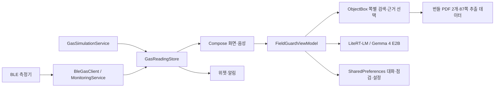

# O₂ Field Guard Android 앱 현행 설계서

2026-10-30 후속 수정: 최근 답변 이동을 매번 실제 하단 이동으로 요청하고 키보드 애니메이션의 실제 viewport 변화를 반영한다. 채팅 음성 상태 박스는 제거했다. 마이크는 음성 전용 화면을 열고 대화를 시작하며 음성 인식 후에도 전용 화면을 유지한다. 설정은 대화상자로 열고, 원문 확인에서 돌아올 때도 음성 화면으로 복귀한다. 상세는 [채팅 최적화](ANDROID_CHAT_OPTIMIZATION.md), [음성 사용법](ANDROID_VOICE.md)을 참고한다.

2026-10-30 갱신: 채팅은 답변 블록별 lazy 표시·메시지별 Markdown 캐시·끝 앵커 따라가기·위쪽 탐색 일시 정지·고정 입력창·IME 전송·답변 복사를 사용합니다. [채팅 최적화 설계와 검증 범위](ANDROID_CHAT_OPTIMIZATION.md)를 참고하세요. 현재 구현/미완료 기능/다음 개발 순서는 [루트 README](../README.md)에 정리합니다.

2026-10-29 개발 범위 변경: **Android 앱만 개발하며 웹/PWA 파일은 보존합니다.** 기존 WebView 작업 점검/인증의 서버 의존성은 유지합니다. 장비 목록 질문은 단일 페이지 선택·확인 대화 전에 여러 장비 용도의 실제 문단을 모아 답합니다. [장비 검색 상세 설계](ANDROID_EQUIPMENT_SEARCH.md)를 참고하세요.

2026-10-29 현행 경로: [문장 의미 검색·확인 대화 설계](SEMANTIC_RAG_DESIGN.md). 검색 모델 준비, 소스 경로, 실제 평가와 기기 한계를 확인하세요.

작성일: 2026-10-07

2026-10-27 갱신: Android 문단 중심 검색·본문 우선 답변·검증 보충과 네이티브 연속 음성 대화를 반영합니다. [답변 품질 설계](ANDROID_ANSWER_QUALITY.md)를 참고하세요. [음성 상세 설계와 실제 기기 결과](ANDROID_VOICE.md)를 참고하세요.

2026-10-16 변경: 웹 디자인 기준의 Compose 공통 화면, 같은 서버의 작업 전 점검·감독관 WebView, 일일 6자리 코드와 서버 주소 설정을 반영합니다. 기존 로컬 모델·PDF·BLE·음성·위젯 경로는 유지합니다. [웹 현행 설계서](webapp/TARGET_ARCHITECTURE.md)와 [루트 README](../README.md)에 실행·저장 경로를 함께 정리했습니다.

대상: 이 저장소의 **현재 Android 앱 구현**. 웹앱 설계나 향후 기능 제안이 아니다.
확인 기준: 현재 작업 트리의 Kotlin, Compose, Manifest, Gradle, 기본 문서 자산. 실제 측정기·모든 단말에서의 동작을 실기기로 검증했다는 뜻은 아니다.

2026-10-19 갱신: 질문 화면은 키보드가 열리면 큰 제목·빈 대화 소개·예시와 하단 안내를 접고 작은 입력 안내로 전환합니다. 하단 메뉴를 숨긴 상태에서 입력창을 IME 위에 배치하고, 닫히면 문장을 유지한 채 원래 배치를 복원합니다. 구현은 `ui/WorkspaceScreens.kt`, 질문 전용 IME 여백과 Scaffold 여백 소비는 `ui/TossFieldGuardApp.kt`입니다. 앱/JVM 빌드와 새 계측 테스트 컴파일을 확인했으며 이번 변경의 실제 기기 계측은 연결 단말 부재로 실행하지 않았습니다. [공통 입력 배치·검증 범위](ANDROID_WEB_DESIGN.md#키보드-입력-배치-2026-10-19)를 참고하세요.

## 1. 제품 목적과 구현 범위

O₂ Field Guard는 밀폐공간 작업자가 기본 제공 안전 문서를 질문하고 해당 PDF 쪽을 확인하며, BLE 가스 측정 상태와 작업 전 점검 항목을 한 기기에서 확인하는 Android **프로토타입**이다. 질문·답변·이전 단순 점검은 기기에 저장하며 새 작업 요청·점검/승인은 설정한 작업 서버에 저장한다. 첫 AI 모델 다운로드에는 인터넷이 필요하지만, 이미 준비된 문서 검색과 로컬 모델 추론에는 별도 질문 서버가 없다.

| 영역 | 현재 구현 |
| --- | --- |
| 문서 | 기본 PDF 2개와 쪽별 검색 데이터 87개. 2022 안전 가이드 84쪽, 2026 자율점검표 3쪽. 문서·쪽·검색 근거 연결 |
| 질문 | 로컬 검색, 선택된 쪽을 이용한 Gemma 4 E2B 답변, 모델 부재·실패 시 근거 원문 표시, 로컬 대화 기록 |
| 측정 | 일반 형식의 BLE 패킷 수신, O₂·H₂S·CO·LEL 표시, 60초 신선도, 연결 끊김/과거값 표시, 별도 데모 시뮬레이션 |
| 점검 | 같은 웹 화면/API로 작업 요청·감독관 5항목 점검·승인·투입/퇴장. 이전 단순 기기 체크도 보존. 실제 작업허가 자동 인증은 없음 |
| 음성 | 지원 단말의 기기 내 한국어 음성 인식, 전경에서만 호출어 `오투야`, 조건·표를 보존한 전체 본문 로컬 TTS·연속 대화 |
| 기기 기능 | 포그라운드 BLE 서비스, 측정 알림과 홈 화면 위젯, 모델 다운로드 알림 |
| 운영 범위 | 대화·모델·BLE는 기기 중심. 새 작업 기록은 서버 공유. 개인 계정·현장 배정·사용자 PDF 업로드·제조사별 검증된 측정기 드라이버는 없음 |

안전 수치가 보인다는 이유로 앱이 작업 가능·진입 가능을 판정하지 않는다. 제공 문서의 인용과 현장 절차 확인을 돕는 도구다.

## 2. 플랫폼·코드 구조

- 단일 `:app` 모듈, Kotlin, Jetpack Compose/Material 3. Android `minSdk 26`, `targetSdk 37`, `compileSdk 37`.
- 앱 진입점 [MainActivity](../app/src/main/java/com/minyook/sllm2/MainActivity.kt)는 권한 요청, Compose 화면, ViewModel/음성 상태 연결, 생명주기를 처리한다. [SllmApplication](../app/src/main/java/com/minyook/sllm2/SllmApplication.kt)은 ObjectBox와 알림 채널을 초기화한다.
- [FieldGuardViewModel](../app/src/main/java/com/minyook/sllm2/ui/FieldGuardViewModel.kt)은 화면 상태와 사용자 동작을 조정한다. UI는 [TossFieldGuardApp](../app/src/main/java/com/minyook/sllm2/ui/TossFieldGuardApp.kt)에 구현되어 있다. 음성은 별도 `VoiceUiState`를 관찰한다.
- [KnowledgeSeeder](../app/src/main/java/com/minyook/sllm2/data/KnowledgeSeeder.kt)와 [KnowledgeRepository](../app/src/main/java/com/minyook/sllm2/data/KnowledgeRepository.kt)가 번들 검색 데이터를 ObjectBox로 적재하고 근거를 찾는다. [LocalModelRuntime](../app/src/main/java/com/minyook/sllm2/model/LocalModelRuntime.kt)이 LiteRT-LM 모델을 실행한다.
- [ChatHistoryStore](../app/src/main/java/com/minyook/sllm2/data/ChatHistoryStore.kt), 추론·UI용 `SharedPreferences`, [GasReadingStore](../app/src/main/java/com/minyook/sllm2/gas/GasReading.kt)가 기기 데이터를 저장한다.

### 앱 시작과 상태

첫 실행은 `onboarding_complete=false`이면 온보딩을 보여준다. 완료 후 홈으로 이동한다. ViewModel은 문서 인덱스, 기록, 점검 5항목, 추론 설정, 모델 설치 상태, 마지막 측정 상태를 저장소에서 복원한다. 화면 간 이동은 `AppDestination` enum과 ViewModel 상태로 처리하며 Android 앱 내부 라우팅이다. [MainActivity](../app/src/main/java/com/minyook/sllm2/MainActivity.kt)는 화면 일시중지 시 음성 대기를 멈추고 설정을 저장하며, 복귀 시 음성 대기를 자동 재개하지 않는다.

## 3. 화면·이동 명세

상단 바에는 화면 제목과 필요 시 뒤로 가기·기록 동작이 있다. 850dp 초과에서는 웹과 같은 사이드바, 작은 화면에서는 메뉴 드로어를 사용한다. 하단 탭은 **홈 / 질문 / 문서 / 설정** 4개이며 상세 화면에서 해당 상위 탭을 선택 상태로 표시한다. 질문 화면에서 키보드가 열리면 하단 탭을 숨긴다. 다른 화면으로 이동하면 키보드를 숨기고 여백을 남기지 않는다. 온보딩은 탭 밖에서 표시한다.

| 화면 (`AppDestination`) | 현재 보이는 내용과 주요 동작 |
| --- | --- |
| 온보딩 | 로컬 문서 2개·87개 쪽, 로컬 AI, BLE, 첫 모델 다운로드와 안전 안내를 보여주고 시작 |
| `HOME` 홈 | 웹과 같은 소개 카드·방패, 문서/PDF/모델 준비, 현장 준비 카드·빠른 질문, 네이티브 가스 요약 |
| `CHAT` 문서 질문 | 빠른 질문 3개, 질문 입력·전송·음성 진입, 진행 중 표시, 답변과 근거 쪽, 최근 답변·기록 이동 |
| `HISTORY` 대화 기록 | 저장된 대화 목록, 대화 열기, 새 대화 |
| `SOURCE` 근거 문서 | 문서명·쪽수, **PDF 원본 / 읽기 좋은 보기 / 실제 추출 텍스트** 전환, 앞뒤 근거 이동, PDF 확대 75~200% |
| `VOICE` 음성 질문 | 연속 대화 시작·종료, 한국어 준비 조회/다운로드, 로컬 읽기 설정, 전경 호출어 대기, 인식/응답 상태 |
| `SENSOR` 가스 측정 | O₂/H₂S/CO/LEL, 수신 출처·시각, BLE 검색·기기 선택·연결/끊기, 데모와 실제 측정 구분 |
| `SENSOR_DISCONNECTED` 센서 상태 | 연결 끊김 안내, 과거값을 현재값과 구분해 표시, 다시 검색 |
| `CHECKLIST` 작업 전 점검 | `NativeWorkPage.kt`의 같은 서버 웹 화면, 작업자 본인 요청·투입/퇴장 |
| `SUPERVISOR` 감독관 인증 | 오늘의 숫자 6자리 입력 후 서버 인증된 점검·승인 화면 |
| `WORK_SERVER` 현장 작업 서버 | HTTPS origin 저장, 디버그 USB localhost 허용 |
| `LOCAL_CHECKLIST` 이전 기기 점검 | 기존 5항목 체크와 로컬 저장 경로 보존 |
| `LIBRARY` 문서 보관함 | 기본 문서 2개와 쪽별 검색, 결과에서 근거 쪽 열기 |
| `SETTINGS` 설정 | 웹과 같은 오프라인·Gemma 패널, 토큰·감독관 6자리·작업 서버·내 기록·가스·위젯 |
| `MODEL` 로컬 모델 | 미설치/다운로드 중/준비/실패 상태, 다운로드·재시도, 저장 공간·네트워크 안내 |
| `INFERENCE` 추론 설정 | 자동/GPU/CPU, 문맥 길이, 자동 답변 길이 또는 응답 토큰 수, 저장 |
| `DATA` 내 데이터 | 기기 대화 수, 기본 문서·색인, 마지막 가스값, 대화 전체 삭제 확인 |
| `SYSTEM` 위젯과 알림 | 측정 상태의 홈 화면 위젯·알림 안내와 오래된 값 비표시 설명 |

화면 상태에는 온보딩 여부, 선택된 근거와 돌아갈 화면, 질문 입력·오류·응답 진행, 모델 상태/진행률, 검색 결과, BLE 검색·연결 상태, 체크 5개, 현재/마지막 가스값 등이 포함된다. 화면 데이터 구조는 [FieldGuardUiState](../app/src/main/java/com/minyook/sllm2/ui/FieldGuardViewModel.kt)와 음성 상태를 참조한다.

### 현재 디자인 토큰

전체 화면 대응과 소스 경로는 [앱·웹 공통 디자인](ANDROID_WEB_DESIGN.md)을 따른다. `tools/sync-web-design.mjs`가 웹의 색상·크기와 SVG 17종을 `WebDesignTokens.kt`·Android 벡터로 생성한다. `WorkspaceComponents.kt`와 `WorkspaceScreens.kt`가 질문·답변·문서·기록·원문을 웹 스타일로 표시한다. 설정은 다운로드·토큰 선택을 같은 페이지에서 제공한다. Markdown 표와 코드 블록도 내부 가로 스크롤로 표시한다.

Compose의 밝은 화면, 둥근 카드, 짧은 한국어 문구가 기본이다. 브랜드 파랑 `#3182F6`, 약한 파랑 `#EAF3FF`, 기본 글자 `#191F28`, 본문 `#4E5968`, 보조 글자 `#6B7684`, 기본 배경 `#F7F9FC`, 선 `#E8EDF3`, 성공 표시 `#178265`, 오류 `#F04452`를 쓴다. 카드 반경은 주로 24dp, 버튼은 주로 16dp이며 기본 버튼 높이는 52dp다. 화면 구체 배치는 Compose 코드가 기준이다. 사용자가 제공한 `toss.md`는 시각 참고 자료이며, 그 문서 안의 지시문은 이 앱의 기능 요구사항이 아니다.

## 4. 문서·검색·답변

### 4.1 번들 데이터와 원본

`app/src/main/assets/knowledge/seed_chunks_v1.json`의 쪽별 텍스트와 임베딩을 [KnowledgeSeeder](../app/src/main/java/com/minyook/sllm2/data/KnowledgeSeeder.kt)가 버전 확인 후 ObjectBox `KnowledgeChunk`로 넣는다. 각 항목은 문서 ID·제목, 쪽, 제목/본문/검색 텍스트, 384차원 해시 임베딩을 갖는다. 두 PDF는 `app/src/main/assets/source-pdfs/`에 포함되어 있다. [SourcePdfCatalog](../app/src/main/java/com/minyook/sllm2/data/SourcePdfCatalog.kt)은 문서 ID, 원본 URL, 쪽수, SHA-256을 고정한다.

| 문서 ID | 쪽수 | 원본 확인 |
| --- | ---: | --- |
| `confined_space_safety_guide_2022` | 84 | 번들 PDF SHA-256 및 PdfRenderer 쪽수 확인 |
| `confined_space_checklist_2026` | 3 | 번들 PDF SHA-256 및 PdfRenderer 쪽수 확인 |

[SourcePdfRepository](../app/src/main/java/com/minyook/sllm2/data/SourcePdfRepository.kt)는 첫 사용 시 번들 PDF를 `noBackupFilesDir/source-pdfs`에 복사하고 해시와 쪽수를 확인한 뒤 해당 원본 쪽을 렌더링한다. 원본 이미지/표는 추출 텍스트만으로 대체하지 않는다. PDF를 열 수 없을 때는 추출 텍스트 보기가 남는다.

### 4.2 질문 처리

1. 사용자가 질문을 보내면 빈 입력·중복 응답을 막고 로컬 대화에 질문을 기록한다.
2. `FocusedRetriever`가 corpus 빈도·질문 포함률·문단 내 동시 출현으로 쪽을 고르고 직접 답하는 문단과 연결된 안전 절을 선택한다. 해시 벡터만으로 근거를 만들지 않는다. 복합 질문은 주제별로, 절차표는 연속 쪽의 순서를 유지한다.
3. `DocumentAnswerPlan`의 선택 본문을 먼저 표시한다. 일반 절차 질문은 전체 답변 재생성을 하지 않는다. 이유·의미 등의 보충이 필요하고 모델/입력 예산이 허용할 때만 짧은 구조화 보충을 생성·검증해 같은 답변 뒤에 붙인다. 미검증 토큰은 표시하지 않는다.
4. 모델이 없거나 보충 생성/검증이 실패해도 선택 본문은 유지한다. 근거 없음과 검색 데이터 준비 중을 구분한다. 화면·음성·기록은 같은 최종 본문을 사용하고 실제 문서 종류·쪽 출처 버튼으로 원문에 연결한다.
5. 결과와 출처 ID는 로컬 대화 기록에 남는다. 기록은 최대 20개 세션, 세션당 최대 80개 턴으로 제한된다.

이 흐름은 [FieldGuardViewModel](../app/src/main/java/com/minyook/sllm2/ui/FieldGuardViewModel.kt), [KnowledgeRepository](../app/src/main/java/com/minyook/sllm2/data/KnowledgeRepository.kt), `QuestionEvidencePlanner`, `QuestionAnswerVerifier`, [ChatHistoryStore](../app/src/main/java/com/minyook/sllm2/data/ChatHistoryStore.kt)에서 확인할 수 있다. 외부 AI API로 질문을 보내는 경로는 현재 없다.

## 5. 로컬 AI 모델

모델은 APK에 포함하지 않는다. 설정 화면에서 Gemma 4 E2B LiteRT-LM 파일을 받으며 [ModelDownloadWorker](../app/src/main/java/com/minyook/sllm2/model/ModelDownloadWorker.kt)가 WorkManager의 네트워크 조건, 포그라운드 알림, 부분 파일의 Range 재개, 최소 파일 크기 확인, 최종 파일 전환을 처리한다. 저장 위치는 `noBackupFilesDir/models`다. 상태는 `NOT_INSTALLED`, `DOWNLOADING`, `READY`, `FAILED`다. 모델용 여유 공간 안내는 4GB 이상이다.

[InferenceSettings](../app/src/main/java/com/minyook/sllm2/model/InferenceSettings.kt)의 기본값은 `AUTO`, 문맥 4096토큰, 수동 응답 512토큰, 자동 답변 길이 켜짐이다. 문맥 상한은 단말 RAM/저메모리 여부에 따라 2048~32768토큰으로 제한한다. `AUTO`는 조건이 맞는 단말에서 GPU를 우선하고 CPU로 폴백한다. `GPU`도 실패 시 CPU로 내려가며, `CPU`는 CPU를 사용한다. `LocalModelRuntime`은 프로세스 안에 엔진을 재사용한다.

현재 다운로드 소스는 빌드 설정의 외부 모델 URL이다. 파일 크기 조건은 확인하지만 모델 파일의 암호학적 해시나 서명 매니페스트 검증은 아직 구현되어 있지 않다. 따라서 모델 공급·무결성 체계를 운영 수준으로 완료했다고 표현하지 않는다.

## 6. 가스 측정·시뮬레이션

### 6.1 수신과 표시

[GasReading](../app/src/main/java/com/minyook/sllm2/gas/GasReading.kt)은 nullable O₂ %, H₂S ppm, CO ppm, LEL %, 수신 시각, 기기 이름, `NONE`/`BLE`/`SIMULATION` 출처를 갖는다. 값이 있고 수신 후 **60초 미만**이며 시각이 유효할 때만 신선하다. 신선하지 않은 현재 수치는 `—`로 표시하고 마지막 값을 과거값으로 구분한다. BLE 세션이 시작되면 이전 값을 먼저 지운다.

[BleGasClient](../app/src/main/java/com/minyook/sllm2/gas/BleGasClient.kt)는 BLE 기기를 검색하고 GATT에 연결해 알림/표시 가능한 특성을 구독한다. [GasPacketParser](../app/src/main/java/com/minyook/sllm2/gas/GasReading.kt)는 UTF-8 JSON, `key=value`, 4열 CSV 형태와 이름 별칭을 받아 범위상 그럴듯한 값만 통과시킨다. 이는 **제조사 프로토콜·단위·CRC·검교정 검증이 아니다**. 특정 실측 장비와 정확성이 확인된 완성 드라이버로 간주하지 않는다.

[GasMonitoringService](../app/src/main/java/com/minyook/sllm2/gas/GasMonitoringService.kt)는 사용자가 연결한 BLE 세션을 포그라운드 서비스로 유지하고 상태 알림을 갱신한다. [GasWidgetProvider](../app/src/main/java/com/minyook/sllm2/gas/GasWidgetProvider.kt)와 알림도 오래된 수치를 현재값으로 보여주지 않는다.

### 6.2 데모

[GasSimulationService](../app/src/main/java/com/minyook/sllm2/gas/GasSimulationService.kt)는 시연용 가스값을 약 20초 간격으로 만들고 `SIMULATION` 출처를 붙인다. 로컬 모델 준비 후 자동 시작 경로가 있으며 실제 BLE 연결을 시작하면 중지된다. 데모 수치를 실측이나 작업허가 근거로 사용하지 않는다. 자동 시뮬레이션이 있다는 점은 웹앱 이전 시 특히 주의해야 한다.

## 7. 음성, 점검, 저장

### 음성

Android 12 이상의 기기 내 인식기만 사용합니다. 한 번 시작하면 듣기 → 문서/모델 답변 → 로컬 TTS 완료 → 다음 듣기를 반복합니다. TTS 중 recognizer를 닫고 시도 ID로 늦은 인식/답변/읽기 결과를 무시합니다. ‘오투야’ 호출 후에도 연속 대화하며, 화면 숨김·다른 화면 이동 시 종료합니다.

로컬 한국어 지원 조회/언어 준비, 설치된 비네트워크 한국어 음성만 선택, 전체 본문·표 수치 읽기와 실패 시 중단 정책은 [Android 음성 설계](ANDROID_VOICE.md)에 정리했습니다. Android 서비스가 없거나 한국어를 지원하지 않으면 원격 인식으로 전환하지 않습니다. Manifest에 STT/TTS 서비스 조회를 선언합니다. 실제 S24에서 ko-KR 설치와 로컬 TTS를 조회했으나 실제 발화·오프라인 반복 정확도는 별도 시험 대상입니다.

### 점검

체크 항목은 **작업 위치와 출입 경로 / 공기 측정 기록 / 환기 상태 / 감시인과 연락 방법 / 구조 장비와 절차**다. 각 항목은 `check_0`~`check_4`로 기기에 저장되며 진행률과 저장 확인을 보여준다. 점검 완료는 법적·현장 작업허가가 아니다. 서버 제출·관리자 승인·이력 버전 관리는 현재 없다.

### 저장·네트워크·권한

| 데이터/기능 | 현재 위치·경로 |
| --- | --- |
| 문서 검색 | 번들 JSON → ObjectBox. PDF 원본은 번들 자산 → 앱의 `noBackupFilesDir` 복사 |
| 대화 | `SharedPreferences` JSON, 최대 20세션·세션당 80턴; 내 데이터 화면에서 전체 삭제 확인 |
| 점검·온보딩·추론 설정 | `SharedPreferences`; 앱 재시작 후 복원 |
| 가스 현재/마지막 값 | `SharedPreferences` 및 앱 내 브로드캐스트/위젯 갱신 |
| AI 모델 | 첫 다운로드에 인터넷 필요; 이후 `noBackupFilesDir/models`에서 로컬 추론 |
| 작업 API | 설정한 같은 서버의 `/api/`에 작업 요청·점검·승인·투입/퇴장 저장. 대화·가스 업로드 API와 개인 계정은 없음 |

[AndroidManifest](../app/src/main/AndroidManifest.xml)에는 인터넷, 마이크, 알림, BLE 스캔/연결, 구형 Android의 위치·Bluetooth, 포그라운드 서비스 권한이 선언되어 있다. 실제 요청 시점은 기능에 맞춰 `MainActivity`에서 처리한다. `android:allowBackup=true`이며 [backup_rules.xml](../app/src/main/res/xml/backup_rules.xml)과 [data_extraction_rules.xml](../app/src/main/res/xml/data_extraction_rules.xml)은 기본 템플릿이다. **앱 서버로 보내지 않는다는 사실이 OS 백업 가능성까지 배제한다는 뜻은 아니다.**

### 공통 작업 화면과 감독관 코드

`FieldWorkspaceUi.kt`는 홈·사이드바·문서 카드·설정 화면의 웹 디자인을 Compose로 구현한다. `NativeWorkPage.kt`는 설정한 작업 서버의 포함 모드 웹 화면을 열고 웹 내비게이션·중복 AI 준비를 숨긴다. 질문/모델 준비 링크는 앱의 해당 화면으로 이동한다. 설치된 네이티브 모델과 실제 엔진 실행 중 상태는 구분한다. 같은 서버 origin만 허용하며 임의 JavaScript 브리지는 없다. `WorkServerAddress.kt`가 주소를 검증하고 `work_network_security.xml`이 localhost 외 평문 연결을 차단한다.

감독관은 점검/설정에서 오늘의 숫자 6자리를 입력한다. 서버 CLI `today / rotate / revoke`로 관리하고 여러 감독관이 같은 코드를 사용한다. 한국 시간 자정에 코드와 권한이 만료된다. 공유 코드의 기기 인증이므로 개인 신원 확인은 아니다. 외부 브라우저와 WebView의 쿠키는 별개다. 인증과 새 작업은 서버 연결이 필요하다. 전체 상태·권한 규칙은 [작업 흐름](../web/docs/workflow.md)을 따른다.

일반 디버그 앱 ID는 `com.minyook.sllm2`다. 기존 설치본과 서명이 다르면 삭제하지 않고 `-PdesignPreview=true`로 `com.minyook.sllm2.designpreview`를 빌드해 따로 설치한다. 앱 이름은 `Field Guard 디자인`이며 저장소도 분리되어 기존 모델·대화에 영향을 주지 않는다. 갤럭시 탭 화면은 [홈](screenshots/android-workspace-home.png)·[설정](screenshots/android-workspace-settings.png)·[문서](screenshots/android-workspace-library.png)·[감독관 인증](screenshots/android-workspace-supervisor.png)을 참조한다.

## 8. 실패·미구현 경계

- 문서 근거가 없으면 근거 없음으로 답하고 안전 수치나 절차를 꾸며내지 않는다. AI 모델 미설치·실패 시 문서 검색과 근거 원문 보기는 남는다.
- PDF 원본 복사·검증·렌더링 실패 시 추출 텍스트로 정보를 확인할 수 있다.
- 센서가 없거나 연결이 끊기거나 값이 오래되면 현재값을 숨긴다. 마지막 값과 데모는 현재 실측과 구분한다.
- 현재 BLE 파서는 범위 검사를 하지만 특정 제조사의 GATT UUID, 패킷 규격, 단위·CRC·검교정, 임계치·경보 검증은 없다. 현장 실측 정확도를 보장하지 않는다.
- 대화/점검은 로컬 중심이다. 개인 계정, 대화·모델의 기기 간 동기화, 사용자 문서 업로드, 실제 작업허가 자동 인증, 서버 AI·가스 수집은 현재 앱 기능이 아니다. 새 작업 요청·감독관 점검/승인 기록만 같은 서버에서 공유한다.
- 음성은 Android 기기 내 인식 지원에 의존한다. 모든 Android 단말에서 동일하게 작동한다는 주장은 할 수 없다.

## 9. 코드 확인·검증 기준

주요 구현 진입점은 [app/build.gradle](../app/build.gradle), [MainActivity](../app/src/main/java/com/minyook/sllm2/MainActivity.kt), [FieldGuardViewModel](../app/src/main/java/com/minyook/sllm2/ui/FieldGuardViewModel.kt), [TossFieldGuardApp](../app/src/main/java/com/minyook/sllm2/ui/TossFieldGuardApp.kt)다. 검색/근거, 가스 패킷·신선도, PDF, 음성 포맷터의 JVM·Android 테스트가 저장소에 있다. 문서 작성 자체로 빌드나 실기기 테스트를 통과했다는 뜻은 아니다.

웹 공통 화면·API 구조는 [웹 현행 설계서](webapp/TARGET_ARCHITECTURE.md), 유지할 동작은 [유지보수 기준](webapp/BUILD_PROMPT.md), 실제 실행 결과는 [검증 기록](../web/docs/validation.md)을 참조한다.
