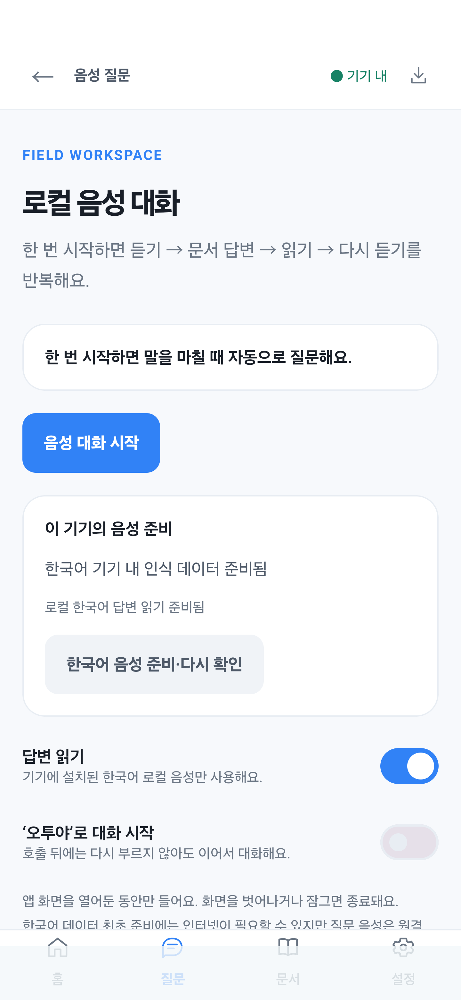

# Android 설치형 앱의 로컬 연속 음성 대화

갱신: 2026-10-27. 이 문서는 **Android APK**의 구현이다. 웹/PWA의 Whisper/WASM 구현은 [별도 문서](webapp/LOCAL_VOICE.md)를 따른다.

2026-10-30 화면 변경: 채팅의 상시 음성 상태 박스를 제거했다. 마이크를 누르면 전용 대화 화면으로 이동해 한 번 시작하고, 질문·답변·원문 출처를 그 화면에서 이어 표시한다. 인식 직후 채팅으로 강제 이동하지 않는다. [채팅/음성 변경 검증](validation/android-chat-voice-20261030.json). 현재 새 화면의 실기기 터치·음성 왕복은 미검증이다.

## 앱에서 사용하는 방법

1. `O₂ Field Guard` 앱을 열고 **질문의 마이크**를 누른다. 전용 음성 화면을 열고 대화를 시작한다. 최초 마이크 권한을 허용한다. 권한 창/화면 이동으로 대화가 종료되었다면 전용 화면의 시작을 다시 누른다. 설정 메뉴로 음성 화면만 연 경우에도 시작을 누른다.
2. 듣는 중 표시가 나오면 말한다. 문장이 끝나면 OS 로컬 인식 결과를 기존 문서 검색·기기 내 AI로 전달한다. 인식된 질문과 답변·출처를 전용 화면의 대화 목록에서 확인한다.
3. 설치된 로컬 한국어 음성으로 답변을 읽고, 읽기가 완료되면 잠시 뒤 다음 질문을 듣는다. 매 질문마다 버튼을 누르거나 누르고 있을 필요가 없다.
4. **음성 대화 종료**, 텍스트 채팅으로 돌아가기, 채팅/음성 외 화면으로 이동, 앱 숨김·잠금으로 인식·읽기를 종료한다. 복귀 시 자동으로 마이크를 재시작하지 않는다. ‘음성 대화 종료’라고 말해도 종료한다. 원문을 확인했다가 돌아올 때도 화면은 음성으로 복귀하되 마이크를 자동 재개하지 않는다.
5. 전용 화면의 **음성 설정**에서 로컬 준비 상태·답변 읽기·‘오투야’ 호출 대기를 설정한다. ‘오투야’ 뒤에 질문을 바로 말해도 보존하며, 호출 후에는 재호출 없이 연속 대화한다.

이 앱은 웹용 약 65MB 음성 파일을 사용하지 않는다. Android 12 이상에서 `createOnDeviceSpeechRecognizer`로 기기의 로컬 인식 서비스를 사용한다. 한국어가 없으면 지원 서비스의 **한국어 음성 준비·다시 확인**을 사용한다(Android 13 이상, 진행 콜백은 14 이상). 서비스가 이를 지원하지 않으면 기기 음성 서비스 설정에서 로컬 한국어를 준비해야 한다. 처음 언어 설치에는 인터넷이 필요할 수 있다. 일반 `createSpeechRecognizer`·서버 인식·외부 음성 입력 화면으로 전환하지 않는다. Android 8~11 또는 서비스 미지원 기기는 텍스트 질문을 사용한다.

읽기는 한국어이면서 `isNetworkConnectionRequired=false`이고 미설치로 표시되지 않은 OS 음성만 선택한다. 로컬 읽기 음성이 없거나 실패하면 설명 후 멈춘다. **답변 읽기**를 끄고 음성 질문+화면 답변으로 사용할 수 있다. 문서/AI 모델도 기기에 준비되어 있어야 완전 오프라인 답변이 가능하다.

## 수정한 문제

이전 앱은 한 문장 인식 후 종료되었고 TTS 완료 콜백은 비어 있었다. ‘오투야’ 대기 역시 질문을 받으면 꺼졌으며, 전역 `suppressNextError`가 다음 인식의 오류를 숨길 수 있었다. 화면에 문서 근거가 있어도 음성은 일반 안내만 하거나 두 문장 위주로 잘랐다. TTS 서비스의 패키지 조회 선언도 빠져 있었다.

이제 시도 ID를 붙인 루프가 `듣기 → 답변 대기 → 읽기 → 다음 듣기`를 관리한다. 인식 결과를 받으면 해당 recognizer를 닫고 답변을 처리한다. 읽는 동안 recognizer를 열지 않는다. 정상 TTS 마지막 조각의 `onDone` 후 550ms 쉬고 다시 듣는다. 침묵/인식 없음은 지연 후 재대기하며 인식기 사용 중 오류는 2회까지만 재시도한다. 권한·언어·네트워크·읽기 오류는 종료 안내하고 자동 루프를 만들지 않는다.

오래된 인식·답변·읽기 콜백과 예약 작업은 ID/phase/세대 검사로 무시한다. 인식 준비 무응답·발화/결과 지연·답변 5분·읽기 조각 90초에 watchdog을 둔다. 한국어 지원 조회는 15초, 데이터 준비 완료 대기는 120초로 제한한다. 서비스의 문장 종료/침묵 판정 시간은 OS가 정하며 앱에서 웹처럼 1.2초로 고정하지 않는다. OS SpeechRecognizer는 전용 상시 호출어 엔진이 아니므로 전경 시험용이며 전력 소모·현장 소음 동작은 추가 검증이 필요하다.

답변 전체를 Markdown 표시와 출처 메타데이터만 정리하여 300자 이하 조각으로 읽는다. 표의 값과 늦게 나오는 조건을 버리지 않는다. 모델 응답이 없어 문서 근거로 답한 경우에도 화면의 실제 본문을 읽는다. 음성 종료는 인식·읽기를 중단하고 늦은 답변을 말하지 않게 한다. 이미 시작된 문서/AI 답변 자체는 화면에서 완료될 수 있으며 강제로 네이티브 추론 엔진을 죽이지 않는다. 기기 메모리·한국어 인식 정확도를 보장하는 기능은 아니다.

## 실제 코드 경로

| 경로 | 역할 |
|---|---|
| `app/src/main/java/com/minyook/sllm2/ui/VoiceConversationLoop.kt` | 순수 Kotlin 상태 흐름·시도 ID·중단·읽기 조각 |
| `app/src/main/java/com/minyook/sllm2/ui/VoiceConversationController.kt` | Android 로컬 STT/TTS·지원 조회·언어 준비·watchdog |
| `app/src/main/java/com/minyook/sllm2/MainActivity.kt` | 마이크 권한·화면/생명주기·답변 콜백 |
| `app/src/main/java/com/minyook/sllm2/ui/FieldGuardViewModel.kt` | 기존 RAG/AI 연결·실제 본문 읽기·실패 전달 |
| `app/src/main/java/com/minyook/sllm2/ui/WorkspaceScreens.kt` | 채팅의 시작/종료·인식 문장·읽기 상태 |
| `app/src/main/java/com/minyook/sllm2/ui/TossFieldGuardApp.kt` | 네이티브 음성 설정 화면 |
| `app/src/main/AndroidManifest.xml` | 마이크 권한·STT/TTS 서비스 조회 |
| `app/src/test/java/com/minyook/sllm2/ui/VoiceConversationLoopTest.kt` | 반복 대화·재입력·늦은 결과·종료·실패 검사 |
| `app/src/androidTest/java/com/minyook/sllm2/NativeVoiceSupportTest.kt` | 실제 기기 읽기 전용 지원 조회 |
| `app/src/androidTest/java/com/minyook/sllm2/NativeVoiceUiTest.kt` | 실제 Compose 버튼/설정/읽기 상태 검사 |

## 빌드와 확인 결과

저장소 루트에서 다음을 실행한다. 이 PC JDK는 `C:\Program Files\Android\Android Studio1\jbr`다.

```powershell
.\gradlew.bat :app:testDebugUnitTest :app:assembleDebug :app:assembleDebugAndroidTest
```

APK: `app/build/outputs/apk/debug/app-debug.apk`. 원래 앱과 같은 서명으로 `adb install -r` 업데이트하며 앱 삭제·데이터 초기화를 하지 않는다. 이번 연결 S24의 기존 APK는 Git 제외 경로 `tmp/native-voice/previous-app.apk`에 보관했다.

2026-10-27 **JVM 32개**, S24 Ultra(SM-S928N, Android 16/API 36) **계측 4개** 통과. [지원 조회 결과](android-voice-support-2026-10-27.txt)에서 `onDeviceRecognition=true`, 설치 언어 `ko-KR`, 로컬 한국어 TTS 5개를 확인했다. 앱/테스트 APK를 실제 기기에 업데이트했다. 아래 화면은 S24에서 렌더링한 **가상 음성 상태의 Compose UI 검사**이며 실제로 녹음하거나 말하는 장면은 아니다.



[채팅 연속 대화 표시](screenshots/android-native-voice-listening.png). 검사는 실제 마이크를 켜거나 권한을 강제로 부여하거나 언어/AI 모델을 다운로드하지 않았다. **실제 발화→인식→문서/AI→읽기 왕복, 비행기 모드 반복 질문, 소음·잠금·발열·장시간 안정성은 별도 시험이 필요**하다. 설치된 언어 조회/가상 UI 성공을 음성 정확도·완전 오프라인 왕복의 성공으로 간주하지 않는다.
