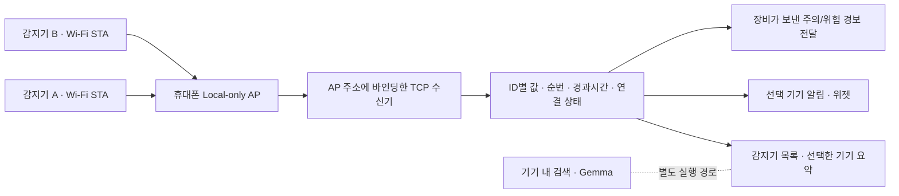

# Android 스마트폰 AP 센서 수신 설계

갱신: 2026-11-04. 상태: **장비 통신 규격 협의 전 프로토타입**. Android 앱의 BLE 코드·권한·검색 화면과 자동 가스 데모 서비스를 제거하고 스마트폰 AP 수신으로 전환했다. 웹/PWA 파일은 보존했다.

## 연결 구조



휴대폰이 AP를 만들고 감지기는 클라이언트로 접속한다. 인터넷 테더링을 켜는 방식이 아니며 SIM·모바일 데이터·인터넷 서버가 센서 통신에 필요하지 않다. 앱에서 AP를 켜도 실제 감지기 펌웨어가 동일한 TCP 규격을 구현해야 수치를 받을 수 있다. 기본 문서/모델 최초 다운로드와 작업 승인 서버는 별도 네트워크 조건을 가진다.

## 앱 사용

1. 메뉴의 **센서 연결 상태**로 이동해 **휴대폰 AP 시작**을 누른다.
2. Android 13+는 주변 기기, Android 12L 이하는 위치 권한을 허용한다. Android 17+는 로컬 네트워크 권한도 요청한다. 구형 Android에서는 시스템 위치 서비스가 켜져 있어야 AP를 만들 수 있다. 알림 권한 거부는 수신 자체를 막지 않지만 알림 패널 표시가 제한될 수 있다.
3. 표시한 Wi-Fi 이름/암호로 감지기를 연결하고 수신 주소·포트·연결 코드를 입력한다. **실제 AP IPv4 주소를 확인해 표시하며 고정 IP를 가정하지 않는다.**
4. 연결한 감지기를 ID별로 확인한다. ‘요약에 표시’를 누르면 홈·알림·위젯은 그 감지기 하나의 값만 보여준다. 다른 장비 값을 합치거나 끊긴 장비 대신 임의로 바꾸지 않는다.
5. **AP 끄기**를 누르면 소켓과 AP 예약을 해제한다. 다시 켜면 연결 정보를 다시 확인한다. OS가 앱을 종료한 뒤에는 AP를 자동으로 다시 켜지 않는다.

Android 16/API 36.1 이상은 공개 `SoftApConfiguration.Builder` API로 WPA2·2.4 GHz·임의 연결 정보를 지정한다. 이전 버전은 `startLocalOnlyHotspot`이 제공하는 실제 SSID·암호와 OS가 선택한 대역을 사용한다. 기존 핫스팟과 충돌하거나 AP 주소를 하나로 확정할 수 없으면 오류를 표시하고 예약을 해제한다. 일반 인터넷 핫스팟으로 조용히 바꾸지 않는다.

코드의 **동시 TCP 연결 한도 16개는 소프트웨어 보호 한도**다. 휴대폰 AP의 최대 무선 접속 수나 실제 감지기 16대 지원을 의미하지 않는다. S24·감지기 펌웨어의 실제 AP 수용량·거리·차폐·화면 잠금·배터리 절약·발열 조건은 실기기에서 별도로 측정해야 한다.

## 시험 규격 v1

TCP 포트 기본값 **8765**, UTF-8 JSON 한 개당 LF(`\n`) 하나. 한 프레임은 LF 제외 최대 **8192바이트**. TCP 패킷 하나와 JSON 프레임 하나가 같다고 가정하지 않으며 분할/병합 수신을 처리한다. 제조사 공식 규격으로 확정한 값이 아니다.

감지기의 최초 메시지 예시(코드는 앱에 표시된 값을 사용):

```json
{"type":"hello","protocol":1,"token":"<앱의 연결 코드>","deviceId":"meter-001","name":"감지기 1","test":false,"intervalMs":1000}
```

- `deviceId`: 1~48자 ASCII 영문·숫자·`._-`, 동시에 연결한 장비 사이에서 고유해야 한다. 다른 살아 있는 연결의 ID로 덮어쓸 수 없다.
- `name`: 생략하면 ID, 최대 64자. `test`는 필수 Boolean. 테스트 송신기는 **반드시 true**로 보낸다.
- `intervalMs`: 정수 100~60000ms. 앱은 기기별로 이 값을 사용해 신선도를 확인한다.
- `token`: AP 세션마다 새로 만든 128비트 연결 코드. hello에서 확인하며 로그/설정 파일에 저장하지 않는다.
- 수락 시 `{"type":"welcome","protocol":1,"deviceId":"meter-001","pingIntervalMs":5000}`를 보낸다. 규격/코드/ID 오류 시 `error`를 보내고 연결을 닫는다.

측정 메시지:

```json
{"type":"reading","seq":1,"sampleAgeMs":0,"o2Percent":20.9,"h2sPpm":0,"coPpm":2,"lelPercent":0,"status":"ok","alarm":"none"}
```

| 필드 | 의미·검사 |
|---|---|
| `seq` | 연결 안에서 증가하는 정수, 0~9007199254740991. 재접속하면 새 순번으로 시작 가능 |
| `sampleAgeMs` | 이 프레임을 보낼 때 원래 센서 측정 이후 경과한 정수 ms, 0~300000. 송신 전에 센서 측정 버퍼에 머문 시간을 반영하기 위해 필수 |
| `o2Percent` | 산소 vol%, 숫자 0~100 |
| `h2sPpm` | 황화수소 ppm, 숫자 0~1000 |
| `coPpm` | 일산화탄소 ppm, 숫자 0~10000 |
| `lelPercent` | %LEL, 숫자 0~100 |
| `status` | `ok` 또는 `fault`. `ok`는 하나 이상의 채널 필수. `fault`는 모든 채널 생략 가능 |
| `alarm` | 장비가 판정한 `none` / `warning` / `danger` / `unknown`. 수신기가 농도에서 자동 생성한 판정이 아님 |

위 숫자 범위는 **파싱 허용 범위**이며 안전 기준·법적 기준·교정 검증이 아니다. 없는 채널/JSON null은 ‘—’로 표시한다. 숫자 문자열·범위 초과·알 수 없는 필드는 거부한다. 임의 CSV·키=값을 가스값으로 추측하지 않는다. `none`은 장비가 보낸 경보 상태이며 앱의 작업 가능 판정이 아니다.

각 프레임 수신 후 `{"type":"ack","seq":1,"accepted":true}`를 보낸다. 중복/역순은 `accepted:false`이며 수신 경과시간을 갱신하지 않는다. 순번 누락은 장비별로 집계한다. TCP는 바이트 전송을 보장하지만 미전송·생성 누락까지 보장하지 않으므로 순번으로 따로 확인한다.

서버는 5초마다 `{"type":"ping","id":"<임의 값>"}`를 보낸다. 감지기는 `{"type":"pong","id":"<같은 값>"}`으로 응답해야 한다. AP 시작 콜백이 20초 동안 없거나 시작 후 주소를 8초 안에 확인하지 못하면 중단한다. hello 미수신은 5초, 인증 이후 소켓 무응답은 15초에 연결을 닫는다. 측정 간격이 길어도 ping/pong은 응답해야 한다. 다른 메시지·잘못된 프레임은 오류를 보내고 닫는다. 재접속은 송신기 쪽에서 지수 백오프와 지터를 두고 구현한다. 이전 소켓의 늦은 종료가 새 연결을 끊지 않도록 소유권을 확인한다.

## 신선도와 속도

장비마다 `max(3000ms, intervalMs × 3)`를 신선도 한도로 둔다. 서버의 단조 시계로 **센서가 보낸 경과시간 + 수신 후 경과시간**을 합산한다. 연결만 살아 있거나 pong을 받았다는 이유로 측정값을 최신으로 갱신하지 않는다. 오류·끊김·한도 초과는 현재 채널을 가리고 재접속 후 첫 유효 프레임까지 과거 숫자를 현재값으로 복원하지 않는다. 위젯은 선택한 기기의 유효 시간과 AP 실행 상태도 확인한다.

센서 오류 프레임에 장비의 주의/위험 경보가 함께 있으면 최신 프레임인 동안 그 경보는 전달하고 숫자만 숨긴다. 오래된 오류 프레임의 경보를 새로 수신한 경보로 다시 발생시키지 않는다.

화면 상태는 250ms 주기로 합치고 알림·위젯/저장은 최대 1초 간격으로 갱신해 패킷마다 UI/디스크 작업을 발생시키지 않는다. 따라서 패킷 ACK, 화면 반영, 알림/위젯 반영 시간은 서로 다르다.

UI의 **왕복 ms**는 휴대폰에서 ping을 보낸 시점부터 동일한 pong을 받은 시점까지 단조 시계로 측정한 RTT다. 동기화하지 않은 감지기 시각과 휴대폰 시각을 빼서 편도 지연을 만든 값이 아니다. 측정기 센서 갱신·샘플 대기·RF 재전송까지 포함한 종단 지연은 실제 장비로 별도 시험해야 한다. 임의로 ‘항상 1ms’ 같은 보장치를 두지 않았다. `sampleAgeMs`는 송신 전 경과시간이므로 송신 이후 TCP 버퍼/무선 재전송에서 지연된 시간까지 검증하지는 못한다. 제조사 연동 시 센서 단조 시각·최근 샘플 요청/응답·버퍼 폐기 정책을 추가로 확정해야 하며 현재 표시된 경과시간을 절대적인 센서 종단 지연으로 해석하면 안 된다.

## 실행과 테스트 송신기

APK: `app/build/outputs/apk/debug/app-debug.apk` (현재 PC에는 빌드 결과를 보존). 기존 모델/대화가 있는 기기는 삭제하지 않고 같은 서명의 APK로 업데이트한다.

PC 또는 다른 Wi-Fi 지원 장비를 휴대폰 AP에 연결한 뒤 Node.js로 시험 송신기를 실행한다. 인터넷·외부 패키지는 필요 없다.

```powershell
$env:FIELDGUARD_AP_TOKEN='<앱 연결 코드>'
node tools/wifi-ap-sender.mjs --host <앱의 AP 주소> --count 2 --interval 1000 --seconds 30
Remove-Item Env:FIELDGUARD_AP_TOKEN
```

항상 `test:true`, 기기별 고유 ID와 구분되는 가상 수치를 전송하고 ping/pong·ACK·재연결을 처리한다. 종료 시 ACK 왕복 중앙값/P95/최대·성공/거부 수를 출력한다. AP 암호나 연결 코드는 출력하지 않는다. 장비 RF 성능, 물리 센서 응답 시간, 실제 기기 수용량의 증명으로 이 PC 모의 송신 수치를 사용하면 안 된다.

## 파일 경로

모두 저장소 루트 기준이다.

| 파일 | 역할 |
|---|---|
| `app/src/main/java/com/minyook/sllm2/gas/GasMonitoringService.kt` | Local-only AP 예약·주소 확인·포그라운드 수신·정리·알림/경보 전달 |
| `app/src/main/java/com/minyook/sllm2/gas/WifiMeterProtocol.kt` | 유계 UTF-8 프레임·단위/필드 검사·연결 소유권·장비별 순번/신선도 |
| `app/src/main/java/com/minyook/sllm2/gas/WifiMeterServer.kt` | AP IPv4에 바인딩한 TCP, 동시 연결 한도·인증·ACK·heartbeat·종료 |
| `app/src/main/java/com/minyook/sllm2/gas/WifiApState.kt` | 메모리 안의 AP 연결 정보·선택 장비·StateFlow |
| `app/src/main/java/com/minyook/sllm2/gas/GasReading.kt` | 선택 장비 요약·마지막 값 저장, 종료된 세션은 현재값으로 복원하지 않음 |
| `app/src/main/java/com/minyook/sllm2/gas/GasWidgetProvider.kt` | 선택 장비의 최신 수치 위젯 |
| `app/src/main/java/com/minyook/sllm2/ui/TossFieldGuardApp.kt` | `WifiApSensorScreen`: 시작/종료·연결 정보·감지기별 상태·요약 선택 |
| `app/src/main/java/com/minyook/sllm2/ui/FieldGuardViewModel.kt` | AP 상태 관찰·시작/종료·선택과 기존 앱 상태 연결 |
| `app/src/main/java/com/minyook/sllm2/MainActivity.kt` | AP 시작 시 필요한 런타임 권한 요청 |
| `app/src/main/AndroidManifest.xml` | Wi-Fi/AP/로컬 네트워크·connectedDevice FGS 권한. Bluetooth 권한 없음 |
| `app/src/test/java/com/minyook/sllm2/gas/WifiMeterProtocolTest.kt` | 프레임/단위/버전/인증 및 장비 격리·신선도 회귀 검사 |
| `app/src/test/java/com/minyook/sllm2/gas/WifiMeterServerTest.kt` | 실제 loopback TCP 동시 송신·분할/병합·오류/종료·RTT 검사 |
| `tools/wifi-ap-sender.mjs` | 별도 PC에서 동작하는 명시적 테스트 송신기 |

`BleGasClient.kt`, `GasSimulationService.kt`, 이전 관대한 BLE 패킷 파서는 제거했다. 모델 다운로드/READY 이후 자동 가상 측정 서비스 시작도 제거했다. 테스트 수치는 외부 시험 송신기를 명시적으로 실행할 때만 들어온다.

## 검증 경계와 다음 작업

이번 사용자는 **APK·코드 검사까지** 진행하도록 요청했다. 연결된 실기기가 없어 AP 생성·권한 UI·휴대폰 화면 렌더링·실제 감지기 무선 송신은 미실행이다. 컴파일/정적 검사/PC TCP 통신 시험을 실기기 AP 성공으로 표시하지 않는다. 최종 검사는 **단위 테스트 92개 통과 / 2개 선택 실행 평가 제외**, **Lint 오류 0개 / 경고 118개**, 디버그 APK·계측 테스트 APK 빌드 통과다. 신규 프로토콜/registry/TCP 검사는 16개이며 loopback에서 송신기 10개의 1,000개 측정 프레임을 처리했다. Node 시험 송신기는 로컬 mock에 3개 ID로 45개 프레임을 보내 ACK/heartbeat를 확인했다. 검사 수치·APK SHA-256은 `docs/validation/android-wifi-ap-20261104.json`에 기록했다.

상용 장비 연동 전에는 제조사와 다음을 확정해야 한다: Wi-Fi STA 지원/2.4 GHz, TCP 클라이언트 지원, 최대 센서 수, 전송 주기, 채널별 단위·오류 코드·검교정 상태, 장비 ID, 재접속, 경보 전달, 시간/순번, 인증·업데이트 정책. AP 암호와 앱 연결 코드는 세션 단위 공유 인증이며 개인/장비 신원 인증이나 TLS·메시지 서명 구현은 아니다. 현재 JSON TCP는 평문 애플리케이션 프로토콜이므로 운영용 인증·암호화는 장비 펌웨어와 함께 설계한다. 앱은 AP 인터페이스 주소에만 수신을 열고 외부 인터넷 서버나 모든 인터페이스에 노출하지 않는다.

수신/알림은 모델 생성과 별도 스레드/서비스 경로이지만 **같은 Android 프로세스**에 있다. AI 네이티브 크래시/OOM에도 감지가 유지된다고 보장하지 않는다. 센서 자체 경보를 우선 유지하고 별도 프로세스·안전 인터록·알람 SLA 검증은 후속 범위다.

참조: [Android Local-only hotspot](https://developer.android.com/develop/connectivity/wifi/localonlyhotspot), [SoftApConfiguration.Builder 공개 API](https://developer.android.com/reference/android/net/wifi/SoftApConfiguration.Builder), [로컬 네트워크 권한](https://developer.android.com/privacy-and-security/local-network-permission), [connectedDevice FGS](https://developer.android.com/develop/background-work/services/fgs/service-types#connected-device).

## 추가 TCP 스트레스 검사 (2026-11-04)

운영 코드 수정 없이 16개 동시 송신·서버 재시작·상한/시간 초과·100회 재접속·불량 송신기 격리의 7개 시나리오를 추가했고 모두 통과했다. 전체 JVM 99개 통과, 선택 실행 2개 제외다. 실제 수신기와 Node 송신기를 사용한 PC loopback 결과이며 AP/무선 시험과 구분한다. [상세 결과·재실행 명령](validation/android-wifi-ap-stress-20261104.md).
