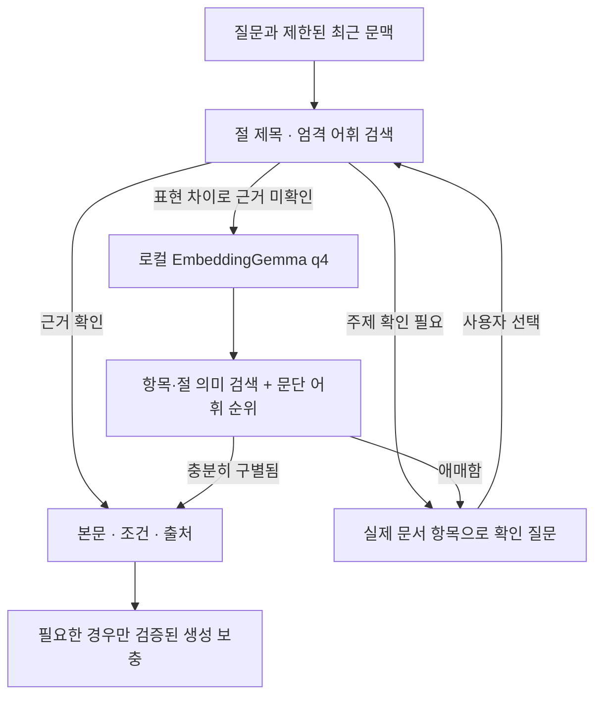

# 문장 의미 검색과 확인 대화

Android의 현재 질문 경로는 [문서 우선·의미 재검토·일반 지식 답변](ANDROID_REVIEWED_RAG.md)이다. 아래 최초 도입 설명의 ‘근거 미확인일 때만 의미 검색’과 달리 현재는 일반 어휘 후보도 의미 재검토한다. 문서 직접 근거를 확인하지 못한 경우 별도 안내와 함께 일반 지식 생성을 허용한다. 웹은 보존된 기존 구현이며 변경하지 않았다.

현재 개발 대상은 **Android 앱**이며 웹/PWA 파일은 보존합니다. 아래 앱·웹 공통 설명은 최초 의미 검색 도입 기록입니다. 이후 Android에만 추가한 [장비 목록 검색](ANDROID_EQUIPMENT_SEARCH.md)은 일반 목록과 의미가 모호한 질문을 구분하며, 여러 용도의 근거를 한 답변에 모읍니다. 기존 웹의 검색 동작까지 같아졌다는 뜻은 아닙니다.

갱신: 2026-10-29. Android와 웹/PWA의 새 질문에 적용한다. 원본 PDF, ObjectBox 페이지/벡터 스키마, 과거 기록과 Gemma/Qwen 모델은 유지한다.

## 동작



기존 해시 벡터는 학습된 의미 임베딩이 아니다. 이번에는 **EmbeddingGemma 300M q4**를 실제 실행한다. 명확한 기존 검색은 매번 신경망으로 다시 처리하지 않는다. 어휘 일치 기준을 통과한 문서에만 의미 검색을 적용하는 구조도 아니다.

원자 항목 329개와 같은 절의 연결 문맥 64개, **393개**를 PC에서 미리 임베딩한다. 질문별 정답 페이지 표나 대화 빈도는 인덱스에 넣지 않는다. 원본 페이지 본문을 함께 묶어 현재 문서와 다른 항목은 사용하지 않는다. 문서 입력은 `title: 절 제목 | text: 원문`, 질문은 `task: search result | query: 질문`이며 정규화한 768차원 벡터를 쓴다. 문서 검색 벡터는 최대 384토큰으로 계산하지만 표시 본문을 그 길이로 자르지 않는다. 기기 질문이 256토큰을 넘으면 임의 절단하지 않고 기본 검색/질문 분할 안내로 돌아간다.

의미 후보와 문단 어휘(IDF·길이) 후보를 RRF로 합친다. 코사인과 다른 페이지와의 차이는 보수적인 휴리스틱이며 **정답 확률이 아니다**. 기존 엄격 검색이 확인한 본문을 유지한다. 학습된 재정렬기나 현장 작업 판정 모델은 추가하지 않았다.

선택 절의 조건/예외를 보존한다. 바로 앞 괄호 주제 문단이 해당 절의 자격/적용 요건을 설명하면 함께 붙인다. ‘측정자의 자격’에서 ‘올바른 해석’ 요건이 누락되는 회귀로 확인한 연결이다. 앱과 웹은 같은 패키지의 원문 항목을 사용한다.

## 확인 대화

- 직접 근거가 있으면 본문·조건과 쪽 출처를 표시한다.
- 넓거나 애매하면 대상/방법/시기를 확인하고 실제 절 제목을 최대 3개 선택지로 제공한다. 관련성도 부족하면 선택지를 강제 생성하지 않는다.
- 전등 주제가 있어도 전압·IP 등급·가격 등 요청 사양을 다른 정보로 대신 답하지 않는다. ‘현재 문서 근거로 확인하지 못했다’고 안내한다. 모든 부재 속성을 검출하는 기능은 아니다.
- 실시간 승인 질문은 문서로 완료 여부를 추측하지 않고 작업 전 점검 화면을 안내한다.
- 브라우저 작업 완료 미확인은 자동 재적재를 멈추며 **의미 검색 파일 확인·복구**로 재시도한다. 종료 원인을 Jetsam으로 단정하지 않는다.

명시적인 후속 질문에만 최근 질문 문맥을 제한적으로 연결한다. 독립 새 질문에 지난 주제를 붙이지 않는다. 모든 지시어·주제 전환을 이해하는 모델은 아니다. 선택지와 해석 질문을 새 기록에도 저장한다.

일반 절차는 본문을 바로 표시한다. 이유/뜻/차이 설명이 필요한 경우만 생성 모델을 호출한다. PC Gemma도 공통 계획을 전달받으면 JSON 근거 ID·수치·조건·중복 검사를 통과한 보충만 덧붙인다. 예산이 부족하면 조건을 잘라 넣지 않고 본문을 유지한다.

## 준비와 메모리

**Android:** 검색 모델은 APK에 포함한다. 기존 앱 위에 업데이트하며 대형 Gemma 답변 모델은 재다운로드하지 않는다. ONNX Runtime 1.22.0 CPU로 질문만 임베딩하고 세션/텐서를 닫는다. 검색 인코더 실행 전 생성 엔진을 해제한다. APK와 내부 사본 때문에 추가 저장 공간이 필요하다.

**웹/PWA:** 설정 → **문장 의미 검색 준비**. 모델/토크나이저 약 220MB와 CPU WASM을 저장한다. 대용량 모델은 기본 PWA 셸에서 자동 사전 캐시하지 않는다. 고정 버전·SHA-256·크기를 확인하며 스트리밍 저장하고 실제 필수 파일도 확인한다. 준비 후 질문을 서버/Hugging Face로 보내지 않는다. Worker는 캐시와 로컬 blob 실행 파일만 읽으며 그 외 fetch를 거부한다.

검색·음성 인식·생성 모델은 공통 실행 잠금을 쓴다. 다운로드 전에도 생성 모델을 정리한다. 검색 Worker는 한 질문 후 세션을 정리하고 종료한다. 취소·시간 초과·정리 미확인은 다음 자동 적재를 차단한다. 즉각적인 메모리 회수나 실제 iPhone 안정성 보장은 아니다.

검색 모델과 답변 모델은 별개다. [EmbeddingGemma 설명](https://ai.google.dev/gemma/docs/embeddinggemma), [Gemma 이용 조건](https://ai.google.dev/gemma/terms), [고정 ONNX 출처](https://huggingface.co/onnx-community/embeddinggemma-300m-ONNX/tree/5090578d9565bb06545b4552f76e6bc2c93e4a66). 가중치는 Git에 넣지 않고 버전/해시로 준비한다.

## 파일 경로와 재현

| 경로 | 역할 |
|---|---|
| `tools/prepare-semantic.mjs`, `tools/semantic-model-files.json` | 모델 준비·무결성 검사·앱/웹 복사 |
| `web/scripts/build-semantic-index.mjs` | PC ONNX CPU 문서 벡터 생성 |
| `app/src/main/assets/knowledge/semantic-index-v1.json` | 공통 393개 항목/절·벡터·원문 연결 |
| `app/src/main/assets/semantic-model/` | 생성된 앱 모델 자산, Git 제외 |
| `web/public/semantic-model/` | 생성된 웹 모델 자산, Git 제외 |
| `web/src/rag/semantic-passages.ts`, `hybrid.ts` | 문단 구성·검색 결합·확인 정책 |
| `web/src/rag/semantic-assets.ts`, `semantic-runtime.ts`, `semantic.worker.ts` | 검증 저장·잠금·완료 기록·WASM |
| `app/src/main/java/com/minyook/sllm2/data/SemanticTokenizer.kt` | 고정 Gemma BPE·byte fallback |
| `app/src/main/java/com/minyook/sllm2/data/SemanticEncoder.kt` | Android CPU 임베딩·수명 관리 |
| `app/src/main/java/com/minyook/sllm2/data/HybridRetrieval.kt` | 네이티브 검색·확인 정책 |
| `app/src/main/java/com/minyook/sllm2/ui/FieldGuardViewModel.kt` | 텍스트/음성 공통 흐름 |
| `web/src/App.tsx`, `web/src/features/Settings.tsx` | 질문/선택지·준비 화면 |
| `web/tests/deep-questions.json` | 구어체·조건·정보 부재 심화 40문항 |
| `web/scripts/evaluate-semantic.mjs` | 실제 추론·전후 개발 평가 |
| `app/src/test/resources/semantic-*.json` | 실제 토큰/질문 벡터·앱/웹 비교 자료 |

최초 준비는 저장소 `web/`에서 한다. 한 번 다운로드한 모델은 해시 확인 후 재사용한다.

```powershell
cd web
npm ci
npm run prepare:assets
npm run dev
# 별도 검사
npm test
npm run evaluate:semantic
npm run build
cd ..
.\gradlew.bat :app:testDebugUnitTest :app:assembleDebug :app:assembleDebugAndroidTest
```

Gradle `verifySemanticAssets`가 모델 크기·SHA-256과 인덱스 버전을 확인한다. 준비를 생략한 새 체크아웃은 안내 오류로 멈춘다. 원문 해시 변경 시 인덱스를 다시 생성한다. APK는 `app/build/outputs/apk/debug/app-debug.apk`다.

## 평가 범위

기존 150+33문항에 심화 40문항을 추가했다. 심화는 답이 있는 34문항과 정보 부재·실시간 상태·확인 6문항이다. **개발 집합이며 독립 holdout 정확도가 아니다.** [PC 실제 평가](validation/semantic-rag-20261029.json)는 쪽·필수 본문 구절을 검사하며 생성 답변의 의미 정확도를 측정하지 않는다.

심화 34문항의 직접 근거 반환은 기존 2개에서 14개로 늘었다. 나머지 20개는 확인 대화가 필요하다. 별도 6개도 기대 동작으로 처리하여 전체 40개 중 기준 통과는 20개다. 이 집합의 잘못된 정답 쪽 반환은 0개였지만 모든 새 질문에 오답이 없다는 뜻은 아니다. 실제 발화·소음·부정/복합 조건·독립 미지 질문과 도메인 검수가 남아 있다.

PC 브라우저 WASM에서 준비, ‘휴대용 불빛’ → 방폭 전등/27쪽, 두 번째 ‘측정’의 선택지를 확인했다. [답변 화면](screenshots/semantic-lamp-browser-20261029.jpg). 최초 개발 의존성 최적화 재로드는 완료 미확인으로 처리하고 명시적으로 복구한 뒤 재시험했다. 실제 iPhone과 변경 후 Android 기기의 메모리·연속 음성 왕복은 별도 검증 사항이다.

최종 검사: 웹 45개 파일 542개, Android JVM 53개 통과. TypeScript/Vite/PWA와 앱·테스트 APK 빌드 성공. 제공 APK 사본: tmp/semantic-rag/fieldguard-semantic-20261029.apk (390,889,922 bytes; SHA-256 f903f62f4d84568470085dffb2ad064641fd900ac06d7bd447229bdcf69f3123). 실기기에는 설치하지 않았다.

복합 질문에서 일부만 확인되면 확인된 본문을 제공하고 미확인 주제를 이름으로 표시한다. 미확인 조건을 생성 보충으로 채우지 않는다. 실제 브라우저에서 심폐소생술+전등 IP 등급의 분리 안내도 확인했다. QA 탭·서버는 정리했다.
