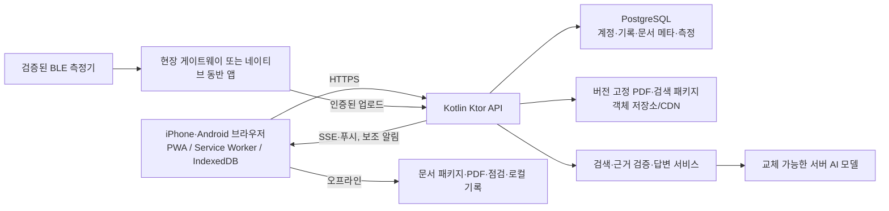

# O₂ Field Guard 웹앱 전환 권고안

작성일: 2026-10-07
상태: **향후 웹앱의 권고 설계**. 이미 구현된 Android 앱의 설계서는 [Android 앱 현행 설계서](../ANDROID_APP_SPEC.md)다. 실제 계측기 프로토콜, 운영 인증 방식, 현장 네트워크 조건은 확정 전이다.

## 1. 목표와 경계

현재 프로젝트는 밀폐공간 안전작업 문서 2종의 87개 쪽별 근거를 검색하고, Gemma 4 E2B로 기기 안에서 답변하며, BLE 가스 측정값과 데모값을 구분하는 Android 프로토타입이다. 현재 구현 사실은 [Android 앱 현행 설계서](../ANDROID_APP_SPEC.md)를 기준으로 한다. 이 문서는 같은 **질문 → 근거 확인 → 현장 확인** 흐름을 iPhone과 Android의 일반 브라우저에서 제공하기 위한 **목표 아키텍처 제안**이다. [오프라인 RAG 설계](../OFFLINE_RAG_ARCHITECTURE.md)와 [클릭 가능한 웹 UI 시안](../webapp-ui/index.html)을 참고한다.

**권장 제품 형태는 HTTPS로 제공하는 모바일 우선 PWA + 서버 RAG + 선택적 측정기 게이트웨이**다. PWA는 문서, 출처, 점검, 기록의 공통 경험을 제공한다. 온라인일 때 서버가 AI 답변과 기기 간 동기화를 제공한다. 오프라인이면 저장된 문서 검색과 근거 열람, 로컬 점검을 계속 쓰되 AI 생성과 원격 센서 수신은 사용할 수 없다고 명확히 표시한다.

이 설계의 “어느 핸드폰”은 **현행 iPhone·Android의 표준 브라우저에서 핵심 화면과 문서 기능을 제공**한다는 뜻이다. 모든 기기에서 브라우저가 BLE, 백그라운드 감시, 대형 온디바이스 모델을 동일하게 지원한다는 뜻은 아니다. 특히 Safari에는 Web Bluetooth가 없고, 서비스 워커는 항상 실행되는 프로세스가 아니다. [WebKit의 Web Bluetooth 입장](https://webkit.org/tracking-prevention/), [MDN Web Bluetooth](https://developer.mozilla.org/en-US/docs/Web/API/Web_Bluetooth_API), [MDN PWA 백그라운드 동작](https://developer.mozilla.org/en-US/docs/Web/Progressive_web_apps/Guides/Offline_and_background_operation)을 근거로 브라우저 단독 BLE 감시를 공통 경로에서 제외한다.

### 제품 원칙

1. 출처 없는 안전 수치나 절차를 AI가 만들어내지 않는다. 답변마다 문서명, 판본, 쪽수, 원본 PDF 링크를 보여준다.
2. 계측값은 출처·기기·수신 시각과 함께 표시한다. 60초 이상 새 유효값이 없거나 연결이 끊기면 현재값은 `—`로 가린다. 이 60초 기준은 현 Android 코드의 표시 규칙이며, 운영 기준은 장비 검증 후 확정한다.
3. 데모값은 운영 계측과 데이터 모델·API·UI에서 분리한다. 데모값으로 작업 가능 여부를 판정하지 않는다.
4. 웹앱은 작업허가, 법정 판단, 긴급 구조 지휘를 대신하지 않는다. 푸시 알림이나 브라우저 탭을 현장 경보의 유일한 수단으로 쓰지 않는다.
5. 온라인/오프라인/동기화 대기/오류를 숨기지 않는다. 저장 성공은 서버 응답을 받은 경우에만 서버 저장으로 표시한다.

## 2. 현재 기능의 웹 전환

| Android 현재 기능 | 웹앱 기본 구현 | 제한·대체 경로 |
| --- | --- | --- |
| 홈, 온보딩, 하단 탭 | 반응형 홈·모바일 하단 탭·데스크톱 사이드바 | 화면 폭 320px 이상에서 정보 누락 없이 표시 |
| 문서 2개, 87개 쪽 검색 | 버전이 고정된 문서 패키지와 검색 인덱스를 브라우저에 저장 | 패키지가 없으면 온라인 검색, 없을 때 정확한 상태 표시 |
| Gemma 4 E2B 로컬 생성 | 서버의 답변 서비스가 검색 근거만 사용해 생성; 스트리밍 표시 | 오프라인/모델 장애 시 근거 원문을 표시. 브라우저 로컬 LLM은 후속 실험 |
| PDF 원본·읽기 보기·추출 텍스트 | 같은 쪽에서 3가지 보기, 앞·뒤 쪽 이동 | PDF와 추출본을 동일한 문서 판본으로 묶음 |
| 채팅·빠른 질문·기록·새 대화 | 동일 흐름, 로컬 임시 저장과 로그인 시 서버 동기화 | 계정 없이 쓸 때는 브라우저별 기록임을 표시 |
| 음성 질문·짧은 음성 답변·호출 대기 | 텍스트 입력은 항상 제공. 음성은 지원 환경에서 명시적 시작 후 사용 | Web Speech 인식은 브라우저마다 다르고 일부는 서버에 음성을 보낸다. 상시 호출 대기는 공통 웹 기능으로 보장하지 않음 |
| BLE 검색·연결·측정·연결 끊김 | 기본 경로는 검증된 게이트웨이 → 서버 → 웹 실시간 화면 | Android Chrome의 직접 Web Bluetooth는 선택적 기능. iPhone의 직접 BLE가 필수면 네이티브 동반 앱 필요 |
| 데모 시뮬레이션 | 개발/시연 모드로 격리, 모든 화면에 `데모 · 실제 측정값 아님` 표시 | 운영 API와 데이터에서 혼합 금지 |
| 작업 전 5항목 점검 | 오프라인 체크·저장·복원·서버 동기화 상태 표시 | 작업허가나 승인으로 해석되지 않음 |
| 로컬 모델·CPU/GPU·문맥/답변 길이 | 사용자 설정은 AI 이용 상태·답변 길이·근거 표시로 재구성 | 서버 CPU/GPU·2.4GB 모델 다운로드는 웹 사용자 화면에 그대로 복제하지 않음. 관리자 진단으로 이동 |
| 내 데이터·삭제 | 브라우저 저장과 서버 저장을 분리해 설명, 각각 삭제/내보내기 | 서버에 데이터를 보내는 정책은 출시 전에 확정 |
| Android 위젯·포그라운드 알림 | 웹 홈 카드와 지원 환경의 선택적 웹 푸시 | OS 홈 화면 위젯 및 지속 감시는 네이티브 기능으로 분리 |

브라우저 음성 인식은 일부 구현에서 서버 기반이므로 기존 Android 앱의 “로컬 음성” 약속을 웹에 그대로 쓰지 않는다. [MDN SpeechRecognition](https://developer.mozilla.org/en-US/docs/Web/API/SpeechRecognition)을 따른다. iOS 웹 푸시는 홈 화면에 추가한 웹앱과 사용자 권한이 필요하다. [WebKit Web Push](https://webkit.org/blog/13878/web-push-for-web-apps-on-ios-and-ipados/).

## 3. 권장 시스템 구조

### 선택한 기술

| 계층 | 추천 | 이유 |
| --- | --- | --- |
| 웹 UI | React + TypeScript + Vite, 라우터, 접근 가능한 HTML/CSS | 현재 시안의 화면을 컴포넌트화하고 모바일 브라우저에 정적 배포하기 쉽다. 특정 프레임워크의 서버 기능에 오프라인 동작을 묶지 않는다. |
| PWA | manifest, Service Worker, Cache API, IndexedDB | 앱 셸·판본이 고정된 PDF/검색 패키지는 캐시, 점검·임시 기록은 IndexedDB에 저장한다. 서비스 워커는 지속 실행을 가정하지 않는다. |
| API | Kotlin/JVM + Ktor | 기존 Kotlin의 순수 검색·검증 로직을 Android 의존성에서 분리해 재사용할 수 있다. SSE로 답변과 상태를 전달할 수 있다. |
| 저장소 | PostgreSQL, PDF 파일용 객체 저장소 | 사용자/문서 판본/기록/센서 이벤트를 관계형으로 관리한다. 87쪽 규모에서 별도 벡터 DB를 먼저 도입하지 않는다. |
| 검색 | 쪽 단위 키워드+한국어 표현 보강, 이후 평가된 임베딩을 혼합 | 먼저 정답 쪽 회수율을 측정한다. 규모가 늘 때 PostgreSQL `pgvector`를 추가할 수 있다. |
| 생성 AI | 서버의 교체 가능한 `AnswerProvider` | 휴대폰 성능·브라우저 WebGPU·대형 모델 저장량에 의존하지 않는다. 공급자/자체 호스팅 전환을 API 뒤에 감춘다. |
| 실시간 | 질문 답변은 SSE, 센서 상태는 SSE 또는 짧은 폴링, 게이트웨이 업로드는 HTTPS | 서버 → 화면 단방향 갱신에 적합하다. 연결 종료 즉시 `수신 중`을 해제한다. |
| 센서 | 기기별 프로토콜 어댑터가 있는 게이트웨이 | iPhone·Android 공통 브라우저 화면을 유지한다. 장비 UUID·패킷·CRC·단위가 확정되기 전에는 실제 연결을 주장하지 않는다. |

Ktor의 [SSE 문서](https://ktor.io/docs/server-server-sent-events.html)와 [pgvector 공식 문서](https://github.com/pgvector/pgvector)를 참고한다. 현재 프로젝트의 `QuestionEvidencePlanner`는 Kotlin 순수 로직에 가까우나 `GasReadingStore`는 Android 의존성이 있다. 재사용 전 `shared-core` 같은 JVM 모듈로 분리하고 브라우저에 Android 구현을 복사하지 않는다.

### 기기 내 AI를 기본 경로로 두지 않는 이유

현재 Android 모델은 2GB 이상이다. 웹 브라우저의 저장 공간은 기본적으로 축출될 수 있고, WebGPU는 기기·브라우저별 지원과 GPU 상태가 다르다. 따라서 모든 휴대폰을 목표로 할 때 브라우저 내 생성 모델은 **지원 기기에서만 켜는 후속 옵션**이다. 그 옵션을 만들더라도 AI가 없어도 문서 검색과 근거 열람은 유지한다. [MDN 저장소 한도·축출](https://developer.mozilla.org/en-US/docs/Web/API/Storage_API/Storage_quotas_and_eviction_criteria), [MDN WebGPU](https://developer.mozilla.org/en-US/docs/Web/API/WebGPU_API), [Chrome Android WebGPU 조건](https://developer.chrome.com/blog/new-in-webgpu-121).

## 4. 정보 구조와 화면 명세

모바일 주 탐색은 **홈 / 질문 / 측정 / 설정** 4개다. 작업 전 점검·문서 보관함은 홈의 빠른 작업과 전체 메뉴에서 열고, 대화 기록은 질문에서 연다. 데스크톱은 왼쪽 사이드바로 동일 기능에 접근한다. 상세 화면에서는 브라우저 뒤로 가기, 직접 URL 진입, 새로고침 후 복원을 지원한다. 현재 [UI 시안](../webapp-ui/index.html)의 시각 구조를 기능 구현의 시작점으로 삼되, 시안의 예시 데이터와 가짜 버튼은 제거한다.

| 경로/화면 | 핵심 내용과 행동 | 반드시 보여줄 상태 |
| --- | --- | --- |
| `/start` 시작 | 문서·AI·센서 처리 범위, 오프라인 한계, 시작 | 최초 진입, 재방문 |
| `/` 홈 | 문서 준비, 센서 상태, 질문 CTA, 점검, 보관함, 최근 활동 | 오프라인, 센서 미수신/끊김/데모 |
| `/ask` 질문 | 입력, 빠른 질문, 진행 상태, 답변, 근거, 음성 진입, 새 대화 | 로딩, AI 불가 시 근거 원문, 답변 오류, 빈 기록 |
| `/ask/history` 기록 | 대화 목록, 열기, 새 대화, 삭제 | 로컬만/서버 동기화/미동기화 |
| `/sources/:id` 근거 | 문서명·판본·쪽수, PDF 원본/읽기 보기/추출 텍스트, 앞뒤 쪽 | 원본 로드 실패, 오프라인 캐시 없음 |
| `/ask/voice` 음성 | 지원 확인, 명시적 녹음 시작/중단, 인식 결과 확인 | 미지원, 권한 거부, 인식 실패, 녹음 중 |
| `/sensor` 가스 측정 | O₂/H₂S/CO/LEL, 기기·출처·마지막 유효 수신, 연결 상태 | 미수신, 신선한 값, 60초 경과, 끊김, 데모 |
| `/sensor/connect` 연결 안내 | 게이트웨이 또는 동반 앱 연결 상태, 장비 식별 | 미등록, 등록 중, 오류, 검증 전 장비 |
| `/checklist` 작업 전 점검 | 기존 5개 항목, 진행률, 저장, 근거 열기 | 임시 저장, 서버 저장, 충돌, 오류 |
| `/library` 보관함 | 기본 문서 2개, 검색, 결과, 원문 이동 | 검색 결과 없음, 패키지 갱신 필요 |
| `/settings` 설정 | AI 상태, 답변 설정, 데이터, 알림 | 온라인/오프라인 |
| `/settings/ai` AI 이용 상태 | 서버 AI 상태, 현재 모델 버전, 오프라인 폴백 설명 | 이용 가능, 느림, 이용 불가 |
| `/settings/answer` 답변 설정 | 자동 길이, 선택 가능한 답변 길이, 근거 표시 | 서버 정책상 변경 불가 값 설명 |
| `/settings/data` 내 데이터 | 로컬·서버 저장 범위, 내보내기/삭제 | 삭제 확인과 결과 |
| `/settings/notifications` 알림 | 웹 푸시 지원/구독 상태, 현장 경보 대체 불가 안내 | 미지원, 미설치, 거부, 구독 |

Android의 모델 다운로드·CPU/GPU 설정은 웹 사용자 화면에서 **AI 이용 상태**로 바꾼다. 실제 서버 모델의 설치·백엔드 선택은 운영자 화면/설정에서만 다룬다. 기존 기능의 목적을 유지하되 모바일 웹이 제공하지 않는 능력을 암시하지 않는다.

## 5. 화면 디자인 시스템

사용자가 제공한 `toss.md`는 **시각 참고 자료**다. 그 문서의 제품 지시나 금융 서비스 구조를 O₂ Field Guard 요구사항으로 취급하지 않는다. 제품명·로고는 O₂ Field Guard를 사용한다.

| 토큰 | 값/용도 |
| --- | --- |
| `--brand` | `#3182F6`, 화면의 한 가지 주 행동 |
| `--brand-weak` | `#E8F3FF`, 약한 강조 면 |
| `--text-primary` | `#191F28`, 제목과 핵심 수치 |
| `--text-secondary` | `#4E5968`, 본문 |
| `--text-muted` | `#6B7684`, 보조 설명 |
| `--surface` | `#F2F4F6`, 보조 카드/입력 배경 |
| `--line` | `#E5E8EB`, 1px 구분선 |
| `--danger` | `#F04452`, 연결 끊김·오류 |
| `--success` | `#178265`, 준비 완료. 측정값 자체의 안전 판정에 사용하지 않음 |

- 한글은 Pretendard 우선, 시스템 한글 폰트로 폴백한다. 모바일 본문 15px/1.5, 페이지 제목 28~32px, 상태 수치는 tabular 숫자를 사용한다.
- 카드 반경 20~24px, 버튼 12~16px, 칩 full pill, 구분선 1px이다. 평면 흰색·쿨그레이 면을 기본으로 하고 그라디언트 장식을 쓰지 않는다.
- 모바일 320~640px 한 열, 태블릿 641~1023px 한 열 또는 적은 보조 열, 데스크톱 1024px 이상 사이드바와 콘텐츠 열을 쓴다. 본문 최대 폭은 약 1200px이다.
- 모든 터치 표적은 최소 44×44px, 키보드 포커스와 명확한 이름을 갖는다. 색만으로 상태를 구분하지 않고 `미수신`, `데모`, `연결 끊김`을 텍스트로 표시한다.
- 제품 문구는 짧은 해요체를 쓴다. 버튼은 `질문하기`, `근거 보기`, `기기 다시 연결`처럼 실행 결과를 말한다. 데모·시안·미검증 상태는 작은 각주에만 숨기지 않는다.
- 웹 접근성은 WCAG 2.2 AA를 목표로 한다. 글자 확대, 320px 폭, 화면 읽기 도구, 키보드, reduced motion을 확인한다.

## 6. 핵심 처리 흐름

### 6.1 질문과 근거

1. 질문을 입력하면 클라이언트가 로컬 문서 패키지에서 근거를 먼저 검색해 `문서명·쪽수`를 표시한다.
2. 온라인이면 API가 같은 판본의 서버 검색 인덱스로 근거를 재선정하고, 질문과 선택한 원문만 답변 모델에 전달한다. 복합 질문은 주제별 근거를 확보한다.
3. `POST /v1/questions`로 질문 작업을 만들고 `GET /v1/questions/{id}/events`의 SSE로 `answer`, `citationIds`, `documentVersion`, `answerMode`를 스트리밍한다. UI는 출처를 확정하기 전의 임시 문장을 최종 답변처럼 저장하지 않는다.
4. 근거가 없으면 추측 대신 `제공 문서에서 근거를 찾지 못했어요`를 보여준다. 모델 오류·오프라인이면 검색된 원문과 페이지를 보여준다.
5. 근거를 누르면 같은 판본의 해당 PDF 쪽, 읽기 보기, 실제 검색에 사용된 추출 텍스트로 전환한다. PDF 이미지/표는 추출 텍스트로 대체하지 않는다.

기본 문서 판본은 `confined_space_safety_guide_2022`(84쪽), `confined_space_checklist_2026`(3쪽)이다. PDF 바이너리와 추출본의 SHA-256 및 페이지 수를 매니페스트로 검증하고, 배포 중인 판본을 원자적으로 전환한다. 현재 Android 앱의 쪽 단위 원문·페이지 연결을 유지한다.

### 6.2 측정값과 신선도

센서 API의 수신 데이터는 `{deviceId, source, measuredAt, receivedAt, values, units, sequence, isBackfill, validationVersion}`를 갖는다. `source`는 `GATEWAY_BLE`과 `DEMO`를 별도 경로/권한으로 나눈다. 장비 어댑터가 제조사 프로토콜, CRC, 단위, 범위, 연결 상태를 검증하기 전의 패킷은 운영값으로 저장하지 않는다.

서버는 마지막 유효 수신 시각과 연결 상태로 `fresh | stale | disconnected | no_data | demo`를 계산한다. 뒤늦게 업로드한 `isBackfill` 데이터는 도착 시각이 새로워도 현재값이 아니다. 클라이언트도 60초 타이머로 화면을 갱신해, 네트워크/SSE가 멈추면 값을 즉시 `—`로 가린다. 마지막 값은 감사용 기록에서만 `이전 수치`로 볼 수 있다. **숫자만으로 `안전`/`진입 가능`을 자동 표시하지 않는다.**

### 6.3 점검·기록·동기화

점검의 기존 5항목은 로컬에서 즉시 저장한다. 로그인 시 서버 동기화는 고유 기록 ID와 수정 버전으로 중복 업로드를 막고, 충돌 시 두 기록을 보존해 사용자가 선택하게 한다. 삭제는 로컬·서버 범위를 분리해 명시한다. 중요한 현장 기록을 브라우저 저장소에만 의존하지 않는다. IndexedDB/Cache는 브라우저 정책이나 사용자 정리로 사라질 수 있다. [MDN 저장소 동작](https://developer.mozilla.org/en-US/docs/Web/API/Storage_API/Storage_quotas_and_eviction_criteria).

## 7. 데이터와 API 계약 초안

서버의 모든 시간은 UTC ISO 8601, 수치 단위는 필드별로 고정한다. API 응답에는 `schemaVersion`, 문서 `version` 또는 측정 `validationVersion`을 넣는다.

| 도메인 | 필수 데이터 |
| --- | --- |
| `Document` | `id`, `title`, `version`, `pageCount`, `pdfSha256`, `textSha256`, `publishedAt` |
| `SourceChunk` | `id`, `documentId`, `version`, `page`, `heading`, `body`, `searchText` |
| `ChatSession`/`Message` | 사용자 또는 로컬 ID, 질문/답변, 생성 시각, `answerMode`, `citationIds`, 동기화 상태 |
| `ChecklistRecord` | 기록 ID, 5개 항목, 저장 시각, 수정 버전, 로컬/서버 상태 |
| `SensorDevice` | 장비 ID, 제조사·모델·검증 버전, 연결/등록 상태, 현장 범위 |
| `GasReading` | O₂ %, H₂S ppm, CO ppm, LEL %LEL(각각 nullable), 출처, 측정/수신 시각, 장비 ID, sequence, backfill 여부 |

권장 API: `GET /v1/capabilities`, `GET /v1/documents/manifest`, `GET /v1/sources/{id}`, `POST /v1/questions`(작업 생성), `GET /v1/questions/{id}/events`(SSE), `GET/POST /v1/chats`, `GET/PUT /v1/checklists/{id}`, `GET /v1/sensors/{id}/latest`, `GET /v1/sensors/{id}/events`(SSE), 인증된 `POST /v1/gateways/{id}/readings`. 업로드 API는 사용자 브라우저에 장비 비밀키를 노출하지 않는다. 구체 스키마는 OpenAPI로 버전 관리한다.

## 8. 보안·개인정보·운영

- 전체 서비스는 HTTPS, 서버 인증, 현장/장비별 접근 제어를 사용한다. 계정·조직 정책을 정하기 전에는 센서 기록이나 사용자 대화를 공용 URL로 공개하지 않는다.
- 서버 저장을 시작하면 현재 Android의 “질문·답변 전송 서버 없음” 문구를 그대로 쓰지 않는다. 질문/음성/센서 데이터가 어디에 보관되고 얼마나 남는지 화면에 설명한다.
- 기본 PDF 배포 판본, 검색 인덱스, 답변 모델 버전, 센서 검증 버전을 로그에 남긴다. 질문 원문과 측정값은 운영 로그에 무제한 복제하지 않는다.
- 웹 푸시는 참고 알림이다. 운영 경보는 검증된 측정기와 현장 절차에 의존한다. 앱이 닫혀도 지속 측정/경보가 필수면 게이트웨이 또는 네이티브 동반 앱을 사용한다.
- 장비 통합 전에는 실측 수치를 표시하지 않는다. 개발용 시뮬레이터는 격리된 계정/환경에서만 접근하고 운영 데이터와 합치지 않는다.

## 9. 구현 순서와 완료 기준

1. **공통 웹 기반**: 현재 시안을 실제 라우터·상태 관리·접근 가능한 컴포넌트로 옮기고 HTTPS PWA 설치, 오프라인 앱 셸을 완성한다.
2. **문서 기능**: 2개 PDF와 87개 쪽 인덱스의 판본 검증, 로컬 검색, 원본/읽기/추출 보기, 근거 이동을 완성한다.
3. **질문 서비스**: 서버 검색·근거 검증·AI 어댑터·SSE, AI 없는 근거 폴백, 대표 질문 회귀 평가를 완성한다.
4. **개인 기록**: 점검·대화 로컬 저장, 계정/서버 동기화, 충돌·삭제·내보내기 정책을 완성한다.
5. **측정 연동**: 장비 제조사·모델·프로토콜을 확정한 뒤 게이트웨이 어댑터를 실장하고 실제 장비에서 신선도·끊김·단위·경보를 검증한다.
6. **선택 기능**: 지원 범위가 확인된 음성 입력, 웹 푸시, Android 직접 Web Bluetooth, 고사양 브라우저 로컬 AI를 점진적으로 추가한다.

릴리스 게이트: iPhone Safari와 Android Chrome/Samsung Internet 실기기에서 홈·질문·근거·점검·설정이 작동하고, 오프라인에서 문서 검색이 가능해야 한다. 센서가 없거나 60초 이상 멈추면 네 값이 `—`로 바뀌어야 한다. 데모값은 모든 경로에서 실측 아님이 보이고, AI 답변은 열 수 있는 근거 쪽을 동반해야 한다. 기기별 음성·푸시·BLE 미지원 상태를 오류 없이 설명해야 한다.

## 10. 구현 전에 확정할 사항

1. **현장 인터넷**: 완전 오프라인에서 AI 답변과 실시간 센서까지 필요한가? 그렇다면 순수 PWA만으로는 목표를 충족하지 못하므로 네이티브 동반 앱/전용 게이트웨이가 제품 필수 요소다.
2. **측정기**: 제조사·모델, GATT UUID, 패킷/CRC, 단위, 검교정, 경보·연결 끊김 요구사항이 필요하다.
3. **계정/데이터**: 개인용인지 조직/현장용인지, 대화·점검·측정 기록의 서버 저장과 보존 기간을 정해야 한다.
4. **AI 운영**: 자체 호스팅/외부 제공자, 데이터 전송 범위, 모델 비용·응답시간·평가 목표를 정해야 한다.

이 결정이 없더라도 1~3단계의 공통 PWA와 문서 중심 기능은 개발할 수 있다. 위 항목을 확정하기 전에는 센서 실측과 전 기기 오프라인 AI를 완료했다고 표시하지 않는다.
