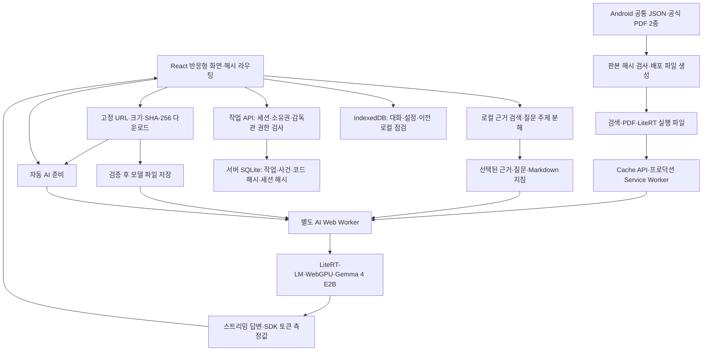

# HybridTech O₂ Field Guard 웹 현행 설계서

최종 갱신: 2026-10-15. 이 문서는 `web/`의 실제 구현을 설명합니다. 10월 7일 서버 RAG 제안은 [이전 권고안](ARCHITECTURE_PROPOSAL_20261007.md)에 보존했습니다. 현재 사용자 결정은 **Android 설치형 앱 유지 + 기기 내 AI를 사용하는 별도 반응형 웹/PWA**입니다.

## 제품 구성과 경계

| 구성 | 현재 역할 | 구현 경계 |
| --- | --- | --- |
| Android 앱 | Compose 화면, 로컬 RAG·Gemma, BLE·데모·알림·위젯·음성 기반 | 제조사 프로토콜과 현장 장비 정확도 검증 필요 |
| 웹/PWA | 홈·질문·문서·PDF·기록·작업 요청/점검·AI/토큰 설정 | 개인 계정 로그인·현장 배정·푸시·실시간 센서 미연결 |
| iPhone 홈 화면 앱 | HTTPS 주소를 Safari에서 홈 화면에 추가하는 PWA | 실기기 설치·추론·저장소 유지·성능 시험 필요 |
| 감독관 등록 코드 | 서버 CLI 발급·일회용 코드·기기별 HttpOnly 세션 | 인증 후에만 감독관 조회·점검·승인, 8시간 만료·관리자 회수 |

웹은 질문이나 답변을 AI 서버로 보내지 않습니다. 최초 모델과 배포 파일을 받는 데 네트워크를 사용하고, 검증·저장된 자료로 로컬 검색과 생성을 수행합니다. 웹의 가스값은 미연결 상태 `—`이며 자동 위험 예측이나 경보가 있는 것처럼 표시하지 않습니다.

## 실행 구조

React 19.2.0, TypeScript 5.9.3, Vite 8.3.4, PDF.js 6.4.299, LiteRT-LM 0.18.0을 lockfile로 고정합니다. 세부 의존성은 `web/package-lock.json`을 기준으로 합니다.

## 화면과 탐색

| 해시 경로 | 화면 |
| --- | --- |
| `#/` | 홈·준비 상태·빠른 질문 |
| `#/ask`, `#/ask/:id` | 질문·생성·저장된 대화 |
| `#/library` | 문서 2종과 본문 검색 |
| `#/sources/:documentId/:page` | 같은 PDF 쪽·확대·쪽 이동·추출 텍스트 |
| `#/history` | 기기에 저장된 대화 목록 |
| `#/checklist` | 작업자 본인 요청·승인 결과·투입·대피·퇴장 기록 |
| `#/supervisor-access` | 서버 발급 개인용 일회용 코드 인증 |
| `#/supervisor` | 인증된 감독관만 점검·승인·종료, 미인증 시 인증 화면 |
| `#/settings` | 파일·모델 자동 다운로드·AI 상태·토큰·데이터·PWA 안내 |

PC 사이드바, 모바일 하단 메뉴와 320px 이상 반응형 레이아웃을 사용합니다. Markdown 표와 코드는 내부 가로 스크롤을 허용하고 페이지 전체가 넘치지 않게 합니다. 홈의 방패 그림은 모바일 카드 내부에 들어오도록 배치합니다.

### 생성 중 스크롤

이전에는 토큰 갱신마다 `scrollIntoView({behavior: 'smooth'})`를 호출해 사용자의 휠·스크롤과 충돌했습니다. 현재는 `chat/useChatScroll.ts`와 `chat/scroll.ts`가 실제 문서 위치와 메시지 크기를 관찰합니다.

1. 새 질문과 답변 끝에서 읽는 동안에만 자동으로 최신 내용을 따라갑니다.
2. 휠·터치 이동·탐색 키·스크롤바 조작은 예약된 자동 이동을 취소합니다.
3. 읽던 위치는 답변이 추가되거나 완료되어 출처가 붙어도 강제로 바꾸지 않습니다.
4. 생성 중인 마지막 줄이 실제 읽기 영역에 보이도록 사용자가 다시 내려오면 자동 따라가기를 재개합니다. 페이지 맨 아래 2px에 도달할 필요가 없습니다. 상단 메뉴·입력창·모바일 시각적 뷰포트의 가림 영역을 제외하며, 위로 탐색할 때나 창 크기만 바뀔 때는 자동 재개하지 않습니다. `최신 답변으로 이동` 버튼도 유지합니다.
5. ResizeObserver와 requestAnimationFrame으로 레이아웃 갱신을 프레임당 한 번 처리하며 반복 smooth 애니메이션을 사용하지 않습니다.
6. 생성 중과 저장 완료 후에 동일한 메시지 ID/DOM 위치를 유지하고 브라우저 스크롤 앵커와 자동 이동의 충돌을 방지합니다.

## 문서 검색과 답변

공식 자료의 2종·87개 쪽별 청크를 사용합니다. Java 문자열 해시와 같은 384차원 로컬 벡터 및 단어 일치를 결합하고 복합 질문은 주제별 근거를 선택합니다. 문서 ID·제목·실제 PDF 쪽수는 끝까지 보존합니다.

질문·선택된 근거를 한국어 Markdown 지침과 함께 모델에 전달합니다. 근거 부족, 모델 없음, 초기화/생성 실패 또는 일부 수치 모순이 감지되면 생성 답변 대신 검색 원문과 그 이유를 표시합니다. 이 검사는 모든 의미·수치 오류를 검출하는 완전한 검증기가 아닙니다.

`react-markdown`과 GFM으로 제목·강조·목록·표·코드·인용을 표시합니다. HTML 실행과 생성된 원격 이미지 요청은 허용하지 않습니다. 원문 기호는 escape하여 보존하며 단일 물결표가 수치 범위를 취소선으로 바꾸지 않습니다.

PDF 원본은 PDF.js로 렌더링합니다. 두 PDF의 SHA-256을 빌드 때 확인하고, 페이지 연결을 검색 원문의 문서 ID에 고정합니다. 문서 판본이 바뀌면 PDF와 추출 텍스트·쪽수를 함께 재검토해야 합니다.

## 모델 다운로드와 자동 실행

`ai/catalog.ts`는 [공식 웹 모델 파일](https://huggingface.co/litert-community/gemma-4-E2B-it-litert-lm/blob/b3ca0d2f076785a8f4b2219ddbd2bdb99954eae1/gemma-4-E2B-it-web.litertlm)의 immutable 리비전·파일명·크기·SHA-256을 고정합니다.

- 파일: `gemma-4-E2B-it-web.litertlm`
- 크기: `2,008,432,640`바이트, 약 2.01GB.
- 리비전: `b3ca0d2f076785a8f4b2219ddbd2bdb99954eae1`.
- SHA-256: `3a08e8d94e23b814ae5414469c370c503813949acb8ceaa17e4ebf8a35af35b5`.

다운로드는 실행 파일 준비 → 모델 스트리밍 → 크기·해시 검증 → OPFS 쓰기 완료 → 메타데이터 commit → 자동 AI 준비 순서입니다. 불완전한 파일은 설치 완료로 표시하지 않고, 기존 모델은 새 검증 성공 후 교체합니다. OPFS 미지원 환경의 대형 모델은 설치를 거부합니다. 모델 파일 단위 부분 이어받기는 없으며 중단 후 다시 다운로드합니다.

앱 재접속 시 저장 모델을 자동으로 불러옵니다. 실행·메모리 해제 버튼은 없습니다. 무거운 검증·WASM/GPU 초기화·생성은 `ai-worker.js`에서 수행합니다. SDK가 importScripts를 사용하므로 개발/배포 모두 동일한 classic worker를 번들하며 WASM 경로를 `runtime/`으로 지정합니다. 중단·재설정·삭제·개발 중 교체 시 워커를 종료해 관련 메모리를 정리합니다.

자동 준비 요청은 합쳐 한 번만 실행합니다. 준비 중 질문은 완료를 기다리고, 모델이 없으면 다운로드 안내와 검색 원문을 표시합니다. 단계·경과 시간을 보여주며 설정을 떠나도 준비를 계속합니다. 기기 검증과 GPU 준비 시간은 필요합니다. 장시간 무응답은 제한 시간 후 오류로 표시하고 다음 질문에서 재시도할 수 있습니다.

### 토큰 설정과 측정

| 설정 | 값 | 적용 |
| --- | --- | --- |
| 최대 답변 토큰 | 256 / 512 / 1,024 / 1,536 / 2,048 / 4,096 | SDK `sessionConfig.maxOutputTokens` |
| 문맥 토큰 | 4,096 / 8,192 / 16,384 | SDK `mainExecutorSettings.maxNumTokens` |
| 기본값 | 답변 1,536 / 문맥 8,192 | IndexedDB에 저장하고 다음 질문부터 반영 |

답변 한도는 문맥의 절반 이하로 제한합니다. 문맥 변경은 새 엔진을 준비하고, 출력 한도만 변경하면 엔진을 재사용합니다. 준비 도중 설정을 바꿔도 실제 질문은 새 문맥과 일치하는 엔진을 사용합니다. SDK에서 얻은 입력·생성·전체 토큰 수와 사용한 한도를 대화에 보존합니다. SDK 측정이 없으면 글자 수로 임의 추정하지 않습니다. 이 값은 기기 내 추론량이며 API 과금 내역이 아닙니다.

## 작업자와 감독관

[작업 흐름 설계](../../web/docs/workflow.md)의 요청 → 감독관 5항목 점검 → 승인 → 작업자 투입 → AI 문서 지원 → 위험 신고 → 탈출/퇴장 → 감독관 종료를 구현했습니다.

감독관 점검은 가스·보호구·통신·환기·작업자 상태 및 측정 장비/시각·감시인/연락·유효기한을 기록합니다. 누락, 문서 공기 기준 이탈, 유효기한 경과로 승인·투입을 진행할 수 없습니다. 가스는 실제 센서 수신이 아닌 수동 입력 기록입니다. 작업허가 자동 인증 기능이 아닙니다.

새 작업은 서버 `/api/`에서 담당 작업자·권한·현재 상태를 검사합니다. SQLite 트랜잭션과 revision으로 동시 갱신을 거부하고, 승인/점검 당시 측정값은 사건 snapshot에 보존합니다. 작업자의 감독관 버튼을 제거하고 주소 직접 입력·역할/담당자 ID 변조·직접 API 호출도 서버에서 거부합니다. 이전 로컬 작업은 읽기 전용으로 남기며 서버 승인으로 신뢰하지 않습니다.

감독관 코드는 서버 PC의 `npm run supervisor -- issue --name "이름"`으로 발급합니다. 24시간 이내 1회 등록, 감독관 권한 8시간 유지, 5회 실패 후 15분 제한, 잠금·관리자 회수·세션 교체를 구현했습니다. SHA-256 코드/세션 해시와 HttpOnly·SameSite=Strict 쿠키, 변경 요청 CSRF 검사를 사용합니다. 인증·작업 API는 no-store이며 서비스 워커를 우회합니다. 기기별 세션 인증이며 개인 로그인·현장 배정·계정 복구는 아직 없습니다. 인증된 감독관은 이 서버 프로젝트 전체 요청을 확인합니다. 같은 서버의 PC·탭은 작업을 공유하고 15초 간격으로 확인하지만 푸시 알림은 제공하지 않습니다.

## 저장·오프라인·업데이트

| 저장 위치 | 내용 |
| --- | --- |
| IndexedDB `fieldguard-web` v2 | 대화, 이전 로컬 점검/작업 이력, 모델 메타데이터, 작업자 표시 이름, 토큰 설정 |
| 서버 `web/.local/workflow.sqlite` | 새 작업/사건·소유권, 일회용 코드 해시·회수, 기기 세션 해시 |
| OPFS | 검증된 대형 모델 파일 |
| Cache API | 크기·SHA-256 확인된 문서·PDF·런타임 파일 |
| 프로덕션 Service Worker | 버전별 앱 셸·AI worker, 해당 버전 파일 패키지 연결 |

기기 저장소의 스키마는 유지하고 기존 기록·모델을 보존합니다. 기기 기록 삭제는 서버 작업·승인을 지우지 않습니다. JSON v3 내보내기는 로컬 이력과 본인 서버 작업을 구분하고 서버 미연결 시 누락 상태를 기록합니다. 동일 origin 탭은 BroadcastChannel로 갱신/인증 변경을 알립니다. 새 작업·점검·승인·투입/퇴장 기록에는 서버 연결이 필요하며 문서·PDF·AI는 준비 후 오프라인으로 사용합니다.

서비스 워커는 프로덕션에만 등록합니다. 새 앱 셸 파일이 전부 준비되어야 업데이트가 설치되고, 대화 도중 강제로 교체하지 않습니다. 동일 주소 탭을 모두 닫고 다시 열면 새 버전으로 전환합니다. 큰 파일은 사용자가 설정에서 준비하며 검증된 파일만 재사용합니다. `localhost`와 `127.0.0.1`은 서로 다른 저장소입니다.

## 빌드·배포·검증

`web/README.md`의 명령과 `package-lock.json`으로 재현합니다. `npm run prepare:assets`는 공통 Android JSON/PDF, 설치된 SDK/PDF.js에서 배포 파일과 AI worker를 생성합니다. `node_modules`, `dist`, 생성한 public 대형 파일, 약 2GB 모델, `.qa` 임시 영상은 Git에 넣지 않습니다. 원본 PDF 2종과 소스·스크립트·lockfile은 저장소에 포함합니다.

Node.js 24.15 이상에서 개발 포트 5174와 프로덕션 미리보기 4173을 고정 사용하며 두 서버는 동일한 SQLite 작업 DB를 사용합니다. `.local/`과 서버 소스는 개발 서버 정적 접근에서 차단합니다. 정적 배포 출력은 `web/dist`이며 문서·AI에 HTTPS·COOP/COEP·WASM MIME과 캐시 설정이 필요합니다. 감독관·새 점검은 API 런타임이 필요하므로 `dist` 정적 호스팅만으로 사용할 수 없습니다. Vite 통합 API는 개발/미리보기용이며 실제 외부 운영 배포·계정 연동·DB 백업/복구 운영 구성은 수행하지 않았습니다.

현재 자동 테스트는 15개 파일 **100개 통과**입니다. 검색 정답 쪽 회귀 평가는 **29/30**이며 생성 정확도 평가와 구분합니다. Windows Chromium의 실제 다운로드·초기화·생성·사용량·파일/PDF 오프라인 동작과 세부 조건은 [검증 기록](../../web/docs/validation.md)에 있습니다. 실제 iPhone과 제조사 센서 검증은 남아 있습니다.

## 주요 코드

| 경로 (`web/` 기준) | 역할 |
| --- | --- |
| `src/App.tsx`, `src/ui.tsx` | 화면·대화·탐색·Markdown |
| `src/chat/` | 사용자 스크롤을 보존하는 자동 이동 |
| `src/ai/catalog.ts`, `model.ts` | 고정 다운로드·무결성·모델 저장 |
| `src/ai/runtime.ts`, `worker-engine.ts`, `engine.worker.ts` | 자동 준비·워커 통신·SDK 추론 |
| `src/ai/preferences.ts`, `protocol.ts` | 설정 검증·저장·요청/사용량 타입 |
| `src/rag/search.ts` | 검색·복합 근거 선택·원문 대체·간단한 모순 검사 |
| `src/storage/db.ts` | IndexedDB schema·기기 기록·이전 로컬 작업 이력 |
| `src/workflow/work.ts`, `src/features/WorkChecklist.tsx` | 공통 작업 전환·권한별 점검 화면 |
| `src/workflow/access.ts`, `src/features/SupervisorAccess.tsx` | 서버 세션·코드 인증·잠금·API 클라이언트 |
| `server/store.ts`, `api.ts`, `plugin.ts`, `manage.ts` | SQLite 권한/작업 트랜잭션·HTTP API·Vite 통합·코드 CLI |
| `src/offline/assets.ts`, `scripts/` | 파일 생성·검증·캐시·PWA·AI worker 번들 |

## 남은 연결과 실기기 시험

- HTTPS 실제 호스팅과 iPhone Safari/홈 화면 설치·재실행·재부팅.
- 기종별 WebGPU·저장소 유지·메모리·발열·성능 및 생성 답변 전문 검수.
- 실제 로그인·감독관 코드·현장 권한·서버 동기화·다른 기기 알림.
- BLE 장비 프로토콜과 실제 위험 감지·예측·경보·대피 경로 연동.
- 웹 음성·상시 호출·네이티브 위젯은 구현 범위에 포함하지 않음.
