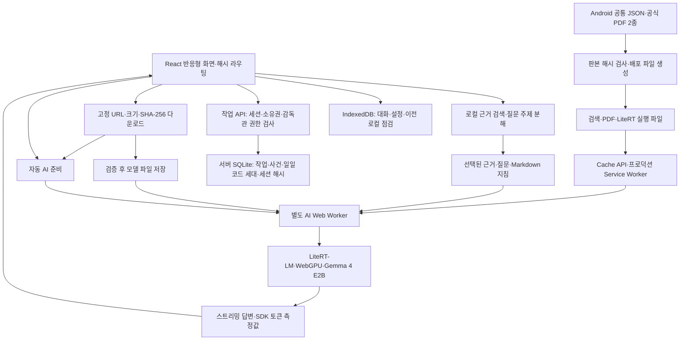

# HybridTech O₂ Field Guard 웹 현행 설계서

최종 갱신: 2026-10-19. 이 문서는 `web/`의 실제 구현을 설명합니다. 10월 7일 서버 RAG 제안은 [이전 권고안](ARCHITECTURE_PROPOSAL_20261007.md)에 보존했습니다. 현재 사용자 결정은 **Android 설치형 앱 유지 + 기기 내 AI를 사용하는 반응형 웹/PWA + 웹 기준 공통 디자인**입니다.

## 제품 구성과 경계

| 구성 | 현재 역할 | 구현 경계 |
| --- | --- | --- |
| Android 앱 | Compose 화면, 로컬 RAG·Gemma, BLE·데모·알림·위젯·음성 기반 | 제조사 프로토콜과 현장 장비 정확도 검증 필요 |
| 웹/PWA | 홈·질문·문서·PDF·기록·작업 요청/점검·AI/토큰 설정 | 개인 계정 로그인·현장 배정·푸시·실시간 센서 미연결 |
| iPhone 홈 화면 앱 | HTTPS 주소를 Safari에서 홈 화면에 추가하는 PWA | 실기기 설치·추론·저장소 유지·성능 시험 필요 |
| 감독관 등록 코드 | 서버 CLI 일일 숫자 6자리·기기별 HttpOnly 세션 | 인증 후에만 감독관 조회·점검·승인, 한국 자정 만료·즉시 교체/중지 |

웹은 질문이나 답변을 AI 서버로 보내지 않습니다. 최초 모델과 배포 파일을 받는 데 네트워크를 사용하고, 검증·저장된 자료로 로컬 검색과 생성을 수행합니다. 웹의 가스값은 미연결 상태 `—`이며 자동 위험 예측이나 경보가 있는 것처럼 표시하지 않습니다.

## 실행 구조

React 19.2.0, TypeScript 5.9.3, Vite 8.3.4, PDF.js 6.4.299, LiteRT-LM 0.18.0을 lockfile로 고정합니다. 세부 의존성은 `web/package-lock.json`을 기준으로 합니다.

## 화면과 탐색

| 해시 경로 | 화면 |
| --- | --- |
| `#/` | 홈·준비 상태·빠른 질문 |
| `#/ask`, `#/ask/:id` | 질문·생성·저장된 대화 |
| `#/library` | 문서 2종과 본문 검색 |
| `#/sources/:documentId/:page` | 같은 PDF 쪽·확대·쪽 이동·추출 텍스트 |
| `#/history` | 기기에 저장된 대화 목록 |
| `#/checklist` | 작업자 본인 요청·승인 결과·투입·대피·퇴장 기록 |
| `#/supervisor-access` | 오늘의 숫자 6자리 공유 코드 인증 |
| `#/supervisor` | 인증된 감독관만 점검·승인·종료, 미인증 시 인증 화면 |
| `#/settings` | 파일·모델 자동 다운로드·AI 상태·토큰·데이터·PWA 안내 |

PC 사이드바, 모바일 하단 메뉴와 320px 이상 반응형 레이아웃을 사용합니다. Markdown 표와 코드는 내부 가로 스크롤을 허용하고 페이지 전체가 넘치지 않게 합니다. 홈의 방패 그림은 모바일 카드 내부에 들어오도록 배치합니다.

### 키보드와 보이는 화면 높이

`chat/viewport.ts`의 측정기는 포커스와 키보드가 닫힌 높이를 기억합니다. `useChatViewport.ts`는 VisualViewport resize/scroll, 창 resize, focusin/out, pageshow를 프레임당 한 번 처리해 높이·위치·키보드 상태를 전달합니다. 작은 툴바 변화·포커스만 있는 하드웨어 키보드·핀치 확대를 구분하고 화면 방향 변경 후 기준 높이도 다시 맞춥니다. [VisualViewport API](https://developer.mozilla.org/en-US/docs/Web/API/VisualViewport)의 실제 보이는 높이를 사용합니다.

850px 이하 질문 화면은 그 높이에 상단 바·대화 영역·입력창·하단 메뉴를 함께 배치합니다. 키보드가 열리면 큰 소개와 메뉴·하단 안내를 접고 입력창을 키보드 경계에 둡니다. 851px 이상의 넓은 태블릿도 키보드가 열린 동안 같은 배치를 사용하며 사이드바는 유지합니다. 대화만 스크롤하므로 창 전체 스크롤과 각각 fixed/sticky 입력창이 충돌하지 않습니다. 입력창은 내용에 따라 최대 4줄로 늘고 닫기 후 원문 입력을 유지합니다. `chat.css`는 페이지 이동 시 적용이 끝나며 다른 화면의 창 스크롤은 유지합니다.

### 생성 중 스크롤

이전에는 토큰 갱신마다 `scrollIntoView({behavior: 'smooth'})`를 호출해 사용자의 휠·스크롤과 충돌했습니다. 현재는 `chat/useChatScroll.ts`와 `chat/scroll.ts`가 실제 문서 위치와 메시지 크기를 관찰합니다. 일반 PC는 창, 모바일과 키보드가 열린 화면은 `.chat-scroll`의 scrollTop/clientHeight를 사용하며 동일한 따라가기 제어기를 공유합니다.

1. 새 질문과 답변 끝에서 읽는 동안에만 자동으로 최신 내용을 따라갑니다.
2. 휠·터치 이동·탐색 키·스크롤바 조작은 예약된 자동 이동을 취소합니다.
3. 읽던 위치는 답변이 추가되거나 완료되어 출처가 붙어도 강제로 바꾸지 않습니다.
4. 생성 중인 마지막 줄이 실제 읽기 영역에 보이도록 사용자가 다시 내려오면 자동 따라가기를 재개합니다. 페이지 맨 아래 2px에 도달할 필요가 없습니다. 상단 메뉴·입력창·모바일 시각적 뷰포트의 가림 영역을 제외하며, 위로 탐색할 때나 창 크기만 바뀔 때는 자동 재개하지 않습니다. `최신 답변으로 이동` 버튼도 유지합니다.
5. ResizeObserver와 requestAnimationFrame으로 레이아웃 갱신을 프레임당 한 번 처리하며 반복 smooth 애니메이션을 사용하지 않습니다.
6. 생성 중과 저장 완료 후에 동일한 메시지 ID/DOM 위치를 유지하고 브라우저 스크롤 앵커와 자동 이동의 충돌을 방지합니다.

## 문서 검색과 답변

공식 자료의 2종·87개 쪽별 청크를 사용합니다. Java 문자열 해시와 같은 384차원 로컬 벡터 및 단어 일치를 결합하고 복합 질문은 주제별 근거를 선택합니다. 문서 ID·제목·실제 PDF 쪽수는 끝까지 보존합니다.

질문·선택된 근거를 한국어 Markdown 지침과 함께 모델에 전달합니다. 근거 부족, 모델 없음, 초기화/생성 실패 또는 일부 수치 모순이 감지되면 생성 답변 대신 검색 원문과 그 이유를 표시합니다. 이 검사는 모든 의미·수치 오류를 검출하는 완전한 검증기가 아닙니다.

`react-markdown`과 GFM으로 제목·강조·목록·표·코드·인용을 표시합니다. HTML 실행과 생성된 원격 이미지 요청은 허용하지 않습니다. 원문 기호는 escape하여 보존하며 단일 물결표가 수치 범위를 취소선으로 바꾸지 않습니다.

PDF 원본은 PDF.js로 렌더링합니다. 두 PDF의 SHA-256을 빌드 때 확인하고, 페이지 연결을 검색 원문의 문서 ID에 고정합니다. 문서 판본이 바뀌면 PDF와 추출 텍스트·쪽수를 함께 재검토해야 합니다.

## 모델 다운로드와 자동 실행

`ai/catalog.ts`는 [공식 웹 모델 파일](https://huggingface.co/litert-community/gemma-4-E2B-it-litert-lm/blob/b3ca0d2f076785a8f4b2219ddbd2bdb99954eae1/gemma-4-E2B-it-web.litertlm)의 immutable 리비전·파일명·크기·SHA-256을 고정합니다.

- 파일: `gemma-4-E2B-it-web.litertlm`
- 크기: `2,008,432,640`바이트, 약 2.01GB.
- 리비전: `b3ca0d2f076785a8f4b2219ddbd2bdb99954eae1`.
- SHA-256: `3a08e8d94e23b814ae5414469c370c503813949acb8ceaa17e4ebf8a35af35b5`.

다운로드는 실행 파일 준비 → 모델 스트리밍 → 크기·해시 검증 → OPFS 쓰기 완료 → 메타데이터 commit → 자동 AI 준비 순서입니다. 불완전한 파일은 설치 완료로 표시하지 않고, 기존 모델은 새 검증 성공 후 교체합니다. OPFS 미지원 환경의 대형 모델은 설치를 거부합니다. 모델 파일 단위 부분 이어받기는 없으며 중단 후 다시 다운로드합니다.

앱 재접속 시 저장 모델을 자동으로 불러옵니다. 실행·메모리 해제 버튼은 없습니다. 무거운 검증·WASM/GPU 초기화·생성은 `ai-worker.js`에서 수행합니다. SDK가 importScripts를 사용하므로 개발/배포 모두 동일한 classic worker를 번들하며 WASM 경로를 `runtime/`으로 지정합니다. 중단·재설정·삭제·개발 중 교체 시 워커를 종료해 관련 메모리를 정리합니다.

Apple 모바일에서는 한 엔진으로 한 답변만 생성합니다. 답변과 SDK 사용량을 받은 뒤 conversation과 엔진의 `delete()`를 기다리고 Worker의 `done`을 전달합니다. 메인 런타임은 해당 Worker를 종료한 다음 다음 질문용 엔진 하나를 자동 준비합니다. WASM 힙이 이전 답변의 최대 용량을 유지한 채 다음 질문을 처리하지 않도록 수명을 나눕니다. 준비 중 질문은 같은 `prepareAI` Promise를 기다리고 이전 Worker의 늦은 메시지는 무시합니다. 준비 중 질문 취소는 새 초기화의 중단 표시를 지우지 않습니다. 데스크톱은 기존 엔진 재사용을 유지합니다. 페이지 새로고침·모델 재다운로드는 없지만 질문 사이 모델 준비 시간이 추가될 수 있습니다. 실제 iPhone의 모든 GPU 할당 반환 시점이나 연속 안정성을 보장하는 측정은 아닙니다.

OPFS 파일은 첫 실행에서 저장된 바이트 전체의 SHA-256을 확인한 뒤 검증 기록을 모델 메타데이터에 보존합니다. 재접속 시 크기·수정 시각과 8개 구간의 최대 512KiB 표본 해시가 같고 기록이 7일 미만이면 전체 파일 읽기를 생략합니다. 기록 없음·이상·변경 감지·7일 경과 시 전체 검사를 수행하고, 파일 수정 시각을 확인할 수 없는 Blob/IndexedDB 저장은 전체 검사를 유지합니다. 검증 기록 갱신은 현재 설치와 동일한 키·해시·크기·설치 시각을 확인하는 트랜잭션으로 처리해 삭제/교체된 모델을 되살리지 않습니다. 표본 검사는 전체 무결성 검사와 같지 않으며 수정 정보가 유지된 표본 밖 손상은 주기적인 전체 검사 전까지 검출되지 않을 수 있습니다. 실행 준비·파일 확인·런타임·엔진 적재 시간은 워커의 실제 경과 시간을 측정하고, 화면에는 전체 준비와 파일 확인 시간을 표시합니다. SDK 0.18.0은 JS 경로의 실행 캐시를 `:nocache`로 지정하므로 모델 GPU 적재 시간은 남습니다.

자동 준비 요청은 합쳐 한 번만 실행합니다. 준비 중 질문은 완료를 기다리고, 모델이 없으면 다운로드 안내와 검색 원문을 표시합니다. 단계·경과 시간을 보여주며 설정을 떠나도 준비를 계속합니다. 기기 검증과 GPU 준비 시간은 필요합니다. 장시간 무응답은 제한 시간 후 오류로 표시하고 다음 질문에서 재시도할 수 있습니다.

### 준비 중 페이지 종료와 메모리 입력 경로

OPFS 모델은 메인 화면에서 대형 Blob을 워커로 전달하는 대신 저장 키·크기만 전달하고 워커가 직접 엽니다. 전체 SHA-256 검사와 SDK 입력 스트림은 한 번에 최대 1MiB씩 읽습니다. BYOB와 기본 reader를 모두 지원합니다. LiteRT-LM 0.18.0의 기존 스트리밍 경로를 유지하며 SDK·WASM·GPU가 보유하는 전체 메모리를 이 크기로 제한하는 것은 아닙니다.

`ai/execution.ts`는 SDK의 GPU_ARTISAN 경로를 유지하면서 Apple 모바일의 `mainExecutorSettings.backendConfig`에 `sequence_batch_size:1`, `use_autosized_ringbuffers:true`, `wait_for_weight_uploads:true`, `max_top_k:1`, `num_output_candidates:1`을 전달합니다. 배치 1은 입력에도 길이 1의 decode 그래프를 재사용하고 자동 크기 버퍼는 즉시 되감기 대신 로컬 어텐션 메모리를 줄이는 SDK 옵션입니다. 출처는 고정 버전 [LiteRT-LM v0.18.0 executor 설정](https://github.com/google-ai-edge/LiteRT-LM/blob/v0.18.0/runtime/executor/llm_executor_settings.h)입니다. 외부 임베딩·decode logits·서브모델은 사용하지 않습니다. 데스크톱 엔진의 기존 설정은 유지합니다. 전체 메모리 상한은 보장하지 않으며 입력 시간이 늘 수 있습니다. 대화마다 새 conversation을 사용하고 시스템 지시·문서 근거를 그대로 전달합니다. conversation은 음성/영상 모달리티를 끄고 기존 기본값인 `prefillPrefaceOnInit:false`를 명시합니다.

`ai/recovery.ts`는 준비·생성 전 localStorage의 `fieldguard-ai-operation`에 작업 ID·단계·문맥 크기·시각을 기록하고 정상 완료·처리된 실패·명시적 중단에는 자기 표시만 지웁니다. 질문의 단계는 `conversation`(대화 작업 공간), `prefill`(질문·문서 입력), `decode`(첫 답변 수신 이후), `cleanup`(AI 메모리 정리)로 구분하며 이전 `generation` 기록도 읽습니다. 프롬프트·답변 본문은 기록하지 않습니다. 페이지가 강제 종료돼 표시가 남으면 다음 실행은 `recovery` 상태로 자동 반복을 멈춥니다. 홈·질문 경로로 시작했을 때만 자기 저장소의 설정 화면으로 안내하므로 주소 표시줄이 없는 홈 화면 앱에서도 복구할 수 있습니다. 이후 문서 화면 이동은 막지 않습니다. 명시적 복구 선택으로만 **문맥 2,048/답변 256**을 저장해 다시 준비합니다. `ai/engine-lease.ts`의 Web Lock은 같은 출처·저장소에서 엔진 하나만 유지하고 워커 종료/페이지 종료 시 해제됩니다. 서로 분리된 브라우저·PWA 저장소까지 조정하지는 않습니다.

이미 설치된 구형 서비스 워커의 앱 셸이 반복 종료되면 `GET /api/ai-recovery`로 독립 HTML을 제공합니다. 기존 `/api/` 캐시 제외 규칙으로 서버에서 직접 가져오고 모델·런타임을 import하지 않습니다. 사용자 선택 시 기존 중단 단계·문맥·시각을 보존해 새 표시를 기록하고 정확히 같은 출처의 루트 서비스 워커 등록만 해제합니다. 파일·기록·캐시는 삭제하지 않습니다. 응답은 no-store·nosniff·nonce 기반 CSP이며 작업 기록/감독관 API의 인증 규칙은 유지합니다. Safari에서 이 페이지를 열어도 분리된 홈 화면 앱 저장소의 설정을 바꾸지는 않습니다. 자세한 절차는 [iPhone 복구 안내](../IPHONE_TEST.md#모델-준비-중-페이지가-반복-종료될-때)에 있습니다.

iPhone 13 Pro / iOS 27.0.1의 10/20 10:43:52 Jetsam 기록에서는 WebContent의 `highwater` 종료를 확인했습니다. 이후 파일 구간 읽기 수정 뒤 실제 기기의 첫 답변 성공과 두 번째 질문 ‘심폐소생술 알려줘’ 중 종료는 사용자 보고입니다. 두 번째 사건의 원인 로그는 아직 없습니다. 위 엔진 수명 변경과 PC 실행 결과는 실제 iPhone의 연속 안정성·메모리 사용량·답변 정확도 검증과 구분합니다. [로그·연속 질문 설계](IPHONE_MEMORY_ANALYSIS.md)를 참고하세요.

2026-10-20 사용자는 복구 재시도 후에도 설정 화면의 반복 종료와 다음 진입의 `engine`(모델 메모리 적재) 미완료 안내를 확인했습니다. 이 기기의 Gemma 웹 준비 성공은 여전히 미검증이며 PC 테스트 통과로 지원 판정을 내리지 않습니다. SDK 고급 옵션의 상수 공유·GPU 가중치 변환·원본 텐서 madvise는 0.18.0 소스에서 이미 켜진 기본값이므로 단순히 다시 지정하는 것을 새로운 메모리 수정으로 설명하지 않습니다. iPhone용 경량 웹 모델을 추가하려면 별도 런타임·파일 무결성·저장·오프라인·한국어 근거 답변 품질을 검증해야 합니다. 같은 Gemma의 iOS 네이티브 경로도 PWA와 다른 배포/개발 범위이며 실제 기기 검증이 필요합니다. 모델 교체나 서버 추론으로 자동 전환하지 않습니다.

이후 같은 날의 Jetsam 로그에서 WebContent `highwater` 종료가 확인돼 로컬 파일 입력 경로를 추가했습니다. `model-stream.ts`의 WeakMap으로 검증 파일과 입력 스트림을 같은 워커 안에서 연결하고, `file-model-reader.ts`가 요청한 임의 구간만 1MiB 이하로 읽어 WASM에 복사합니다. `readAndPreserve`의 재읽기는 파일에서 수행하므로 SDK 순차 래퍼의 건너뛴/보존 구간 JS 캐시가 필요하지 않습니다. `sdk-stream-reader.ts`는 등록된 입력만 이 경로를 사용하고 다른 입력은 upstream에 위임합니다. `build-ai-worker.mjs`가 고정 0.18.0 내부 import를 worker 한정으로 연결하고 버전·메서드·실제 연결을 확인해 실패 시 빌드를 중지합니다. `node_modules`·공식 WASM은 수정하지 않습니다. 준비 측정에는 `modelRead`의 방식·읽기 수·총 바이트·최대 읽기 크기를 선택적으로 포함합니다. 총 WASM/GPU 메모리 상한이나 실제 iPhone 성공을 보장하는 조치는 아닙니다. [분석과 유지보수 경계](IPHONE_MEMORY_ANALYSIS.md).

### 토큰 설정과 측정

| 설정 | 값 | 적용 |
| --- | --- | --- |
| 최대 답변 토큰 | 256 / 512 / 1,024 / 1,536 / 2,048 / 4,096 | SDK `sessionConfig.maxOutputTokens` |
| 문맥 토큰 | 2,048 / 4,096 / 8,192 / 16,384 | SDK `mainExecutorSettings.maxNumTokens` |
| 새 기본값 | iPhone/iPad 답변 512 / 문맥 4,096; 데스크톱 1,536 / 8,192 | 기존 저장 선택은 유지, 변경 시 IndexedDB에 저장하고 다음 질문부터 반영 |
| 명시적 중단 복구 | 답변 256 / 문맥 2,048 | ‘문맥을 줄여 다시 준비’ 선택 시 저장 후 기존 모델 재사용 |

답변 한도는 문맥의 절반 이하로 제한합니다. 문맥 변경은 새 엔진을 준비하고, 출력 한도만 변경하면 현재 준비된 엔진을 재사용할 수 있습니다. Apple 모바일은 별도로 각 답변 뒤 엔진을 교체합니다. 준비 도중 설정을 바꿔도 실제 질문은 새 문맥과 일치하는 엔진을 사용합니다. SDK에서 얻은 입력·생성·전체 토큰 수와 사용한 한도를 대화에 보존합니다. SDK 측정이 없으면 글자 수로 임의 추정하지 않습니다. 이 값은 기기 내 추론량이며 API 과금 내역이 아닙니다.

## 작업자와 감독관

[작업 흐름 설계](../../web/docs/workflow.md)의 요청 → 감독관 5항목 점검 → 승인 → 작업자 투입 → AI 문서 지원 → 위험 신고 → 탈출/퇴장 → 감독관 종료를 구현했습니다.

감독관 점검은 가스·보호구·통신·환기·작업자 상태 및 측정 장비/시각·감시인/연락·유효기한을 기록합니다. 누락, 문서 공기 기준 이탈, 유효기한 경과로 승인·투입을 진행할 수 없습니다. 가스는 실제 센서 수신이 아닌 수동 입력 기록입니다. 작업허가 자동 인증 기능이 아닙니다.

새 작업은 서버 `/api/`에서 담당 작업자·권한·현재 상태를 검사합니다. SQLite 트랜잭션과 revision으로 동시 갱신을 거부하고, 승인/점검 당시 측정값은 사건 snapshot에 보존합니다. 감독관 전환 버튼은 코드 입력 화면만 열고, 미인증 주소 직접 입력·역할/담당자 ID 변조·직접 API 호출은 서버에서 거부합니다. 이전 로컬 작업은 읽기 전용으로 남기며 서버 승인으로 신뢰하지 않습니다.

감독관 코드는 서버 PC의 `npm run supervisor -- today`로 확인하며 여러 감독관이 당일 같은 6자리로 인증합니다. 코드·권한은 한국 시간 다음 날 00:00에 만료됩니다. `rotate`는 즉시 새 코드로 교체하며 기존 권한을 모두 무효화하고 `revoke`는 오늘 인증을 중지합니다. 잠금은 해당 기기만 해제하며 당일 코드로 재인증할 수 있습니다. 기기 5회·접속 30회 실패 시 각각 15분 제한합니다. 별도 서버 비밀키로 일일 HMAC 코드를 계산하며 원문은 저장하지 않습니다. SHA-256 세션 해시와 HttpOnly·SameSite=Strict 쿠키, 변경 요청 CSRF 검사를 사용합니다. 인증·작업 API는 no-store이며 서비스 워커를 우회합니다. 기기별 세션 인증이며 개인 로그인·현장 배정·계정 복구는 아직 없습니다. 인증된 감독관은 이 서버 프로젝트 전체 요청을 확인합니다. 같은 서버의 PC·탭·앱은 작업을 공유합니다. 변경 명령은 인증된 POST로 처리하고, `GET /api/work-events?view=worker|supervisor`의 SSE 연결이 상대 화면에 변경을 알립니다. 서버는 트랜잭션 안에서 `order_changes`의 변경 번호를 저장하며 1초마다 권한·변경 번호를 확인하므로 별도 개발/미리보기 프로세스의 쓰기도 감지합니다. 스트림에는 작업 본문을 보내지 않고 변경 신호만 전달하며, 작업자는 본인 변경만 받습니다. 클라이언트는 자기 권한의 전체 목록을 다시 조회합니다. 최초 연결·재연결 시에도 재조회하고 연결 실패/미지원은 5초 확인으로 보완합니다. 권한 만료·회수 시 열린 감독관 스트림도 닫힙니다. 열린 화면의 알림을 제공하며 닫힌 화면의 푸시 알림은 제공하지 않습니다.

감독관 인증과 작업 승인은 분리됩니다. 신규 작업은 반드시 `requested`와 빈 점검으로 생성되고, 감독관이 점검을 저장한 후 승인 API를 호출해야 승인됩니다. 작업자가 승인 내용을 확인해 투입을 별도 요청해야 다음 단계로 진행합니다. 기본 목록은 종료 작업을 제외하며, 종료 이력에서는 과거 승인임을 표시합니다. 새 요청 화면의 진행 단계는 선택했던 이전 작업과 분리합니다. 관련 구현은 `WorkChecklist.tsx`, `workflow/live.ts`, `workflow/presentation.ts`, `server/api.ts`, `server/store.ts`입니다.

## 브라우저별 AI 실행 조건

`web/src/ai/capabilities.ts`가 보안 컨텍스트·WebGPU·Worker 기능을 확인하고 실패 원인별 안내를 생성합니다. `runtime.ts`와 `Settings.tsx`가 같은 판정을 사용하고, 미지원 시 워커 초기화와 모델 다운로드를 시작하지 않습니다. 기존의 포괄적인 ‘이 브라우저에서는 AI 사용 불가’ 문구를 원인·해결 절차와 조건 표시로 바꿨습니다.

iPhone/iPad WebGPU의 정식 지원은 iOS/iPadOS 26부터입니다. 사용자 보고인 iPhone 13 Pro / iOS 18.6.2의 AI 다운로드 차단은 이 기본 지원 조건에 해당합니다. 13 Pro는 iOS 26 지원 기종이지만 업데이트 후 Gemma의 실제 메모리/GPU 실행을 별도로 시험해야 합니다. iOS 버전 문자열이나 기종 이름으로 무조건 차단하거나 실행 성공을 보장하지 않습니다. Safari 사용자 에이전트에 오래된 iOS 버전이 표시되더라도 실제 기능을 제공하면 통과합니다. 기본 검사 통과와 엔진 초기화·추론 성공은 구분합니다.

## iPhone의 같은 Wi-Fi HTTPS 시험

`npm run iphone:test`는 최신 프로덕션 파일을 빌드하고 사설 IPv4에 설치 안내 HTTP 4172와 Vite HTTPS 미리보기 4174를 실행합니다. 공통 작업 API·SQLite·SSE와 COOP/COEP 헤더를 유지하고 TLS 연결에는 Secure 쿠키를 발급합니다. 기존 HTTP 4173·개발 5174와 분리합니다. `https://<PC-IP>:4173`은 TLS 서버가 아니므로 실패합니다.

`server/iphone-https.ts`가 OpenSSL로 개발용 CA(30일)와 사설 IP·localhost 서버 인증서(7일)를 생성·재사용합니다. 개인키는 Git 제외 `.local/iphone-https/`에 유지하고 설치 서버는 공개 CA 하나가 담긴 프로파일과 안내만 제공합니다. 파일 시스템·작업 API·개인키는 이 설치 서버의 경로에 연결하지 않습니다. IP 변경은 기존 CA로 서버 인증서만 재발급합니다. CA 불일치·만료는 중지합니다. PC/휴대전화의 신뢰 저장소를 자동 변경하지 않으며 사용자가 iPhone 설정에서 설치·신뢰해야 합니다. 외부 터널·운영 배포는 포함하지 않습니다.

정확한 명령·프로파일 설치·신뢰·제거·키 경로는 [iPhone 시험 안내](../IPHONE_TEST.md)에 정리합니다. HTTPS 접속 검증과 실제 iPhone AI·메모리 시험 결과는 구분합니다.

정상 Apple 답변 종료에서는 엔진 삭제 이후 SDK 런타임의 실제 WebGPU 장치를 명시적으로 `destroy()`한 뒤 Worker를 종료합니다. `ai/worker-resources.ts`가 실제 WASM 힙 용량·GPU 오류 종류/장치 손실을 표본 기록하고 `ai/diagnostics.ts`가 설정값과 함께 최근 48개만 기기에 보관합니다. 설정의 **AI 진단 기록 저장**으로 내보내며 질문·답변·주소·기기 식별자와 원격 전송은 포함하지 않습니다. WASM 용량은 GPU·전체 WebContent 메모리가 아닙니다. 준비 완료 뒤 질문 전송/`decode`에서 종료가 재발한 실제 iPhone의 안정성은 미해결입니다. 추가된 12:20:58 로그에서는 WebContent의 highwater 종료와 약 2.703GiB 기록 사용량을 확인했습니다. 정확한 할당 비중·앱 빌드는 불명이며 12:38 GPU 정리·진단 변경의 성공/실패를 보여주는 로그가 아닙니다. [최신 원인 분석과 한계](IPHONE_MEMORY_ANALYSIS.md#준비-완료-뒤-질문-전송-시-decode-종료-재발).

## 저장·오프라인·업데이트

| 저장 위치 | 내용 |
| --- | --- |
| IndexedDB `fieldguard-web` v2 | 대화, 이전 로컬 점검/작업 이력, 모델 메타데이터, 작업자 표시 이름, 토큰 설정 |
| 서버 `web/.local/workflow.sqlite` | 새 작업/사건·소유권·변경 번호, 일일 코드 날짜/세대/중지, 기기 세션 해시 |
| 서버 `web/.local/workflow.sqlite.daily-key` | 일일 코드 계산용 비밀키, DB와 함께 백업·Git 제외 |
| OPFS | 검증된 대형 모델 파일 |
| Cache API | 크기·SHA-256 확인된 문서·PDF·런타임 파일 |
| 프로덕션 Service Worker | 버전별 앱 셸·AI worker, 해당 버전 파일 패키지 연결 |

기기 저장소의 스키마는 유지하고 기존 기록·모델을 보존합니다. 기기 기록 삭제는 서버 작업·승인을 지우지 않습니다. JSON v3 내보내기는 로컬 이력과 본인 서버 작업을 구분하고 서버 미연결 시 누락 상태를 기록합니다. 동일 origin 탭은 BroadcastChannel로 갱신/인증 변경을 알립니다. 새 작업·점검·승인·투입/퇴장 기록에는 서버 연결이 필요하며 문서·PDF·AI는 준비 후 오프라인으로 사용합니다.

서비스 워커는 프로덕션에만 등록합니다. 새 앱 셸 파일이 전부 준비되어야 업데이트가 설치되고, 대화 도중 강제로 교체하지 않습니다. 동일 주소 탭을 모두 닫고 다시 열면 새 버전으로 전환합니다. 큰 파일은 사용자가 설정에서 준비하며 검증된 파일만 재사용합니다. `localhost`와 `127.0.0.1`은 서로 다른 저장소입니다.

## 빌드·배포·검증

`web/README.md`의 명령과 `package-lock.json`으로 재현합니다. `npm run prepare:assets`는 공통 Android JSON/PDF, 설치된 SDK/PDF.js에서 배포 파일과 AI worker를 생성합니다. `node_modules`, `dist`, 생성한 public 대형 파일, 약 2GB 모델, `.qa` 임시 영상은 Git에 넣지 않습니다. 원본 PDF 2종과 소스·스크립트·lockfile은 저장소에 포함합니다.

Node.js 24.15 이상에서 개발 포트 5174와 프로덕션 미리보기 4173을 고정 사용하며 두 서버는 동일한 SQLite 작업 DB를 사용합니다. `.local/`과 서버 소스는 개발 서버 정적 접근에서 차단합니다. 정적 배포 출력은 `web/dist`이며 문서·AI에 HTTPS·COOP/COEP·WASM MIME과 캐시 설정이 필요합니다. 감독관·새 점검은 API 런타임이 필요하므로 `dist` 정적 호스팅만으로 사용할 수 없습니다. Vite 통합 API는 개발/미리보기용이며 실제 외부 운영 배포·계정 연동·DB 백업/복구 운영 구성은 수행하지 않았습니다.

현재 자동 테스트는 28개 파일 **202개 통과**입니다. 검색 정답 쪽 회귀 평가는 **29/30**이며 생성 정확도 평가와 구분합니다. Windows Chromium의 실제 다운로드·초기화·생성·사용량·파일/PDF 오프라인 동작과 세부 조건은 [검증 기록](../../web/docs/validation.md)에 있습니다. 실제 iPhone의 연속 생성과 제조사 센서 검증은 남아 있습니다.

## 주요 코드

| 경로 (`web/` 기준) | 역할 |
| --- | --- |
| `src/App.tsx`, `src/ui.tsx` | 화면·대화·탐색·Markdown |
| `src/chat/` | 사용자 스크롤을 보존하는 자동 이동 |
| `src/ai/catalog.ts`, `model.ts` | 고정 다운로드·무결성·모델 저장 |
| `src/ai/runtime.ts`, `worker-engine.ts`, `engine.worker.ts` | 자동 준비·워커 통신·SDK 추론 |
| `src/ai/worker-resources.ts`, `diagnostics.ts` | 명시적 GPU 장치 폐기·WASM/GPU 오류 표본·48개 로컬 진단 |
| `src/chat/viewport.ts`, `useChatViewport.ts`, `chat.css` | 키보드와 보이는 높이·대화/입력 배치 |
| `src/ai/model-stream.ts` | 최대 1MiB 단위 모델 입력 스트림 |
| `src/ai/recovery.ts`, `engine-lease.ts` | 페이지 중단 감지와 엔진 잠금 |
| `server/ai-recovery-page.ts` | AI를 로드하지 않는 서버 복구 화면 |
| `src/ai/preferences.ts`, `protocol.ts` | 설정 검증·저장·요청/사용량 타입 |
| `src/rag/search.ts` | 검색·복합 근거 선택·원문 대체·간단한 모순 검사 |
| `src/storage/db.ts` | IndexedDB schema·기기 기록·이전 로컬 작업 이력 |
| `src/workflow/work.ts`, `src/features/WorkChecklist.tsx` | 공통 작업 전환·권한별 점검 화면 |
| `src/workflow/access.ts`, `src/features/SupervisorAccess.tsx` | 서버 세션·코드 인증·잠금·API 클라이언트 |
| `server/store.ts`, `api.ts`, `plugin.ts`, `manage.ts` | SQLite 권한/작업 트랜잭션·HTTP API·Vite 통합·코드 CLI |
| `src/offline/assets.ts`, `scripts/` | 파일 생성·검증·캐시·PWA·AI worker 번들 |

## Android 공통 디자인과 작업 화면

2026-10-16에는 질문·답변·문서·기록·원문·모델·토큰 설정까지 웹 스타일로 전면 수정했습니다. `tools/sync-web-design.mjs`로 웹 색상/크기와 아이콘을 공유하고 `WorkspaceComponents.kt`·`WorkspaceScreens.kt`가 공통 컴포넌트/화면을 구성합니다. 상세 매핑과 캡처는 [공통 디자인 설계](../ANDROID_WEB_DESIGN.md)를 참고하세요.

`app/src/main/java/com/minyook/sllm2/ui/FieldWorkspaceUi.kt`는 웹과 같은 홈 문구·준비 상태·문서 카드·설정 패널을 Compose로 구현합니다. 850dp 초과은 사이드바, 작은 화면은 드로어와 홈/질문/문서/설정 하단 탭을 사용합니다. 기본 배경 `#F7F9FC`, 파랑 `#3182F6`, 카드 선 `#E8EDF3`가 기준입니다.

`NativeWorkPage.kt`는 설정에 저장한 같은 서버 origin의 `/?embedded=android&nativeAiReady=<설치상태>#/checklist` 또는 `#/supervisor-access`를 엽니다. 웹 내비게이션은 숨기고 앱의 탐색 UI를 사용합니다. 포함 모드에서는 웹 AI를 준비하지 않으며 문서 질문/모델 준비는 제한된 `fieldguard://ask`·`fieldguard://settings` 경로로 앱 기능을 엽니다. 설치 상태는 실제 네이티브 엔진 실행 상태와 구분합니다. 임의 JavaScript 브리지는 없고 같은 서버 origin만 탐색합니다. 운영 HTTPS, 디버그 USB localhost를 허용하며 WebView 쿠키는 외부 브라우저와 별개입니다. 기존 기기 체크는 `LOCAL_CHECKLIST` 읽기/저장 화면으로 보존합니다.

## 남은 연결과 실기기 시험

- HTTPS 실제 호스팅과 iPhone Safari/홈 화면 설치·재실행·재부팅.
- 기종별 WebGPU·저장소 유지·메모리·발열·성능 및 생성 답변 전문 검수.
- 개인 로그인·현장 배정·계정 복구·다른 기기 푸시 알림.
- BLE 장비 프로토콜과 실제 위험 감지·예측·경보·대피 경로 연동.
- 웹 음성·상시 호출·네이티브 위젯은 구현 범위에 포함하지 않음.
